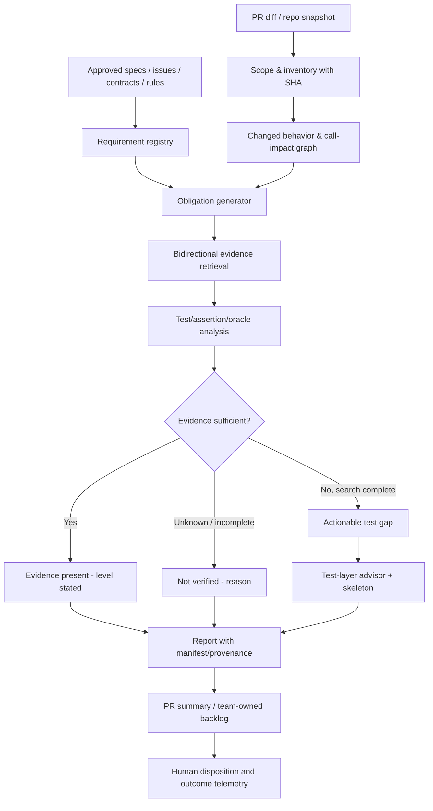

# SpecGuard: critical code review and unknown-unknowns research for Shift Left

> **Review date**: 2026-10-14 (Australia/Sydney)  
> **Repository**: [Mira190/SpecGuard](https://github.com/Mira190/SpecGuard)  
> **Pinned baseline**: `main` / [`5bcf4deb2ba9868969bc1e0b52407c7e34886516`](https://github.com/Mira190/SpecGuard/commit/5bcf4deb2ba9868969bc1e0b52407c7e34886516)  
> **Review method**: through the connected GitHub, read the repository tree, the actual source code, workflows, Skills, tests and historical evaluation reports; static code audit, architectural reasoning and falsifiable experiment design. **In this review nothing was cloned and executed, no paid model was called, no real PR / whole-repo scan was run, and no company repository permissions were verified; so "can be triggered" and "has been triggered" are strictly distinguished.**  
> **Scope**: only a local audit Markdown file is created; no code is changed, no PR is submitted, and nothing is written to GitHub.

## 0. Executive verdict

**Conclusion: a fairly good engineering foundation, but currently it is a "test-gap candidate finder with explainable evidence", not a "whole-repo auditor that can prove every requirement is appropriately covered by tests".**

SpecGuard has implemented: PR review, manual launch against external repositories, reusable workflows, risk ranking and a rotating repository scan, requirement-file traceability, candidate test-file location, code and test citation verification, confidence downgrading, model engine adapters, scan state, budget control and quite a lot of tests. It is no longer just a prompt wrapper. The recent D* requirement backfill and the scan batching also fixed several specific pain points in earlier documents; the "in progress" state of the old audit must not pass for the current facts.

But before deployment there is a safety combination with higher priority than accuracy: **the current SpecGuard control repository is public; the manual workflow supports accessing private target repositories; by default it writes the scan summary and state into an Issue of the control repository, and uploads artifacts that may contain raw private code / requirement citations.** The code has a textual reminder that "the control repository must be private", but I did not see a runtime-enforced public/private information-flow check. **This is a conditional leak path, and does not mean an actual leak has occurred.** Until isolation is confirmed, manual scans of internal private repositories should not be run from the current public control repository.

The second core risk is the wrong "reviewed/confirmed" semantics: **one source citation + one test citation does not constitute sufficient verification of behavior; two repetitions of the same model judgment do not constitute two independent pieces of evidence.** The third is hidden recall loss: slicing, file-name matching, picking top-N first, scan block truncation and the lack of an execution environment can mean hard gaps never get a chance to enter the model context at all.

### Review maturity by item (qualitative, not a score)

| Goal | Current judgment | What should not be promised externally |
|---|---|---|
| PR workflow delivery | **Implemented**, including reuse and manual launch | Do not promise that all branches / closed PRs can be reviewed |
| Requirement → behavior → test obligation | **Partly implemented**: requirement index, model judgment, output with citations | Do not promise that requirements are fully read and that the requirements are interpreted correctly |
| Find missing/weak unit tests | **Has real OSS results**, but misses/false positives are reproducible | Do not promise to exhaust all gaps or that "zero results = sufficient coverage" |
| Coding standards confirmed | **PR has a detection path**, tool execution results must be configured explicitly | Do not equate "read the standards file" with "CI conforms to the standards" |
| Component/integration test pushdown | **A suggestion type exists**, effectiveness not yet sufficiently verified | Do not treat a layer inferred from the file path as ground truth |
| Whole-repo scan | **Bounded incremental sampling + rotation**, not a one-time exhaustive scan | Do not use a blanket "full repo verified" |
| Enterprise security and actual Shift Left value | **There are blocking items**: result residency, vendors and evidence of effect | Do not substitute offline model precision for production improvement |

---

## 1. First principles: the right question is not "is there a test file"

Starting from the cost of errors, Shift Left is not about posting as many comments as possible, but about revealing to someone who can fix it, earlier, **a defect that would otherwise be found at a later stage and can be reliably verified at an earlier one**.

Minimal causal chain:

1. **The real target behavior** exists: business rules, approved designs, interface contracts, system invariants, privacy and security constraints, etc.
2. **The implemented behavior** may differ from the target behavior: manifested in called paths, boundary conditions, error paths, timing or multi-service collaboration.
3. **The verification obligation** is explicit: for each failure mechanism, point out the adversarial input that must make the test fail and the independently judgeable expected result.
4. **Existing evidence** can prove, or cannot prove, this obligation: test names, code citations, execution traces, assertions, mutation sensitivity and the last passing record differ in strength.
5. **The cheapest reliable test layer** is feasible: unit, component, integration, contract, E2E, taking into account whether a test double distorts the contract.
6. **Developer action and fewer regressions**: receive the issue before merge, fix the test or the behavior, and reduce later defect escapes, rather than just leaving an AI comment on the PR.

One cannot infer "X is verified" from "the document mentions X and the test directory contains X". Nor can one infer "X has no test" from "no test was retrieved": the latter has statistical meaning only when the retrieval scope is sufficient, the needed code/tests have been read in full, and indirect verification has been ruled out.

**Suggested product definition**:

> **SpecGuard is an evidence-aware verification-gap advisor. It links approved requirements and changed behaviour to concrete test obligations, checks whether existing assertions could detect meaningful regressions, recommends the cheapest trustworthy test layer, and explicitly reports what it could not inspect.**

"Insufficient evidence" is not a synonym for "missing test". The two need different reports and handling paths.

---

## 2. Evidence grading: avoid treating inference as experimental results

- **E0: code checked**: behavior that can be inferred directly from a specific code condition or data flow, for example "a success return state is complete, but some batches failed". This is the most solid level of this audit.
- **E1: experiment records already in the repository**: results of OSS, personal repositories and seeded fixtures recorded by the author in `docs/shift-left-review-2026-10-14.md` and `eval/results/recall-claude-2026-10-14b.md`. Credibility depends on the records and the experimental setup; **not independently re-run this time**.
- **E2: risk reasoning that is feasible but not triggered**: needs conditions such as a specific private repository, input over a threshold, or a dependency graph after migration. This document gives the smallest falsifiable test and does not claim it has been reproduced.
- **E3: product hypotheses**: for example whether developers really change the tests and whether the organization's coding standards can be confirmed by a GitHub check; these can be measured only in a formal pilot.

### Baseline facts

- Confirmed that the repository is `public`, the current default branch is `main`, and the latest reviewed commit is `5bcf4deb`; the source tree has about 505 blobs (including many fixtures and historical evaluation data). [Repository](https://github.com/Mira190/SpecGuard)
- The repository reports for 18 seeded examples: precision 100%, recall 86%, JSON validity 100%, 22% degraded, and test-quality sub-class recall 67%. **This is a result on internal test fixtures; it is not accuracy in real enterprise repositories, and it is not a re-measured value from this review.** [Evaluation results](https://github.com/Mira190/SpecGuard/blob/5bcf4deb2ba9868969bc1e0b52407c7e34886516/eval/results/recall-claude-2026-10-14b.md)
- The older review of the same day also recorded: one real gap in Express appeared in only 1 of 4 runs (low confidence); there were also verified false positives and real weak tests that could be found. The old review was based on an earlier commit, and it cannot be concluded from it that later commits did not fix things. [Old review §9](https://github.com/Mira190/SpecGuard/blob/5bcf4deb2ba9868969bc1e0b52407c7e34886516/docs/shift-left-review-2026-10-14.md)
- `#168–#172` are merged into the current HEAD: including governing requirement D*, scan batch, the evidence window and the output correction for requirement alignment. This document confirms these fixes while checking the residual boundaries. [Commit history](https://github.com/Mira190/SpecGuard/commits/main/)

---

## 3. Key findings: ordered by business impact

### SG-01 · P0 · Potential information-leak path where the public control repository receives private-target scan results (E0+E2)

**Evidence chain**:

- The control repository is currently `public`. [Repository](https://github.com/Mira190/SpecGuard)
- The manual workflow supports `SPECGUARD_PAT`/GitHub App access to **other private target repositories**; `scan_issue` defaults to `specguard`, i.e. scan results and historical state are kept in SpecGuard's own Issue. [`specguard-run.yml#L1-L26`](https://github.com/Mira190/SpecGuard/blob/5bcf4deb2ba9868969bc1e0b52407c7e34886516/.github/workflows/specguard-run.yml#L1-L26)
- The workflow's `review` job checks out the target and then runs the scan; it can upload `summary.md`, `findings.json`, `audit.json` and `requirements-status.json`, which contain source code and requirement excerpts, as a 14-day artifact, and writes the job summary. [`specguard-run.yml#L109-L176`](https://github.com/Mira190/SpecGuard/blob/5bcf4deb2ba9868969bc1e0b52407c7e34886516/.github/workflows/specguard-run.yml#L109-L176)
- A comment in the file **is explicitly aware** that the issue/artifact contains target code and reminds that the control repository must be private; there is currently no code that **forcibly refuses** based on the visibility of the control repository and the target repository before publishing. The accessibility of GitHub Actions artifacts depends on repository read permissions; retention or a hidden directory cannot be treated as a permission barrier. [GitHub official artifact documentation](https://docs.github.com/en/actions/how-tos/manage-workflow-runs/download-workflow-artifacts)

**Impact**: if someone with permission calls a scan of a private enterprise repository from this public control repository, the specific business rules, source code or test snippets returned by the model may be stored publicly. There is currently no evidence that this combination has actually been run or that anything has leaked.

**Fix**: by default block `private target -> public control`, and at the same time block writing content to public issues, artifacts, job summaries and logs; safe defaults take priority. The easiest deployment is to **copy the control workflow to a controlled private/internal repository and keep the results only in the target repository's private scope**; use a least-privilege GitHub App token, and confirm the model vendor's compliance. The protection should check the **runtime actual repository visibility** and the **target repo visibility**, and fail closed if the permission query fails. Regression tests should check all delivery channels, not just the Issue.

**Acceptance**: the four visibility combinations (public→public, private→private, private target→public control, etc.) are all tested with and without API permissions; the dangerous combination has no accessible Issue, artifact or summary with content.

### SG-02 · P0 · Multi-batch scan "success/complete" contradicts the actual coverage scope (E0)

**Evidence chain**: with more than 20 document blocks, `scan-parts.js` splits into multiple calls; `claude-api.js` writes the failed batches and the batches abandoned due to budget into `scan-parts.json`, and **as long as one batch succeeds, it runs `end('success')`**. [`claude-api.js#L342-L379`](https://github.com/Mira190/SpecGuard/blob/5bcf4deb2ba9868969bc1e0b52407c7e34886516/src/engines/claude-api.js#L342-L379) Although `audit-post.js` shows `Not audited this run` in the body, it relies only on engine-status to decide `partial`, so it can still set the action output `status=complete`, and when there is no retained gap the title shows a green `No unit test gaps...`. [`audit-post.js#L430-L453`](https://github.com/Mira190/SpecGuard/blob/5bcf4deb2ba9868969bc1e0b52407c7e34886516/src/audit-post.js#L430-L453) [`#L621-L656`](https://github.com/Mira190/SpecGuard/blob/5bcf4deb2ba9868969bc1e0b52407c7e34886516/src/audit-post.js#L621-L656)

**Core problem**: a human who expands the report can see the partial loss, but downstream automation and management dashboards that see `complete` may wrongly believe coverage is complete. Even if every batch succeeds, a rotating top-N scan is not a complete whole-repo review.

**Fix**: separate **whether execution was normal** from **whether the review scope is complete**: `execution_status={success,partial,failed}`, `scope_status={complete,selected_only,incomplete,unknown}`; if a planned batch fails or the budget cuts, `status` must not be unconditionally complete. Report totals item by item as `eligible/selected/prompted/read/answered/verified`, and not just "reviewed".

**Refutation test**: two document batches, the first returns valid JSON with no gap, the second simulates a 429 or a forced budget cut; expect the action not to show overall verification success, and to list the number of unreviewed blocks explicitly.

### SG-03 · P0 · Multi-batch document review did not obtain the complete document, and over-long requirements may be truncated before entering the model (E0)

**Evidence chain**: the candidate-line `text` that document extraction gives the model is limited to **240 characters**, and the `full` used for search is limited to **600 characters**. [`audit-collect.js#L80-L95`](https://github.com/Mira190/SpecGuard/blob/5bcf4deb2ba9868969bc1e0b52407c7e34886516/src/audit-collect.js#L80-L95) When the document blocks exceed the default 20 items, the multi-batch prompt is assembled by `scan-parts.js` from `audit-docs.txt` (**a path list**), each batch's `audit-candidates.txt` and the evidence lines; the pack loads only the **code and test fragments** that the evidence points to, and does not put the complete requirement document into the prompt. [`scan-parts.js#L12-L46`](https://github.com/Mira190/SpecGuard/blob/5bcf4deb2ba9868969bc1e0b52407c7e34886516/src/scan-parts.js#L12-L46) The default Claude API has no file tool. [`claude-api.js#L52-L60`](https://github.com/Mira190/SpecGuard/blob/5bcf4deb2ba9868969bc1e0b52407c7e34886516/src/engines/claude-api.js#L52-L60)

The Skill requires both "read all admitted documents completely" and "every clause of every block", so the actual input of the multi-batch API is structurally inconsistent with the specification. [`skills/spec-audit/SKILL.md#L26-L34`](https://github.com/Mira190/SpecGuard/blob/5bcf4deb2ba9868969bc1e0b52407c7e34886516/skills/spec-audit/SKILL.md#L26-L34)

**Impact**: long Markdown table rows, compound business-rule clauses, exception conditions or invariants may sit after the 240th character; the retriever used more characters, but the final reasoner receives only the short line fragment. The model cannot complete behavior alignment review for a tail sentence it has not seen. The `docs_reviewed` field claiming to have read must not be trusted on its own.

**Fix**: extract the **complete block** from the original **requirement file at the specified SHA** by the block's start/end byte/line span and include it in each batch prompt; split over-long blocks further by **atomic clause**, and record the sub-clauses not covered. `docs_reviewed` should be a manifest generated by the input packer, not self-reported by the model; missing or truncated forces `unknown`. For budget reasons each batch may include only the relevant blocks, and need not repeat the whole file every round.

**Refutation test**: build a 400-character acceptance criterion, with "the button width should stay at 100" in the head and "must not send a request when disabled" at the tail; build 25 blocks to trigger batching. Make the tail rule contradict the implementation, and see whether a mismatch with the real source of that fragment is produced. And compare against `scan <=20 blocks`.

### SG-04 · P0 · No matching test file may directly become a "deterministically confirmed missing test" (E0)

`audit-units.js` uses heuristics such as file name, public method names, string mentions and symbol calls to match tests, and one unit connects to at most 20 candidate test files. Names shorter than 4 characters, indirect helpers, parameterized tests, traits/fixtures and aggregate tests can all be missed. [`audit-units.js#L70-L118`](https://github.com/Mira190/SpecGuard/blob/5bcf4deb2ba9868969bc1e0b52407c7e34886516/src/audit-units.js#L70-L118) [`test-map.js#L13-L87`](https://github.com/Mira190/SpecGuard/blob/5bcf4deb2ba9868969bc1e0b52407c7e34886516/src/test-map.js#L13-L87)

But `audit-post.js`, when `missing_test` and `!u.tests.length`, directly sets `det=true`, and `trackFindings` treats `det` as `confirmed`, **with no need for two independent detections**. [`audit-post.js#L244-L269`](https://github.com/Mira190/SpecGuard/blob/5bcf4deb2ba9868969bc1e0b52407c7e34886516/src/audit-post.js#L244-L269) [`#L340-L345`](https://github.com/Mira190/SpecGuard/blob/5bcf4deb2ba9868969bc1e0b52407c7e34886516/src/audit-post.js#L340-L345)

**This is an epistemological error that upgrades "no test was retrieved" to "missing test confirmed".** Even after the known naming false-positive fix in Express, it still holds for unfamiliar languages, naming conventions and tests outside the test directory.

**Fix**: `!matchedTests` can only produce `test_evidence_not_found`; before confirming a missing_test there must be a **reverse search** for the same behavior (tests→symbol/callsite/public API) and a completeness check, together with at least an independent verification method. `confirmed` should be used only for human checking, dynamic experiments or calibrated exhaustive rules.

### SG-05 · P1 · `covered` semantics too strong: a citation existing ≠ a test assertion protecting the requirement (E0)

The `covered` check for the unit class in `gap()` only requires a code citation and a test citation at layer `unit`; `verify()` proves the citation appears in the file at HEAD, but cannot prove that the test calls into that logic, asserts the key result, covers exception/negative paths, or would fail under defect injection. [`audit-post.js#L158-L169`](https://github.com/Mira190/SpecGuard/blob/5bcf4deb2ba9868969bc1e0b52407c7e34886516/src/audit-post.js#L158-L169) [`#L189-L240`](https://github.com/Mira190/SpecGuard/blob/5bcf4deb2ba9868969bc1e0b52407c7e34886516/src/audit-post.js#L189-L240)

**Fix**: split into `linked_to_code`, `test_exists`, `test_executes_behavior`, `assertion_proves_obligation`, `oracle_independent`, `current_head_run_passed`, `mutation_sensitive`; mark each with its evidence type and the reason it is unverified. Without dynamic execution, change `covered` to `static_evidence_present` (can be called `likely_evidenced`).

### SG-06 · P1 · Two identical findings are not independent evidence; state may become stale after code changes (E0+E2)

`track()` marks a gap confirmed according to the document block CID, the state and the consecutive count; `trackFindings()` also marks the same fid confirmed when a prior state exists. The CID mainly comes from the document's original text, and the fid comes from the unit, the finding type and the citation quote; **neither is fully bound to the code, tests, execution/configuration or engine version**. [`audit-collect.js#L80-L95`](https://github.com/Mira190/SpecGuard/blob/5bcf4deb2ba9868969bc1e0b52407c7e34886516/src/audit-collect.js#L80-L95) [`audit-post.js#L292-L345`](https://github.com/Mira190/SpecGuard/blob/5bcf4deb2ba9868969bc1e0b52407c7e34886516/src/audit-post.js#L292-L345)

The probability that the same retrieval loss or model bias appears twice in a row under the same configuration/context is highly correlated, and is not "2 evidence sources". Old state can be carried through rotation even though the code and tests it depends on have changed.

**Fix**: base confirmation on **diversity of evidence mechanisms** (independent review / mutation test / actual execution / human confirmation), not on the number of calls; add `{head_sha, relevant_code_hash, tests_hash, requirements_hash, rules_hash, analyzer_version}` to all `evidence`; a dependency change makes the old conclusion `stale`, and only "found in the last scan" may be shown.

### SG-07 · P1 · The file is the review unit, which is both too coarse and unsuited to "finding missed behaviors" (E0)

The whole-repo inventory uses the file as the unit, not the method, behavior, public API or call path; each time it selects at most 12 source files by default, lists at most the first 6000 candidate sources and reads the first 4000 tests (48MiB in total), source files over 512KiB are excluded by the candidate rule, and single-file context packing has a limit of about 48KiB. [`audit-units.js#L12-L17`](https://github.com/Mira190/SpecGuard/blob/5bcf4deb2ba9868969bc1e0b52407c7e34886516/src/audit-units.js#L12-L17) [`#L70-L105`](https://github.com/Mira190/SpecGuard/blob/5bcf4deb2ba9868969bc1e0b52407c7e34886516/src/audit-units.js#L70-L105) [`claude-api.js#L175-L232`](https://github.com/Mira190/SpecGuard/blob/5bcf4deb2ba9868969bc1e0b52407c7e34886516/src/engines/claude-api.js#L175-L232)

These limits reasonably control cost, but in a large repository a "repository scan" does not mean every behavior will be seen. The 20 tests on a file may all test one happy path, with the remaining 7 branches not covered at all.

**Fix**: layered inventory: `repo → package → symbol/public API → behavior/branch/obligation`. Use incremental parsers / language plugins to form a call index, symbol ranges and test associations; the cache is determined by the SHA and invalidated on change; languages that cannot be parsed are clearly listed as `unsupported`; large files are sharded by method/AST region and include callers and related tests. The whole-repo report shows the denominator of the scope and the reasons for what was not scanned.

### SG-08 · P1 · Scan risk ranking has a Goodhart effect and silent blind spots (E0)

The priority formula scores by the number of public definitions, line count, churn in the last 180 days and commit titles containing `fix|bug`; once a test file matches, the risk factor drops to 0.3. It is a heuristic ranking, not a probability of occurrence calibrated with historical defect data. [`audit-units.js#L35-L52`](https://github.com/Mira190/SpecGuard/blob/5bcf4deb2ba9868969bc1e0b52407c7e34886516/src/audit-units.js#L35-L52)

Low-churn security-boundary code, stable but wrong public algorithms and shared low-level dependencies may be ranked very late; the system treats a "test name match" as a signal that risk drops sharply, which may precisely miss core modules with poor assertion quality.

**Fix**: explicitly distinguish "uncertainty first" from "damage first": exposure surface, authorization/payment/data isolation, API fan-out, dependency centrality, recent incidents, complexity, coverage change and the impact of batch changes, and then rank by cost-benefit; maintain a **random sampling audit** as a hedge, and measure the real detection rate of the top-N versus the random group.

### SG-09 · P1 · Requirement discovery is a local static text search and cannot take on the role of "the source of truth for real requirements" (E0+E2)

The requirement side relies on the GitHub PR body, Issues, the README/MD/feature files in the repository and naming rules; links in the manual `design_docs` that point to another repo are explicitly rejected, and external Confluence/Jira/Figma/PDF etc. have no local read-in path. [`resolve-inputs.js#L83-L110`](https://github.com/Mira190/SpecGuard/blob/5bcf4deb2ba9868969bc1e0b52407c7e34886516/src/resolve-inputs.js#L83-L110) [`requirements.js#L231-L307`](https://github.com/Mira190/SpecGuard/blob/5bcf4deb2ba9868969bc1e0b52407c7e34886516/src/requirements.js#L231-L307)

Lexical matching also has difficulties with translation, terminology aliases, inverted meaning, negated conditions, table exceptions and omitted target paths. A deeper blind spot is that **the design itself may be wrong / unapproved**. A PR that changes both the code and the design to make them consistent cannot automatically prove the change is reasonable.

**Fix**: introduce `requirement_authority`, `approval_status`, `effective_at`, `version`, `supersedes`, `owner` and conflict/expiry markers; support organization-approved external-source plugins (without overstepping authority); distinguish "document missing" from "design inconsistent". If the design and the implementation change at the same time, require an explicit change justification and an approved contract difference.

### SG-10 · P1 · Test-layer classification relies only on path/model and cannot yet reliably guide push-down (E0+E1)

`post.js` by default identifies e2e/integration/component by directory or file name, and otherwise puts many files recognized as tests into unit; part of it forces the model to state the layer. The model also misclassifies when semantics are unclear. [`post.js#L121-L136`](https://github.com/Mira190/SpecGuard/blob/5bcf4deb2ba9868969bc1e0b52407c7e34886516/src/post.js#L121-L136)

The repository already has a live-run record in which Express's supertest HTTP check was treated as unit, and a positive example of "can be pushed down" has never been sufficiently verified. [`shift-left-review §5 C5`](https://github.com/Mira190/SpecGuard/blob/5bcf4deb2ba9868969bc1e0b52407c7e34886516/docs/shift-left-review-2026-10-14.md)

**Fix**: allow teams to define `test_layers` constrained by glob/framework/fixture (with conflict priorities); detect the test's **actual dependency boundary**: pure function / database / HTTP service / real queue / external network / simulation; judge by isolation, speed, stability and the requirement's failure mechanism. Do not suggest fully replacing contract tests with unit tests: pushdown is a **supplementary low-cost feedback**, and cannot erase the verification of service boundaries.

**Acceptance**: prepare 20 cases signed off by the target team, including Angular TestBed, Playwright component, supertest, pytest fixture, Testcontainers and consumer-driven contract; require `current_layer / suggested_layer / should_add_or_move / why / what higher-layer must remain` to be listed clearly, and rate the agreement of two senior reviewers.

### SG-11 · P1 · "Reading" coding standards and "confirmed by a tool" are not unified (E0)

The Action supports automatic lookup through `standards_paths`, and also provides the optional `standards_checks` to query GitHub check/status; **empty by default means no external check is configured**. [`action.yml#L21-L28`](https://github.com/Mira190/SpecGuard/blob/5bcf4deb2ba9868969bc1e0b52407c7e34886516/action.yml#L21-L28) The existing old review explicitly mentions that the whole-repo scan does not yet check coding standards. [`shift-left-review C15`](https://github.com/Mira190/SpecGuard/blob/5bcf4deb2ba9868969bc1e0b52407c7e34886516/docs/shift-left-review-2026-10-14.md)

**Fix**: separate the six states `standard_source_found / applicable_to_files / check_configured / check_run_at_head / check_provenance / pass_fail / manual_review`; for a same-named check such as `check:lint`, the check's producer/source, target SHA, execution conditions and time must be validated, to avoid wrong attribution; scan should also output the rule-coverage result of the baseline (it can first confirm only availability). Do not claim "confirmed" unless the exact run result matches this SHA.

### SG-12 · P1 · Code/test evidence has selection bias, and incomplete retrieval systematically reduces recall (E0+E1)

`audit-collect` gives each block at most 3 code locations and 3 test locations; for large tests it selects only local slices containing the given symbol (short names, dynamic calls and abstract helpers can all be missed). [ `audit-collect.js#L118-L151`](https://github.com/Mira190/SpecGuard/blob/5bcf4deb2ba9868969bc1e0b52407c7e34886516/src/audit-collect.js#L118-L151) [`claude-api.js#L117-L172`](https://github.com/Mira190/SpecGuard/blob/5bcf4deb2ba9868969bc1e0b52407c7e34886516/src/engines/claude-api.js#L117-L172)

Literal hits are used as protection: an error message or literal appearing in the test text can lower `missing_test` to low confidence, but **a literal appearing does not necessarily mean there is a valid assertion**. [`test-map.js#L89-L139`](https://github.com/Mira190/SpecGuard/blob/5bcf4deb2ba9868969bc1e0b52407c7e34886516/src/test-map.js#L89-L139)

**Fix**: for candidates that are to output "missing test", use at least two retrieval paths in different directions (code→tests, tests→code), supplemented by tracing based on real call locations; for "test exists", verify the relationship between the sub-test where the assertions sit and the behavior under test. The report distinguishes `retrieval_sufficient` from `no_matching_test`; measure recall by language layer, with dedicated challenge tests for `_test.js`, parameterized tests, short method names and test helpers.

### SG-13 · P1 · Snapshot lacks execution proof, CI configuration and feature-flag version (E0+E2)

SpecGuard explicitly does not run tests; `coverage_files` requires the caller to collect it **beforehand in the same job**, and it is empty by default. [`action.yml#L28`](https://github.com/Mira190/SpecGuard/blob/5bcf4deb2ba9868969bc1e0b52407c7e34886516/action.yml#L28) Even with lcov/JaCoCo in hand, line coverage cannot show whether the assertions are independently correct.

**Fix**: bind optional dynamic evidence to `head_sha / build_id / test command / environment / flag matrix / report checksum / timestamp`; mark a branch/source mismatch as `invalid_dynamic_evidence`. A lightweight "proposed verification" layer is recommended: verify with test skeletons and minimal mutation, without executing unfamiliar PR code directly on the high-privilege core scan runner; execute it in an independent, low-privilege / isolated runner in the target repo.

### SG-14 · P1 · Delivery of manual runs does not necessarily happen at the developer's decision point (E0+E3)

Manual mode defaults to `post_to_pr=false`, and results are only on the SpecGuard run page and the artifact; whole-repo defaults to writing a central Issue (if enabled), which does not mean the PR author will see, understand and fix it in time. The old review explicitly records the lack of human did-fix, false-positive and time-to-merge data. [`specguard-run.yml#L12-L26`](https://github.com/Mira190/SpecGuard/blob/5bcf4deb2ba9868969bc1e0b52407c7e34886516/.github/workflows/specguard-run.yml#L12-L26) [`shift-left-review §5 C1`](https://github.com/Mira190/SpecGuard/blob/5bcf4deb2ba9868969bc1e0b52407c7e34886516/docs/shift-left-review-2026-10-14.md)

**Fix**: provide the target team with an opt-in PR check / sticky comment, assignment by CODEOWNERS, and low-noise actionable findings; the central scan produces **assignable work items** and not just a big table. Capture the events `acknowledged / accepted / fixed / dismissed / false_positive / deferred / verified`, and after human confirmation trace to the PR SHA and the closing basis. Before there is production data, do not treat comment counts as an adoption result.

### SG-15 · P2 · The self-test set provides engineering regression but is not enough to verify cross-team generalization (E1)

The repository's 18 seeded cases have precision 100% and recall 86%, but some failures are not deducted as false positives but as "case fail"; the grader marks reasonable extra findings as acceptable, summary-only is not counted in TP/FP, and errored runs are not in the accuracy denominator. [`eval/README.md`](https://github.com/Mira190/SpecGuard/blob/5bcf4deb2ba9868969bc1e0b52407c7e34886516/eval/README.md) [`recall results`](https://github.com/Mira190/SpecGuard/blob/5bcf4deb2ba9868969bc1e0b52407c7e34886516/eval/results/recall-claude-2026-10-14b.md)

**Fix**: the production pilot measures both model-level and end-to-end: `TP/FP/FN`, `unknown rate`, `unread-input rate`, `run failure rate`, `effective delivery rate`, `did-fix`, `escape bugs`, `time/cost`. Hold out real defects and repositories; lock instrumentation or rule adjustments, to prevent tuning to a high score repeatedly on the same fixtures. Separate engines; Claude results cannot be taken as the quality of the Copilot default path.

---

## 4. Unknown Unknowns: reasoning from constraints to uncovered defect mechanisms

The table below is not a list of "what else the model could think of", but asks one by one: **if the system gives a clean conclusion while the real behavior is wrong, which assumption may not have held?** Only this way can experiments that actively look for unknown gaps be designed.

| Category | Hidden assumption | Counterexample (real business can have this chance) | Preferred refutation/probe | Recommended default layer |
|---|---|---|---|---|
| **U1 Target behavior drift** | The document is necessarily correct | The developer changes the requirement and the code together, hiding incompatible behavior; an old approved rule is overwritten | Compare the approved spec with base/head, require change approval | Requirement governance + contract |
| **U2 Unexpressed security invariants** | No AC written means no need to test | Leakage between tenants, user privilege escalation, unauthorized retry | Enumerate the role × resource × operation matrix and negative properties | unit + integration/security |
| **U3 Untriggered paths** | A test citation means it was actually called | The test only tests a mock or dead branch, and passes even if a constant is returned | Mutation: delete the call, invert the comparison, change the return value | unit |
| **U4 Oracle collusion** | The expected result is independent | The test copies the implementation algorithm into expected, and both are wrong the same way | Compute literal expected values from the spec; metamorphic/property test | unit/property |
| **U5 Boundary / combinatorial explosion** | The happy path represents all paths | `null/0/negative/overflow/timezone/concurrent flag` interactions | Boundary values and pairwise + state-machine transformations | unit + component |
| **U6 Timing and concurrency** | Sequential-call tests are enough | Double click, duplicate messages, idempotency key, retry race after timeout | deterministic scheduler / fake clock + race probe | unit + integration |
| **U7 Event eventual consistency** | A function finishing means the business finished | Lost events, out-of-order, duplicate consumption, partial transactions | publisher/consumer contract, queue fault injection | component + integration |
| **U8 Cross-repo contracts** | Single-repo tests can be self-sufficient | A payload field rename breaks another team's consumer | API/schema diff + consumer contract dependency graph | contract |
| **U9 Configuration is behavior** | Scanning source is enough | Feature-flag defaults, routing, IAM policy and SQL migrations change functionality | config/schema/policy diff and environment matrix | unit + integration |
| **U10 Test-layer misidentification** | A `*.test` file means unit | supertest / Angular TestBed started a service | Judge the layer by real dependencies and fixtures | Layered governance |
| **U11 Compiled/generated paths** | Changes are all in ordinary source files | protobuf/OpenAPI/generated clients or CI build switches change behavior | Generated source → artifact → caller graph | contract + build |
| **U12 Test run conditions** | Tests that exist all run in CI | `skip`, ignored tag, conditional job, flaky quarantine, path filter | Intersect the workflow and the runner selectors | CI verification |
| **U13 Test new/old mismatch** | The latest artifact represents the current PR | Coverage/tests were run on the base SHA, HEAD has changed | SHA + flag + test-report attestation | Evidence governance |
| **U14 Retrieval/packing starvation** | No output means no problem | The truly key branch at the tail of a long file was not given to the LLM | Shuffle files, move functions, check detection sensitivity to a larger budget | Meta-testing |
| **U15 Language/framework gaps** | General rules cover all code | C++/SQL/Swift fixtures / custom assertions not recognized | Language support matrix and unknown labels, 50 cases per framework | Scan reliability |
| **U16 High-risk stable code** | Low churn means low risk | Rarely changed authentication/billing core algorithms are wrong all along | Rank by business damage × dependency centrality instead, random audit | Planning |
| **U17 Ecosystem security** | Code that is not executed is safe | Secrets leak through summaries/Issues/artifacts/model requests | Data flow and least-privilege/visibility tests | Security blocking |
| **U18 Organizational backlash** | A high detection rate will improve quality | Notification fatigue, PR delay, people assessed by metrics, precision pushed down | Staged shadow → opt-in → experiment, measure did-fix / burden | Product pilot |
| **U19 Destructive test pushdown** | More unit tests are better | Replacing real consumer contracts with mocks, more falsely-green tests | Check that defect-class invariants are the same before/after pushdown | contract kept |
| **U20 Model self-proof loop** | Two identical AI outputs are reliable | Repeated stable false positives under the same retrieval premises and model | Cross-check with multiple methods (compile / execute / human / different information sources) | Evidence governance |

### Ten Test Obligations that are especially easy to miss

These should be the templates by which SpecGuard generates candidate verification obligations; it is not that every PR is by default required to add ten tests:

1. **Rejection path**: with no permission / wrong tenant / a revoked token, there must be no side effects.
2. **State transitions**: `pending → paid → refunded` etc. must not allow skipping levels, going backwards or repeated success.
3. **Idempotency and recoverability**: duplicate events / retries after a timeout do not charge twice or trigger notifications twice.
4. **Boundary precision**: monetary rounding, decimal precision, negative values, empty values, huge values, leap years / timezones / DST.
5. **Failure propagation**: when downstream times out or partially succeeds, the error is observable and compensated as agreed.
6. **Backward compatibility**: an old consumer still works after receiving a new field / default.
7. **Authorization combinations**: role × resource owner × action × flag, not just some `isAdmin` test.
8. **Observability side effects**: no PII leaked; exceptions are not swallowed; audit events are still produced on rejection paths.
9. **Build and environment matrix**: release/debug, production feature switches / regional differences do not bypass the tests.
10. **Test correctness itself**: when the test deliberately inverts a key comparison or deletes the implementation, it must fail (selective mutation).

---

## 5. Recommended target architecture: centered on verification obligations rather than on files



**Keep the responsibilities of the two modes distinct**:

- **PR review**: based on the diff plus an impact graph, focus on the obligations **introduced/invalidated by this behavior change**. The goal is to give the author 1–5 high-confidence, actionable suggestions within 10–60 seconds; if citations are insufficient, list the unproven items separately and do not output a false green.
- **Full-repo scan**: build a **versioned obligation inventory** on a fixed SHA, rotate by business risk and time since last review, and save "which obligations / which files were actually read". The result is a manageable backlog for QA / the team owner, supporting filtering by package, risk and state; a single batch cannot pass for whole-repo completion.
- **Standards checking**: mainly deterministic lint/check/status and specification-scope validation; the LLM only explains rules that cannot be machine-checked. With no configured check by default, write `not confirmed`.
- **Pushdown**: give only the **separable pure behavior** that a unit test can verify, and state explicitly whether the risk protection of contract/integration must be kept.

### Recommended data contract (illustrative)

```json
{
  "snapshot": {
    "repository": "org/service",
    "head_sha": "<40-character SHA>",
    "policy_version": "v1",
    "rules_hash": "sha256:..."
  },
  "scope": {
    "eligible_units": 1084,
    "selected_units": 12,
    "whole_source_read": 9,
    "whole_candidate_tests_read": 8,
    "requirements_complete": 4,
    "unreviewed_reasons": ["large_file", "budget_limit", "unsupported_language"]
  },
  "obligations": [
    {
      "id": "OBL:<stable key>",
      "requirement": {"source": "docs/spec.md", "line": 24, "authority": "approved", "version": "v2"},
      "behavior": {"symbol": "calculatePremium", "failure_mode": "negative input"},
      "test_evidence": {"test_path": "tests/premium.test.ts", "assertion_line": 45, "layer": "unit", "head_verified": false},
      "verification": {
        "status": "insufficient_evidence",
        "reason": "assertion does not distinguish buggy implementation",
        "evidence_grade": "static_observation",
        "candidate_tests_exhaustively_checked": false
      },
      "next_action": "Add independent expected-value assertion for negative boundary"
    }
  ]
}
```

This JSON is **not** the existing schema of the current SpecGuard; it is an **independent evidence manifest** suggested to be introduced during migration. The numbers in it are only examples and do not represent any real scan result.

### Suggested state machine

| State | Definition | Can it show a green pass |
|---|---|---|
| `verified_dynamic` | A real test execution at the specified head, supported by an independent oracle/mutation | Yes, limited to the current obligation and execution environment |
| `evidenced_static` | The relevance of code, test and assertion has been checked, but not executed | Can only show "static evidence exists", must not be called verification passed |
| `missing_test_high_confidence` | The retrieval is complete enough, and the gap was independently verified / confirmed by a human | As an actionable issue |
| `weak_oracle` | The test executes or an assertion exists, but is not sensitive to the real failure mechanism | As an actionable issue |
| `higher_layer_only` | Only component/integration/E2E evidence; the benefit of pushdown needs to be assessed | Suggest adding unit tests, cannot automatically negate integration protection |
| `unknown` | The requirement is vague, the test mapping is insufficient, or semantic evidence is insufficient | No green, no assertion of "missing" |
| `not_reviewed` | Context truncated, language unsupported, budget, partial batch failure | No green, show the reason clearly |
| `stale` | The conclusion of the last scan was based on another version of the dependent code, tests or rules | No green, enters the re-review queue |

The key principle is **not to force a requirement into the binary covered/missing classification**. When the model cannot judge independently, stating uncertainty explicitly is part of the product's reliability.

---

## 6. Concrete transformation route: scheduled by blocking conditions, not by feature count

### P0: the "trusted output boundary" before deployment (ahead of adding new LLM features)

| Work package | Minimal change | Acceptance condition | Code focus |
|---|---|---|---|
| **A. Information-flow control** | In the manual `resolve`/`review`, check the visibility of the target and the control repository; fail closed on dangerous combinations; isolate summary, issue, artifact and logs | Private target content cannot enter a result channel with broader permissions | `.github/workflows/specguard-run.yml` |
| **B. True completeness state** | Reflect failed/dropped in `scan-parts.json` into the action output and the verdict; make the rotation denominator explicit | When one batch fails, `execution_status=partial`, never a false green | `src/engines/claude-api.js`, `src/audit-post.js` |
| **C. Original text goes into the model** | Batched packing includes the complete requirement block and the SHA/line span; multiple clauses across a long line are not lost | The last sentence of a 400-character compound rule in 25 blocks can be reviewed, and is marked unknown when truncated | `src/audit-collect.js`, `src/scan-parts.js`, `src/engines/claude-api.js` |
| **D. Confirmation semantics** | Delete `!u.tests.length => det confirmed`; two model repetitions only mean `stable`, not proof | No "confirmed missing" is reported when implicit/aggregate tests exist; two false positives are not upgraded to fact | `src/audit-post.js`, `src/test-map.js` |

### P1: lift PR and full scan from "finding files" to "finding behavior"

1. **Behavior Obligation IR**: from the approved requirement and the changed branch/public API, generate `precondition / action / observable effect / invariants / failure mode`. Do not let the model search, assert and substantiate all at once.
2. **AST-first bidirectional retrieval**: for the selected pilot languages such as JS/TS, Python and Java, build a symbol-level index, so test references do not rely only on file names. Other languages are explicitly `unknown`, without pretending to be fully supported.
3. **Verification strength**: upgrade from test existence to whether boundaries, an independent oracle and mutation sensitivity are verified; run sampled mutation first, without requiring every PR to take the time to execute.
4. **Team-configurable test layer**: paths, frameworks and dependency rules, with explicit `move vs add`; contract/integration backstops are kept.
5. **Standards provenance**: handle rule applicability scope, the source of same-named checks and the target SHA; the whole-repo scan also outputs at least confirmed/not_configured/unknown.
6. **Data and reporting**: let the results of manual scans reach the target team, but by default do not leak them into the central public repo; attach to each issue an accurate requirement/code/test permalink and a minimal reproducer.

### P2: measurement and scaling

- Upgrade the single-repo `scan_issue` state into a **persistent manifest by head and artifact identity** (database / private object store etc., keeping an accountable manifest); guarantee concurrency, failure recovery and idempotency.
- Build a versioned index and cache for each repository; PR incremental, and periodic completion of obligations unreviewed for a long time; split large monorepos by service + CODEOWNERS.
- Build a baseline from recent real defects, do blind A/B evaluation, and evaluate cost, latency, error rate and fix-through jointly; raising offline precision alone is not a release condition.

---

## 7. Immediately executable experiment matrix (minimal refutation set)

It is suggested to do **first 12 repeatable deterministic/fixture experiments**, and then a 2–4 week real team pilot; all executed on approved data and a private experimental repository.

| ID | Claim to be falsified | Input and control | Pass criterion |
|---|---|---|---|
| T01 | Private data will not leak through the public control repo | A private test repo + the public control repo, with a dedicated harmless canary text | The run fails and neither the Issue/artifact/summary contains the canary |
| T02 | A batch failure will not show complete | One valid batch + one simulated failure / budget-dropped | Partial status + a list of what is missing, not a green confirmation |
| T03 | Multi-batch fully understands long requirements | 25 document blocks, one block has a key negation clause at the 300th character | Reports the correct difference or explicitly unread, and must not be covered |
| T04 | Not seeing a matching test will not "definitely confirm missing" | `req.get` / parameterized tests / helper / cross-directory indirect tests | Unknown when not fully verified, not confirmed |
| T05 | `covered` represents strong evidence | Asserting `expect(result).toBeDefined()`, modifying the internal computation has no effect | Marked weak oracle, should not be covered merely because of a test citation |
| T06 | Two rounds of confirmation will not repeat a false positive | The same model repeats a stable false positive on the same snapshot | Called only a repeatable finding, no "independently substantiated" |
| T07 | Scan state can recognize staleness | After a previous covered, only the test/helper is changed, the requirement unchanged | The old evidence of the affected obligation is stale / re-queued |
| T08 | Large files can be genuinely reviewed | A 70KiB TS file, with the gap in an independent function at the tail | Tells that it was not reviewed, or function sharding locates it accurately, and must not "pass the whole file" |
| T09 | Layer suggestions do not damage contracts | Three examples: HTTP supertest, Testcontainers and a pure function | The unit can be pushed down and the needed integration is not suggested for deletion |
| T10 | Standards confirmation is bound to the correct CI | Two `check:lint` of the same name from different sources, one passes and one fails | Can report the conflict, and does not use the wrong check for a false pass |
| T11 | Requirements and code cannot collude to "slip through" | A PR changes the deadline in both the spec and the code | Requires an approved spec baseline / authority confirmation |
| T12 | The PR author can really fix it | 5–10 real team PRs, opt-in shadow + comment control | Records sent→seen→accepted→fixed, and gives the negative-rating rate / time spent |

### Relation to the old evaluation

Extend the existing `eval/run.js`, `eval/mutate.js`, `eval/grade.js`, `eval/replay.js` and `eval/weekly-report.js` as the skeleton; tearing down and rebuilding is not recommended. First pin the current `5bcf4deb` as the baseline; new tests should first fail stably on the old version, and only then the fix is implemented; keep 20% held-out cases. `Copilot CLI` and `Claude API` must be run separately, and conclusions must not be reused across engines.

**Minimum reporting metrics**:

- **Finding quality**: TP, FP, FN (by failure class / repo / language), plus separately credible but unconfirmed; with 95% confidence intervals rather than a lone 100%.
- **Completeness**: `eligible → selected → packed → completely read → model answered → citation verified`, with the denominator always the repository's currently reviewable objects.
- **Reliability**: CI run failures, timeouts, model refusals, schema degradation, budget truncation, runner version drift.
- **Utility**: human `did-fix`, false-positive dismissals, actionable rate, time-to-ack, time-to-fix, PR delay.
- **Long-tail**: after 8–12 weeks, review new escapes of the same class as historical defects; "zero records" must not be interpreted as zero defects just because time was insufficient.

---

## 8. Mapping to the original user goals and the definition of Done

> Original ask: Create a unit test review AI GitHub Workflow. Must review requirements and the tests, identify missing unit tests; confirm coding standard; if possible review component/integration testing and what should be in unit testing. Also support manual full repository/PR scans for other teams.

| Original goal | Minimum real Done definition | SpecGuard's current situation |
|---|---|---|
| Requirement and test review | Every important changed behavior / sampled requirement has a traceable obligation; present/missing/unknown reliably distinguished | **The basic skeleton exists**; completeness and proof strength need fixing |
| Find missing unit tests | A gap has code+req+test search evidence, the actual false positive rate is low; "not seen" is not treated as confirmed | **Can already find some real problems**; the SG-04 above needs to be blocked |
| Coding standards confirmed | The standard's applicable scope is clear, and the real check/status for the specified SHA is separated from the model's reading | **PR partly supported**; not configured must not claim confirmed |
| Higher-level → unit | What is suggested to add is isolated testable behavior, which higher-level tests to keep is explained, and the target team's review and approval is obtained | **The mechanism exists, verification is insufficient** |
| PR + whole-repo manual workflow | External targets can be reviewed, output is safe, rotation has an honest denominator and an audit manifest | **The path exists**; the current public-control + private-target is a deployment blocker |
| Shift Left result | Humans see it, change it, re-test it, and the improvement in defect escapes or QA cost exceeds the added noise | **A pilot is still needed**; cannot be judged by the volume of AI comments |

### Suggested thresholds for "when other teams can try it"

**Security gate**: SG-01 T01 passes; the company states clearly which vendors and storage scope the code may be sent to.

**Integrity gate**: T02, T03, T04, T07 pass; the report accurately declares unreviewed, expired and insufficient evidence; no false green.

**Quality gate**: at least 50 held-out problem cases from 2 different languages/domains, plus blind human review of 30–50 real team PRs, reporting precision/recall with tolerance lines set in advance. It is suggested that the initial pilot publish only high-confidence advisories; even with high scores, do not automatically block merges.

**Utility gate**: track human `acknowledged/accepted/fixed/dismissed` for at least two weeks, and only expand the feature scope after seeing some class of repeatable real benefit. Provide opt-out, team rules and explainable judgments.

---

## 9. Critical objections: which "intuitive optimizations" are actually dangerous

1. **"Switch everything to a stronger model"**: a bigger model may improve local reasoning, but it cannot read the missed 300th character or a private external design out of thin air; first fix the input and the completeness contract.
2. **"Turn all model findings into a required check"**: uncalibrated high-confidence false positives plus team communication cost will make developers bypass the process or change the standards to dodge warnings. Advisory first, layered gating.
3. **"More entries scanned means more complete"**: a newly added `missing_test` may be only because the test-map missed a match; first verify whether the negative evidence is exhaustive.
4. **"Two identical results in a row means confirmed"**: a repeated bias is also stable; independent evidence different from the original retrieval must be introduced.
5. **"The document is the oracle"**: documents can be outdated, unapproved or in conflict with legal/security rules; authority and version are needed.
6. **"Force integration tests down to unit"**: a contract boundary cannot be reliably substantiated under a mock; unit should supplement and cannot replace the risk protection of the real communication protocol.
7. **"Send the whole repo to an agent in one go"**: budget and context window are not everything; a structured inventory + incremental retrieval is usually more economical and more traceable.
8. **"Lower output volume means high precision"**: reporting only easy high-confidence gaps hides a drop in recall; unknown and FN should be counted jointly.
9. **"The program has 900+ tests, so the product is trustworthy"**: this project's own unit tests can only prove deterministic rules and the given fixtures, and do not mean its behavioral understanding of unknown organizations is accurate.
10. **"The central repository is convenient enough, put all output there"**: convenience must not sacrifice least-privilege; the users' data-residency boundary should be designed first, not redacted afterwards.

---

## 10. Final recommendations and immediate order of execution

**Step one (must be done first)**: close off the possibility of the current public control repository scanning private targets, or migrate the control workflow / output to a controlled private location, and add runtime enforcement. Confirm the enterprise's data-handling policies for Copilot/Anthropic and for artifacts/Issues.

**Step two**: fix SG-02/03/04, so that `complete`, `covered` and `confirmed` only denote the evidence strength actually met; any part the model cannot see is always `unknown` or `not_reviewed`, not a false green or a false "confirmed".

**Step three**: build the requirement/behavior/test obligation intermediate representation around the real product goal. First pick one target stack (for example JS/TS), add real call and assertion checks, and only then add complex multi-language support.

**Step four**: run a real team pilot. The success criterion is **effective correction before merge and developer action**, not "how many problems the LLM found in total".

Only after all four steps are done will SpecGuard be qualified to grow from an "interesting AI reviewer" into a cross-team trustworthy Shift-Left Verification Advisor.

---

## Appendix A: Index of main code and evidence (pinned SHA)

| Topic | Files that can be checked directly |
|---|---|
| Control-repository manual workflow and output | [`.github/workflows/specguard-run.yml`](https://github.com/Mira190/SpecGuard/blob/5bcf4deb2ba9868969bc1e0b52407c7e34886516/.github/workflows/specguard-run.yml) |
| Reusable workflow (referenced action SHA) | [`.github/workflows/specguard.yml`](https://github.com/Mira190/SpecGuard/blob/5bcf4deb2ba9868969bc1e0b52407c7e34886516/.github/workflows/specguard.yml) |
| Action parameters, state and debug artifact | [`action.yml`](https://github.com/Mira190/SpecGuard/blob/5bcf4deb2ba9868969bc1e0b52407c7e34886516/action.yml) |
| Full-scan document block selection and retrieval | [`src/audit-collect.js`](https://github.com/Mira190/SpecGuard/blob/5bcf4deb2ba9868969bc1e0b52407c7e34886516/src/audit-collect.js) |
| Repository code units and test mapping | [`src/audit-units.js`](https://github.com/Mira190/SpecGuard/blob/5bcf4deb2ba9868969bc1e0b52407c7e34886516/src/audit-units.js), [`src/test-map.js`](https://github.com/Mira190/SpecGuard/blob/5bcf4deb2ba9868969bc1e0b52407c7e34886516/src/test-map.js) |
| Scan batching and completeness | [`src/scan-parts.js`](https://github.com/Mira190/SpecGuard/blob/5bcf4deb2ba9868969bc1e0b52407c7e34886516/src/scan-parts.js), [`src/engines/claude-api.js`](https://github.com/Mira190/SpecGuard/blob/5bcf4deb2ba9868969bc1e0b52407c7e34886516/src/engines/claude-api.js) |
| Verification / persistent scan state / publishing | [`src/audit-post.js`](https://github.com/Mira190/SpecGuard/blob/5bcf4deb2ba9868969bc1e0b52407c7e34886516/src/audit-post.js) |
| PR-mode test layers and validation | [`src/post.js`](https://github.com/Mira190/SpecGuard/blob/5bcf4deb2ba9868969bc1e0b52407c7e34886516/src/post.js) |
| Model audit protocol | [`skills/spec-audit/SKILL.md`](https://github.com/Mira190/SpecGuard/blob/5bcf4deb2ba9868969bc1e0b52407c7e34886516/skills/spec-audit/SKILL.md) |
| Existing first principles and known problems | [`docs/goal-first-principles.md`](https://github.com/Mira190/SpecGuard/blob/5bcf4deb2ba9868969bc1e0b52407c7e34886516/docs/goal-first-principles.md), [`docs/unknown-unknowns-optimization-2026-10-11.md`](https://github.com/Mira190/SpecGuard/blob/5bcf4deb2ba9868969bc1e0b52407c7e34886516/docs/unknown-unknowns-optimization-2026-10-11.md) |
| Existing live-run Shift Left review of the same day | [`docs/shift-left-review-2026-10-14.md`](https://github.com/Mira190/SpecGuard/blob/5bcf4deb2ba9868969bc1e0b52407c7e34886516/docs/shift-left-review-2026-10-14.md) |
| Evaluation method and its limits | [`eval/README.md`](https://github.com/Mira190/SpecGuard/blob/5bcf4deb2ba9868969bc1e0b52407c7e34886516/eval/README.md), [`eval/results/recall-claude-2026-10-14b.md`](https://github.com/Mira190/SpecGuard/blob/5bcf4deb2ba9868969bc1e0b52407c7e34886516/eval/results/recall-claude-2026-10-14b.md) |

## Appendix B: Public reference reading

- [GitHub: Downloading workflow artifacts](https://docs.github.com/en/actions/how-tos/manage-workflow-runs/download-workflow-artifacts) — review the access boundary of artifacts in public/private repositories.
- [GitHub: Reusing workflow configurations](https://docs.github.com/en/actions/reference/workflows-and-actions/reusing-workflow-configurations) — permissions not exceeding the caller, and workflow governance.
- [GitHub: Code scanning REST API](https://docs.github.com/en/rest/code-scanning/code-scanning) — SARIF/annotations and sustainable baseline management usable in the future; do not pass findings off as dynamically substantiated.
- [Martin Fowler: The Practical Test Pyramid](https://martinfowler.com/articles/practical-test-pyramid.html) — maintenance cost and feedback speed of test layers.
- [Google Testing Blog: Fixing the Test Hourglass](https://testing.googleblog.com/2020/11/fixing-test-hourglass.html) — the number of more integration tests or more unit tests is not itself sufficiency.

**Audit statement**: the above findings are based on the actual source code at the SHA shown and the documents that repository already has. No company repository code that was not explicitly authorized was accessed, analyzed or uploaded; the dangerous deployment paths and experiment results in this document are labelled respectively as "static reasoning" and "existing repository records", and items without dynamic execution must not be treated as reproduced vulnerabilities.
