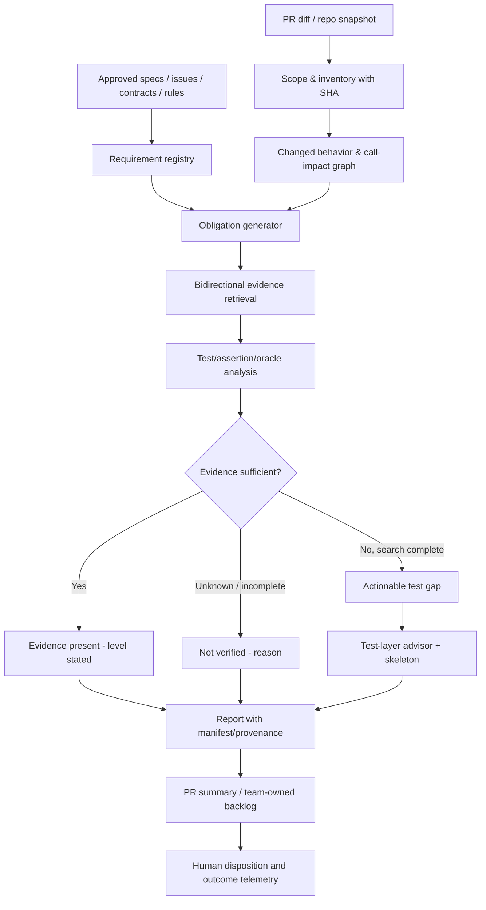

# SpecGuard：面向 Shift Left 的批判性代码审查与 Unknown Unknowns 研究

> **审查日期**：2026-10-14（Australia/Sydney）  
> **仓库**：[Mira190/SpecGuard](https://github.com/Mira190/SpecGuard)  
> **固定基线**：`main` / [`5bcf4deb2ba9868969bc1e0b52407c7e34886516`](https://github.com/Mira190/SpecGuard/commit/5bcf4deb2ba9868969bc1e0b52407c7e34886516)  
> **审查方法**：通过已连接的 GitHub 读取仓库树、实际源代码、工作流、Skill、测试与历史评测报告；静态代码审计、架构推演和可反驳的实验设计。**没有在本次审查中克隆执行、调用付费模型、运行真实 PR/全仓扫描或验证公司仓库权限；故“可触发”与“已触发”严格区分。**  
> **范围**：只创建本地审计 Markdown，不改代码、不提交 PR、不写入 GitHub。

## 0. Executive verdict

**结论：有相当好的工程基础，但目前是“带有可解释证据的测试缺口候选发现器”，不是“能够证明每个需求已被恰当测试覆盖的全仓审计器”。**

SpecGuard 已实现：PR 评审、外部仓库手动启动、可复用工作流、风险排序与轮转式仓库扫描、需求文件追溯、测试文件候选定位、代码和测试引用验证、置信度降级、模型引擎适配、扫描状态、预算控制与相当多的测试。它已经不只是 prompt wrapper。近期 D* 需求回填以及 scan 批处理，也修复了先前文档里的若干具体痛点；不能拿旧审计的“进行中”状态冒充当前事实。

但部署前有一个优先级高于准确率的安全组合：**当前 SpecGuard 控制仓库是 public；手动工作流支持访问私有目标仓库；默认把扫描摘要和状态写进控制仓库的 Issue，并上传可含原始私有代码/需求引用的 artifact。** 代码中有“控制仓库必须私有”的文字提醒，却没有看到执行时强制的公开/私有信息流校验。**这是条件性泄露路径，并不意味着已发生实际泄露。** 在确认隔离之前，不应从当前公开控制仓库对内部私有仓库执行手动扫描。

第二类核心风险是错误的“已审/确认”语义：**一个源代码引用 + 一个测试引用，并不构成行为充分验证；两次重复的相同模型判断，也不构成两个独立证据。** 第三类是隐蔽的召回率损失：切片、文件名匹配、先选 top-N、扫描块截断和无执行环境可能让困难缺口根本没有机会进入模型上下文。

### 审查成熟度分项（定性，不是评分）

| 目标 | 当前判断 | 不应对外承诺的事项 |
|---|---|---|
| PR 工作流交付 | **已实现**，包括复用和手动启动 | 不承诺所有分支/已关闭 PR 均可审 |
| 需求 → 行为 → 测试义务 | **部分实现**：需求索引、模型判断、带引用输出 | 不承诺需求已完整读到、要求被正确解释 |
| 找缺失/弱单元测试 | **已有真实 OSS 成果**，但漏检/误报可复现 | 不承诺穷尽所有缺口或“零结果=充分覆盖” |
| 编码标准已确认 | **PR 有检测通路**，工具执行结果须显式配置 | 不把“读到标准文件”等同于“CI 符合标准” |
| 组件/集成测试下沉 | **已有建议类型**，有效性尚未充分验证 | 不把按文件路径推断的 layer 当作真值 |
| 全仓扫描 | **有界增量抽样 + 轮转**，不是一次性穷尽 | 不应使用笼统的“full repo verified” |
| 企业安全和实际 Shift Left 价值 | **存在阻断项**：结果驻留、供应商与效果证据 | 不以模型离线 precision 代替生产改进 |

---

## 1. 第一性原理：正确的问题不是“有没有测试文件”

从错误成本出发，Shift Left 不是尽可能多发表评论，而是把**本来会在较晚环节才被发现、且能在更早环节可靠验证的缺陷**提前揭示给能修复的人。

最小因果链：

1. **真实目标行为**存在：业务规则、已批准设计、接口契约、系统不变量、隐私与安全约束等。
2. **实现行为**可能与目标行为不同：在被调用路径、边界条件、错误路径、时序或多服务协作中体现。
3. **验证义务**明确：针对每个失败机制，指出必须使测试失败的对抗性输入和可独立判断的预期结果。
4. **现有证据**可以证明，或不能证明，这个义务：测试名称、代码引用、执行轨迹、assertion、变异敏感性、最近一次通过记录的强度各不相同。
5. **最便宜且可靠的测试层**可行：unit、component、integration、contract、E2E，并考虑替身是否扭曲契约。
6. **开发者行动与回归减少**：在合并前接收问题、修正测试或行为，并降低后续 defect escape，而不是只在 PR 留下一条 AI 评论。

不能从“文档提到了 X，测试目录包含 X”推出“X 被验证”。也不能从“没有检索到测试”推出“X 无测试”：后者只有在检索范围充分、所需代码/测试被读完、且排除了间接验证以后才有统计意义。

**建议的产品定义**：

> **SpecGuard is an evidence-aware verification-gap advisor. It links approved requirements and changed behaviour to concrete test obligations, checks whether existing assertions could detect meaningful regressions, recommends the cheapest trustworthy test layer, and explicitly reports what it could not inspect.**

“证据不足”不是“缺测试”的同义词。两者需要不同的报告和处置路径。

---

## 2. 证据分级：避免把推论当实验结果

- **E0：代码已核对**：可以从特定代码条件或数据流直接推出的行为，例如“成功返回状态完整，但一部分批次失败”。这是本审计最坚实的层级。
- **E1：仓库既有实验记录**：`docs/shift-left-review-2026-10-14.md`、`eval/results/recall-claude-2026-10-14b.md` 中作者记载的 OSS、个人仓库与 seeded fixtures 结果。可信度取决于记录与实验设置；**本次未独立重跑**。
- **E2：可行但未触发的风险推演**：需要特定私有仓库、超过阈值的输入、迁移后的依赖图等条件。本文给出最小可证伪试验，而不宣称已经复现。
- **E3：产品假设**：例如开发者是否真的修改测试、组织的 coding standards 是否可由 GitHub check 确认，必须在正式 pilot 才能测量。

### 基线事实

- 已确认仓库为 `public`，当前默认分支 `main`，最新审查提交 `5bcf4deb`；源代码树约 505 个 blob（包含大量 fixture 和历史评测数据）。[仓库](https://github.com/Mira190/SpecGuard)
- 仓库报告的 18 个 seeded 例子：precision 100%、recall 86%、JSON 有效率 100%、22% degraded，测试质量子类 recall 67%。**这是内部测试夹具的结果，不是企业仓库实战准确率，也不是本次重测值。** [评测结果](https://github.com/Mira190/SpecGuard/blob/5bcf4deb2ba9868969bc1e0b52407c7e34886516/eval/results/recall-claude-2026-10-14b.md)
- 同日旧版审查还记录：Express 一个真实缺口在 4 次运行中仅出现 1 次（低置信）；另有已查证的误报和能找到的真实弱测试。旧审查基于较早提交，不能据此认定后续提交未修复。 [旧审查 §9](https://github.com/Mira190/SpecGuard/blob/5bcf4deb2ba9868969bc1e0b52407c7e34886516/docs/shift-left-review-2026-10-14.md)
- `#168–#172` 已并入当前 HEAD：包括 governing requirement D*、scan batch、证据窗口与对需求 alignment 的输出修正。本文对这些修复给予确认，同时核查残余边界。 [历史提交](https://github.com/Mira190/SpecGuard/commits/main/)

---

## 3. 重要发现：按业务影响排序

### SG-01 · P0 · 公共控制仓库接收私有目标扫描结果的潜在信息泄露路径（E0+E2）

**证据链**：

- 控制仓库目前 `public`。[仓库](https://github.com/Mira190/SpecGuard)
- 手动 workflow 支持 `SPECGUARD_PAT`/GitHub App 访问**其他私有目标仓库**；`scan_issue` 默认 `specguard`，即在 SpecGuard 自己的 Issue 中保留扫描结果与历史状态。[`specguard-run.yml#L1-L26`](https://github.com/Mira190/SpecGuard/blob/5bcf4deb2ba9868969bc1e0b52407c7e34886516/.github/workflows/specguard-run.yml#L1-L26)
- 工作流 `review` job 把目标 checkout 后执行扫描，可将包含源代码与需求摘录的 `summary.md`、`findings.json`、`audit.json`、`requirements-status.json` 上传为 14 天的 artifact，并写 job summary。[`specguard-run.yml#L109-L176`](https://github.com/Mira190/SpecGuard/blob/5bcf4deb2ba9868969bc1e0b52407c7e34886516/.github/workflows/specguard-run.yml#L109-L176)
- 文件注释**明确意识到** issue/artifact 包含目标代码，提醒控制仓库必须私有；目前缺少在发布前依据控制仓库和目标仓库可见性**强制拒绝**的代码。GitHub Actions artifact 的可访问性取决于仓库读取权限，不能把 retention 或隐藏目录当作权限屏障。[GitHub 官方 artifact 文档](https://docs.github.com/en/actions/how-tos/manage-workflow-runs/download-workflow-artifacts)

**影响**：如果有权限的人从此公开控制仓库调用扫描私有企业仓库，模型返回的具体业务规则、源代码或测试片段可能被公开保存。当前尚无证据显示实际运行过这种组合或已经泄露。

**修复**：默认阻断 `private target -> public control`，同时阻断对 public issue、artifact、job summary、日志的内容写入；安全默认值优先。最省事的部署是**把控制工作流复制到受控私有/内部仓库，结果只留目标仓库私有作用域**；用 GitHub App 最小权限令牌，确认模型供应商合规。防护应检查**运行时实际仓库 visibility**和**目标 repo visibility**，权限查询失败则 fail closed。回归测试应检查所有交付通道，而非仅仅 Issue。

**验收**：四种 visibility 组合（public→public、private→private、private target→public control 等）在有/无 API 权限下全测；危险组合没有任何可访问的有内容 Issue、artifact 或 summary。

### SG-02 · P0 · 多批 scan“成功/完整”与实际覆盖范围矛盾（E0）

**证据链**：超过 20 个文档块，`scan-parts.js` 分成多个调用；`claude-api.js` 将失败批次和因预算放弃的批次写进 `scan-parts.json`，**只要有一批成功，就执行 `end('success')`**。[`claude-api.js#L342-L379`](https://github.com/Mira190/SpecGuard/blob/5bcf4deb2ba9868969bc1e0b52407c7e34886516/src/engines/claude-api.js#L342-L379) `audit-post.js` 虽然在正文显示 `Not audited this run`，但只依赖 engine-status 决定 `partial`，因此仍可能设置 action 输出 `status=complete`，且在没有保留下来的 gap 时标题出现绿色 `No unit test gaps...`。[`audit-post.js#L430-L453`](https://github.com/Mira190/SpecGuard/blob/5bcf4deb2ba9868969bc1e0b52407c7e34886516/src/audit-post.js#L430-L453) [`#L621-L656`](https://github.com/Mira190/SpecGuard/blob/5bcf4deb2ba9868969bc1e0b52407c7e34886516/src/audit-post.js#L621-L656)

**核心问题**：人类展开报告可以看见部分丢失，但下游自动化和管理看板看到 `complete` 可能错误认为覆盖完成。即使每批成功，轮转式 top-N scan 也不等于全仓完整审查。

**修复**：把**执行是否正常**和**审查范围是否完整**分开：`execution_status={success,partial,failed}`、`scope_status={complete,selected_only,incomplete,unknown}`；若计划批次失败或预算被裁，`status` 不得无条件 complete。总数按 `eligible/selected/prompted/read/answered/verified` 逐项报告，不可只写“reviewed”。

**反证试验**：两个文档 batch，第一个返回无 gap 的有效 JSON，第二个模拟 429 或强制预算裁切；期望 action 不显示总体验证成功，并明确列出未审块数。

### SG-03 · P0 · 多批文档审查没有取得完整文档，超长需求可能在进入模型前被截断（E0）

**证据链**：文档抽取给模型的候选行 `text` 限于 **240 字符**，做搜索的 `full` 限于 **600 字符**。[`audit-collect.js#L80-L95`](https://github.com/Mira190/SpecGuard/blob/5bcf4deb2ba9868969bc1e0b52407c7e34886516/src/audit-collect.js#L80-L95) 当文档块超过默认 20 项后，多批 prompt 由 `scan-parts.js` 使用 `audit-docs.txt`（**路径清单**）、每批 `audit-candidates.txt` 和证据行拼接；pack 只装由 evidence 指向的**代码和测试片段**，而不是把完整需求文档放入 prompt。[`scan-parts.js#L12-L46`](https://github.com/Mira190/SpecGuard/blob/5bcf4deb2ba9868969bc1e0b52407c7e34886516/src/scan-parts.js#L12-L46) 默认 Claude API 无文件工具。[`claude-api.js#L52-L60`](https://github.com/Mira190/SpecGuard/blob/5bcf4deb2ba9868969bc1e0b52407c7e34886516/src/engines/claude-api.js#L52-L60)

Skill 同时要求“完整阅读所有 admitted documents”和“每个 block 的每个 clause”，因此多批 API 实际输入与规范发生结构性不一致。[`skills/spec-audit/SKILL.md#L26-L34`](https://github.com/Mira190/SpecGuard/blob/5bcf4deb2ba9868969bc1e0b52407c7e34886516/skills/spec-audit/SKILL.md#L26-L34)

**影响**：长 Markdown 表格行、业务规则复合条款、例外条件或不变量可能位于第 240 字符以后；检索器曾使用更多字，但最终推理器只收到短行片段。模型对没看过的尾句不能完成行为对齐审查。不能仅因为 `docs_reviewed` 字段声称读过就信任它。

**修复**：按 block 的起止 byte/line span，从原始**指定 SHA 的需求文件**提取**完整 block**并纳入每批 prompt；过长 block 再按**原子条款**拆分，记录未涵盖子条款。`docs_reviewed` 应由输入打包器生成 manifest，而非模型自报；缺失、截断强制 `unknown`。为了预算可以只包含每批相关 blocks，不必每轮重复全文件。

**反证试验**：造一个 400 字符的验收标准，头部写“应保留按钮宽 100”，末尾写“disabled 时不得发请求”；造 25 个 blocks 触发批处理。让末尾规则与实现相反，看是否产生带该片段真实来源的 mismatch。并对比 `scan <=20 blocks`。

### SG-04 · P0 · 无匹配测试文件可能直接成为“确定性确认的缺失测试”（E0）

`audit-units.js` 使用文件名、公开方法名、字符串 mention、符号调用等启发式匹配测试，一个 unit 至多连接 20 个候选测试文件。名字少于 4 个字符、间接 helper、参数化测试、trait/fixture、聚合测试均可能漏匹配。[`audit-units.js#L70-L118`](https://github.com/Mira190/SpecGuard/blob/5bcf4deb2ba9868969bc1e0b52407c7e34886516/src/audit-units.js#L70-L118) [`test-map.js#L13-L87`](https://github.com/Mira190/SpecGuard/blob/5bcf4deb2ba9868969bc1e0b52407c7e34886516/src/test-map.js#L13-L87)

但 `audit-post.js` 在 `missing_test` 且 `!u.tests.length` 时直接令 `det=true`，`trackFindings` 将 `det` 当作 `confirmed`，**无需跨两次独立检测**。[`audit-post.js#L244-L269`](https://github.com/Mira190/SpecGuard/blob/5bcf4deb2ba9868969bc1e0b52407c7e34886516/src/audit-post.js#L244-L269) [`#L340-L345`](https://github.com/Mira190/SpecGuard/blob/5bcf4deb2ba9868969bc1e0b52407c7e34886516/src/audit-post.js#L340-L345)

**这是把“未检索到测试”升级为“缺失测试已确认”的认识论错误。** 即使在 Express 的已知命名误报修复后，对陌生语言、命名约定和不在测试目录的测试仍然成立。

**修复**：`!matchedTests` 只能产生 `test_evidence_not_found`；确认 missing_test 前必须对同一行为进行**反向搜索**（测试→symbol/callsite/公共 API）和完整性检查，并且至少给出独立验证方法。`confirmed` 应只用于人工核查、动态实验或经过校准的可穷尽规则。

### SG-05 · P1 · `covered` 语义过强：引用存在≠测试断言保护需求（E0）

`gap()` 对 unit 类的 `covered` 核验只要求有代码引用和一个层级为 `unit` 的测试引用；`verify()` 证明引用在 HEAD 的文件中出现，但不能证明测试调用到该逻辑、断言关键结果、覆盖例外/负路径或能在缺陷注入时失败。[`audit-post.js#L158-L169`](https://github.com/Mira190/SpecGuard/blob/5bcf4deb2ba9868969bc1e0b52407c7e34886516/src/audit-post.js#L158-L169) [`#L189-L240`](https://github.com/Mira190/SpecGuard/blob/5bcf4deb2ba9868969bc1e0b52407c7e34886516/src/audit-post.js#L189-L240)

**修复**：拆分 `linked_to_code`、`test_exists`、`test_executes_behavior`、`assertion_proves_obligation`、`oracle_independent`、`current_head_run_passed`、`mutation_sensitive`；每一项标明证据类型和未验证原因。没有动态执行时 `covered` 改为 `static_evidence_present`（可叫 `likely_evidenced`）。

### SG-06 · P1 · 两次同样发现不是独立证据；状态可能因代码改动变陈旧（E0+E2）

`track()` 根据文档块 CID、状态和连续次数将 gap 标记 confirmed；`trackFindings()` 对同一个 fid 在先前 state 存在时也标记 confirmed。CID 主要来自文档原文，fid 来自 unit、finding 类型和引用 quote；**两者没有完整绑定代码、测试、执行/配置、引擎版本**。[`audit-collect.js#L80-L95`](https://github.com/Mira190/SpecGuard/blob/5bcf4deb2ba9868969bc1e0b52407c7e34886516/src/audit-collect.js#L80-L95) [`audit-post.js#L292-L345`](https://github.com/Mira190/SpecGuard/blob/5bcf4deb2ba9868969bc1e0b52407c7e34886516/src/audit-post.js#L292-L345)

相同检索丢失或模型偏差，在同一配置/上下文下连续出现两次的概率高度相关，不是“2 个证据源”。旧状态在轮转过程中可以被携带，即便依赖代码和测试已发生变化。

**修复**：确认条件基于**证据机制多样性**（独立审阅/Mutation Test/实际执行/人工确认），不是调用次数；所有 `evidence` 增加 `{head_sha, relevant_code_hash, tests_hash, requirements_hash, rules_hash, analyzer_version}`；依赖变化使旧结论 `stale`，只允许显示“上次扫描发现”。

### SG-07 · P1 · 文件是审查单位，既太粗，也不适合“发现遗漏的行为”（E0）

全仓 inventory 以文件为 unit，而不是方法、行为、公共 API 或调用路径；每次默认最多选 12 个源文件，最多列入前 6000 个候选源码、读取前 4000 个测试（总计 48MiB），源文件超过 512KiB 被候选规则排除，单文件 context 装箱还有约 48KiB 上限。[`audit-units.js#L12-L17`](https://github.com/Mira190/SpecGuard/blob/5bcf4deb2ba9868969bc1e0b52407c7e34886516/src/audit-units.js#L12-L17) [`#L70-L105`](https://github.com/Mira190/SpecGuard/blob/5bcf4deb2ba9868969bc1e0b52407c7e34886516/src/audit-units.js#L70-L105) [`claude-api.js#L175-L232`](https://github.com/Mira190/SpecGuard/blob/5bcf4deb2ba9868969bc1e0b52407c7e34886516/src/engines/claude-api.js#L175-L232)

这种限制合理控制成本，但在大型仓库中“仓库扫描”不代表每个行为都会看到。文件上的 20 个测试也可能全在测 1 个 happy path，剩余 7 个分支根本没覆盖。

**修复**：分层 inventory：`repo → package → symbol/public API → behavior/branch/obligation`。使用增量解析器/语言插件形成调用索引、符号范围和测试关联；缓存由 SHA 决定并在变化时失效；对无法解析的语言清楚列为 `unsupported`；大文件按方法/AST 区域分片并包含调用者和相关测试。全仓报告显示范围的分母及未扫描原因。

### SG-08 · P1 · 扫描风险排序存在 Goodhart 效应和静默盲点（E0）

优先级公式按公开定义数、行数、最近 180 天 churn 和含 `fix|bug` 的 commit 标题计分；测试文件匹配后 risk factor 降低至 0.3。它是启发式排序，不是经历史 defect 数据校准的发生概率。[`audit-units.js#L35-L52`](https://github.com/Mira190/SpecGuard/blob/5bcf4deb2ba9868969bc1e0b52407c7e34886516/src/audit-units.js#L35-L52)

低 churn 的安全边界代码、稳定但错误的公共算法、共享低层依赖，可能被排到很后；系统把“测试名字匹配”当风险大幅下降的信号，可能恰好错过断言质量差的核心模块。

**修复**：显式区分“不确定性优先”和“损害优先”：暴露面、授权/支付/数据隔离、API fan-out、依赖中心性、近期事故、复杂度、覆盖变化、批改动影响，再做成本收益排序；维护**随机抽样审计**作为对冲，测 top-N 与随机组的真实检出率。

### SG-09 · P1 · 需求发现是局部静态文本搜索，不能承担“真实需求真值源”职责（E0+E2）

需求侧依赖 GitHub PR 正文、Issue、仓库内 README/MD/feature 及命名规则；手动 `design_docs` 中指向另一 repo 的链接明确拒绝，外部 Confluence/Jira/Figma/PDF 等没有本机读入通路。[`resolve-inputs.js#L83-L110`](https://github.com/Mira190/SpecGuard/blob/5bcf4deb2ba9868969bc1e0b52407c7e34886516/src/resolve-inputs.js#L83-L110) [`requirements.js#L231-L307`](https://github.com/Mira190/SpecGuard/blob/5bcf4deb2ba9868969bc1e0b52407c7e34886516/src/requirements.js#L231-L307)

词法匹配还有翻译、术语别名、含义倒置、否定条件、表格例外、省略目标路径等困难。更深的盲点是**设计本身可能错/不受批准**。一个 PR 同时修改代码与设计令两者一致，不能自动证明改动合理。

**修复**：引入 `requirement_authority`、`approval_status`、`effective_at`、`version`、`supersedes`、`owner` 与 conflict/expiry 标记；支持组织批准的外部源插件（不越权）；把“文档缺失”与“设计不一致”区分。若 design 与实现同时变更，要求明确 change justification 和经过审批的契约差异。

### SG-10 · P1 · 测试层级分类仅靠路径/模型，尚不能可靠指导 push-down（E0+E1）

`post.js` 默认用目录或文件名识别 e2e/integration/component，否则很多被识别为测试的文件归入 unit；一部分强制模型注明 layer。模型也会在语义不明时分类错误。[`post.js#L121-L136`](https://github.com/Mira190/SpecGuard/blob/5bcf4deb2ba9868969bc1e0b52407c7e34886516/src/post.js#L121-L136)

仓库已有实跑记录把 Express 的 supertest HTTP 检查当成 unit、从未充分验证“可以下沉”的正面例子。[`shift-left-review §5 C5`](https://github.com/Mira190/SpecGuard/blob/5bcf4deb2ba9868969bc1e0b52407c7e34886516/docs/shift-left-review-2026-10-14.md)

**修复**：允许团队定义 `test_layers` 按 glob/框架/fixture 约束（会有冲突优先级）；检测测试的**实际依赖边界**：纯函数/数据库/HTTP 服务/真实队列/外部网络/仿真；按隔离性、速度、稳定性和需求失败机制判断。不要建议把契约测试完全替换为单元测试：下沉是**补充低成本反馈**，不能抹掉服务边界验证。

**验收**：准备 20 个由目标团队签字的案例，包括 Angular TestBed、Playwright component、supertest、pytest fixture、Testcontainers、consumer-driven contract；要求列清 `current_layer / suggested_layer / should_add_or_move / why / what higher-layer must remain`，评两位资深 reviewer 一致性。

### SG-11 · P1 · Coding standards 的“读取”与“已通过工具确认”未统一（E0）

Action 支持 `standards_paths` 自动查找，也提供可选的 `standards_checks` 来查 GitHub check/status；**默认为空表示并未配置外部检查**。[`action.yml#L21-L28`](https://github.com/Mira190/SpecGuard/blob/5bcf4deb2ba9868969bc1e0b52407c7e34886516/action.yml#L21-L28) 现有旧审查明确提到全仓 scan 尚不检查 coding standard。[`shift-left-review C15`](https://github.com/Mira190/SpecGuard/blob/5bcf4deb2ba9868969bc1e0b52407c7e34886516/docs/shift-left-review-2026-10-14.md)

**修复**：将 `standard_source_found / applicable_to_files / check_configured / check_run_at_head / check_provenance / pass_fail / manual_review` 六状态分开；对于 `check:lint` 同名 check，必须校验 check 的 producer/source、目标 SHA、执行条件和时间，避免错误归因；scan 也输出 baseline 的规则覆盖结果（可先只确认可用性）。别声称“已确认”除非确切运行结果与本次 SHA 匹配。

### SG-12 · P1 · 代码/测试证据存在选择偏差，非完整检索会系统性减少 recall（E0+E1）

`audit-collect` 仅给每块最多 3 个代码位置和 3 个测试位置；大型测试只选择含给定 symbol 的局部切片（名称短、动态调用、抽象 helper 都可能错过）。[ `audit-collect.js#L118-L151`](https://github.com/Mira190/SpecGuard/blob/5bcf4deb2ba9868969bc1e0b52407c7e34886516/src/audit-collect.js#L118-L151) [`claude-api.js#L117-L172`](https://github.com/Mira190/SpecGuard/blob/5bcf4deb2ba9868969bc1e0b52407c7e34886516/src/engines/claude-api.js#L117-L172)

字面命中被用作保护：测试文本里出现错误消息或 literal，可以将 `missing_test` 降为低置信，但**字面出现不一定有有效 assertion**。[`test-map.js#L89-L139`](https://github.com/Mira190/SpecGuard/blob/5bcf4deb2ba9868969bc1e0b52407c7e34886516/src/test-map.js#L89-L139)

**修复**：对于要输出“缺测试”的候选，使用至少两条方向不同的检索路径（code→tests、tests→code）、补充基于真实调用位置的追踪；对“存在测试”验证 assertions 所在子测试与被测行为的关系。报告区分 `retrieval_sufficient` 与 `no_matching_test`；按语言分层量测 recall，专门打擂台测试 `_test.js`、参数化、短方法名和测试 helper。

### SG-13 · P1 · Snapshot 缺少执行证明、CI 配置与 feature-flag 版本（E0+E2）

SpecGuard 明确不运行测试；`coverage_files` 需调用方**预先在同一个 job**运行收集，且默认为空。[`action.yml#L28`](https://github.com/Mira190/SpecGuard/blob/5bcf4deb2ba9868969bc1e0b52407c7e34886516/action.yml#L28) 即使拿到了 lcov/JaCoCo，行 coverage 也无法说明断言是否独立正确。

**修复**：为可选动态证据绑定 `head_sha / build_id / test command / environment / flag matrix / report checksum / timestamp`；对 branch/source mismatch 标记 `invalid_dynamic_evidence`。推荐轻量“提议验证”层：用测试骨架和最小 mutation 验证，不直接在高权限核心扫描 runner 执行陌生 PR 代码；在 target repo 独立、低权限/隔离 runner 中执行。

### SG-14 · P1 · 手动运行的交付不一定发生在开发者决策环节（E0+E3）

手动模式默认 `post_to_pr=false`，结果只在 SpecGuard run 页和 artifact；全仓默认写中心 Issue（若启用），这不等于 PR 作者会及时看到、理解并修复。旧审查明确记录缺少真人的 did-fix、误报、time-to-merge 数据。[`specguard-run.yml#L12-L26`](https://github.com/Mira190/SpecGuard/blob/5bcf4deb2ba9868969bc1e0b52407c7e34886516/.github/workflows/specguard-run.yml#L12-L26) [`shift-left-review §5 C1`](https://github.com/Mira190/SpecGuard/blob/5bcf4deb2ba9868969bc1e0b52407c7e34886516/docs/shift-left-review-2026-10-14.md)

**修复**：为 target team 提供 opt-in PR check/sticky comment、按 CODEOWNERS 指派、低噪声 actionable findings；中心扫描生成**可分派工作项**而非只有大表格。捕获 `acknowledged / accepted / fixed / dismissed / false_positive / deferred / verified` 事件，人工确认后追踪到 PR SHA 与关闭依据。没有生产数据之前不把评论数量当 adoption 成果。

### SG-15 · P2 · 自测集提供了工程回归，却不足以验证跨团队泛化（E1）

仓库 18 个 seeded cases 的 precision 为 100%、recall 为 86%，但部分失败不是误报扣分而是“case fail”；评分器将合理的额外发现标注为 acceptable，summary-only 不计入 TP/FP，errored run 不在准确率分母里。[`eval/README.md`](https://github.com/Mira190/SpecGuard/blob/5bcf4deb2ba9868969bc1e0b52407c7e34886516/eval/README.md) [`recall results`](https://github.com/Mira190/SpecGuard/blob/5bcf4deb2ba9868969bc1e0b52407c7e34886516/eval/results/recall-claude-2026-10-14b.md)

**修复**：生产试点同时测 model-level 与 end-to-end：`TP/FP/FN`、`unknown率`、`未读输入率`、`运行失败率`、`有效送达率`、`did-fix`、`escape bugs`、`时间/成本`。以真实缺陷和仓库做 held-out；将插桩或规则调整锁定，防止对同一 fixtures 反复调到高分。分离 engine；不能把 Claude 结果当 Copilot 默认路径质量。

---

## 4. Unknown Unknowns：从约束推演未覆盖的缺陷机制

下表不是“模型还可以想到什么”的列表，而是逐条问：**如果系统给出干净结论，但真实行为错误，哪一条假设可能没有成立？** 这样才能设计主动寻找未知缺口的实验。

| 类别 | 隐藏假设 | 反例（真实业务有机会发生） | 首选反证/探针 | 推荐默认层级 |
|---|---|---|---|---|
| **U1 目标行为漂移** | 文档必然正确 | 开发者同时改需求与代码，隐藏不兼容行为；旧已批准规则被覆盖 | 比较批准 spec 与 base/head，要求 change approval | 需求治理+contract |
| **U2 未表达的安全不变量** | 没写 AC 就无需测 | 不同租户之间泄露、用户权限越界、未授权重试 | 枚举角色×资源×操作矩阵与否定性质 | unit+integration/security |
| **U3 未触发路径** | test 引用即实际调用 | test 只测 mock 或 dead branch，返回常数也会通过 | mutation：删调用、反转比较、改返回值 | unit |
| **U4 Oracle 共谋** | 预期结果独立 | 测试把实现算法抄到 expected，二者同错 | 从规格算 literal expected；metamorphic/property test | unit/property |
| **U5 边界/组合爆炸** | happy path 代表全路径 | `null/0/负数/溢出/时区/并发 flag` 相互作用 | 边界值与 pairwise + 状态机变换 | unit+component |
| **U6 时序和并发** | 顺序调用测试够用 | 双击、消息重复、幂等 key、超时后重试竞态 | deterministic scheduler/fake clock + race probe | unit+integration |
| **U7 事件最终一致性** | 函数完成即业务完成 | 事件丢失、乱序、重复消费、部分事务 | publisher/consumer contract，队列 fault injection | component+integration |
| **U8 跨仓库契约** | 单 repo 测试可自足 | payload 字段改名令另一 team 的 consumer 出错 | API/schema diff + consumer contract dependency graph | contract |
| **U9 配置即行为** | 只需扫 source | feature flag 默认值、路由、IAM policy、SQL migration 改变功能 | config/schema/policy diff 与环境矩阵 | unit+integration |
| **U10 测试层误认** | 文件 `*.test` 表示 unit | supertest/Angular TestBed 启了服务 | 依据真实依赖和 fixture 判层 | 分层治理 |
| **U11 编译/生成路径** | 改动都在普通源文件 | protobuf/OpenAPI/生成客户端或 CI 构建开关改变行为 | 生成源→产物→调用者图 | contract+build |
| **U12 测试运行条件** | 存在的测试都在 CI 跑 | `skip`, ignored tag, 条件 job, flaky quarantine，路径过滤 | workflow 和 runner 选择器求交集 | CI 校验 |
| **U13 测试新旧错配** | 最新 artifact 表示当前 PR | coverage/test 在 base SHA 跑过，HEAD 已变 | SHA+flag+test-report attestation | 证据治理 |
| **U14 检索/打包饥饿** | 没输出就是没问题 | 长文件尾部真正关键分支未给 LLM | 乱序文件、移动函数、增预算检出敏感性 | 元测试 |
| **U15 语言/框架缺口** | 通用规则覆盖全部代码 | C++/SQL/Swift fixture/自定义 assertion 未识别 | 语言支持矩阵与未知标签，50 案例/框架 | 扫描可靠性 |
| **U16 高风险稳定代码** | churn 低风险就低 | 很少改的认证/账单核心算法一直错 | 改用业务损害×依赖中心度排序，随机审计 | 计划 |
| **U17 生态安全** | 代码不执行就安全 | 机密通过摘要/Issue/artifact/model 请求泄露 | 数据流与 least-privilege/visibility 测试 | 安全阻断 |
| **U18 组织反作用** | 高检出率会改善质量 | 通知疲劳、PR 延迟、人员被指标考核、压低 precision | 阶梯式 shadow→opt-in→实验，测 did-fix/负担 | 产品试点 |
| **U19 破坏性测试下沉** | 更多 unit 更好 | 用 mock 取代真实消费者契约，假绿测试增多 | 下沉前/后 defect classes 不变量核对 | contract 保留 |
| **U20 模型自证循环** | 两次同样 AI 输出即可靠 | 同样检索前提和模型重复稳定误报 | 多方法互证（编译/执行/人工/不同信息源） | 证据治理 |

### 十个特别容易被漏掉的 **Test Obligations**

这些应当是 SpecGuard 生成候选验证义务的模板，不是默认认为每个 PR 都必须补十条测试：

1. **拒绝路径**：无权限/错误 tenant/被撤销令牌时不能发生副作用。
2. **状态迁移**：`pending → paid → refunded` 等不允许越级、倒退和重复成功。
3. **幂等与可恢复**：重复事件/超时重试不会重复扣款或重复触发通知。
4. **边界精度**：金额四舍五入、小数精度、负值、空值、极大值、闰年/时区/DST。
5. **失败传播**：下游超时/部分成功时，错误可观测并按约定补偿。
6. **反向兼容**：旧 consumer 接到新字段/default 后仍可工作。
7. **授权组合**：角色×资源所有者×动作×flag，而不只是某个 `isAdmin` 测试。
8. **可观测性副作用**：没有泄露 PII；异常不会被吞；审计事件在拒绝路径仍产生。
9. **构建和环境矩阵**：release/debug、生产特性开关/区域差异不会绕开测试。
10. **测试正确性本身**：测试故意将关键比较反转或删掉实现时必须失败（有选择地做 mutation）。

---

## 5. 推荐的目标架构：以验证义务为中心而不是以文件为中心



**分清两个模式的职责**：

- **PR review**：基于 diff 加 impact graph，聚焦**本次行为更改**引入/失效的义务。目标是 10–60 秒内给作者 1–5 条高置信、能动手的建议；若引用不足，单独列未证实项，不输出假绿。
- **Full-repo scan**：对固定 SHA 建立**版本化 obligation inventory**，按业务风险和未审时间轮转，保存“哪些义务/哪些文件确实被读到”。结果面向 QA / team owner 的可管理 backlog，支持按 package、risk、状态过滤；一次 batch 不能冒充全仓完成。
- **Standards checking**：确定性 lint/check/status 与规范范围校验为主，LLM 只解释无法机器检查的规则。默认没有 configured check 就写 `not confirmed`。
- **Pushdown**：仅给出单位测试可以验证的**可分离纯行为**，同时明确是否必须保留 contract/integration 的风险保护。

### 推荐数据契约（示意）

```json
{
  "snapshot": {
    "repository": "org/service",
    "head_sha": "<40-character SHA>",
    "policy_version": "v1",
    "rules_hash": "sha256:..."
  },
  "scope": {
    "eligible_units": 1084,
    "selected_units": 12,
    "whole_source_read": 9,
    "whole_candidate_tests_read": 8,
    "requirements_complete": 4,
    "unreviewed_reasons": ["large_file", "budget_limit", "unsupported_language"]
  },
  "obligations": [
    {
      "id": "OBL:<stable key>",
      "requirement": {"source": "docs/spec.md", "line": 24, "authority": "approved", "version": "v2"},
      "behavior": {"symbol": "calculatePremium", "failure_mode": "negative input"},
      "test_evidence": {"test_path": "tests/premium.test.ts", "assertion_line": 45, "layer": "unit", "head_verified": false},
      "verification": {
        "status": "insufficient_evidence",
        "reason": "assertion does not distinguish buggy implementation",
        "evidence_grade": "static_observation",
        "candidate_tests_exhaustively_checked": false
      },
      "next_action": "Add independent expected-value assertion for negative boundary"
    }
  ]
}
```

该 JSON **不是**当前 SpecGuard 的现有 schema；它是建议迁移时引入的**独立证据清单**。其中数值仅为示例，不代表任何真实扫描结果。

### 建议的状态机

| 状态 | 定义 | 能否显示绿色通过 |
|---|---|---|
| `verified_dynamic` | 指定 head 的真实测试执行与独立 oracle/mutation 有支持 | 可以，限定当前义务和执行环境 |
| `evidenced_static` | 代码、测试与 assertion 的相关性经核验，但未执行 | 只能显示“静态证据存在”，不能叫验证通过 |
| `missing_test_high_confidence` | 检索足够完整，缺口经独立验证/人工确认 | 作为可行动 issue |
| `weak_oracle` | 测试执行或 assertion 存在，但不敏感于真实的失败机制 | 作为可行动 issue |
| `higher_layer_only` | 仅有组件/集成/E2E 证据，需要评估下沉的收益 | 建议补单元测试，不能自动否定集成保护 |
| `unknown` | 需求含糊、test mapping 不充分、语义证据不足 | 无绿色、无断言“缺失” |
| `not_reviewed` | 上下文截断、语言不支持、budget、部分 batch 失败 | 无绿色，清晰展示原因 |
| `stale` | 上次扫描结论基于另一版本的依赖代码、测试或规则 | 无绿色，进入重新审查队列 |

关键原则是**不强迫一个需求落在二元 covered/missing 分类里**。当模型无法独立判定时，明确表示不确定，是产品可靠性的组成部分。

---

## 6. 具体改造路线：按阻塞条件，而非功能数量排期

### P0：部署前的“可信输出边界”（先于增加新 LLM feature）

| 工作包 | 最小改造 | 验收条件 | 代码关注点 |
|---|---|---|---|
| **A. 信息流控制** | 在手动 `resolve`/`review` 检查目标与控制仓库可见性；危险组合 fail closed；隔离 summary、issue、artifact 与日志 | 私有目标内容不可能进入权限较宽的结果通道 | `.github/workflows/specguard-run.yml` |
| **B. 真正的完成度状态** | 将 `scan-parts.json` 的 failed/dropped 反映到 action output 与 verdict；明确轮转分母 | 一批失败时 `execution_status=partial`，绝不假绿 | `src/engines/claude-api.js`, `src/audit-post.js` |
| **C. 原文进入模型** | 分批装箱包含完整需求 block 与 SHA/line span，跨长行多 clause 不丢 | 25-block 中 400 字符复合规则的末句能被审到，截断时标 unknown | `src/audit-collect.js`, `src/scan-parts.js`, `src/engines/claude-api.js` |
| **D. 确认语义** | 删除 `!u.tests.length => det confirmed`；两次模型重复只表示 `stable`, 不等于证明 | 隐式/聚合测试存在时不报“已确认缺失”；两次误报不升级为事实 | `src/audit-post.js`, `src/test-map.js` |

### P1：把 PR 和 full scan 从“找到文件”提升为“找到行为”

1. **Behavior Obligation IR**：从 approved requirement 与 changed branch/public API 生成 `precondition / action / observable effect / invariants / failure mode`。不要让模型一次既搜、既断言、既证实。
2. **AST-first 双向检索**：对 JS/TS、Python、Java 等选定 pilot 语言做 symbol 级索引，测试引用不只靠文件名。其他语言显式 `unknown`，不假装全支持。
3. **Verification strength**：从 test existence 升级到是否验证边界、独立 oracle 与变异敏感性；先跑抽样 mutation，不要求所有 PR 都耗时执行。
4. **团队可配置 test layer**：路径、框架与依赖规则，明确 `move vs add`；合同/集成兜底保留。
5. **Standards provenance**：处理规则适用范围、同名 checks 来源和 target SHA；全仓 scan 也至少输出 confirmed/not_configured/unknown。
6. **数据与报告**：让手动扫描的结果能触达 target team，但默认不泄露到中心 public repo；每条 issue 附准确的 requirement/code/test/permalink 和最小 reproducer。

### P2：测量与规模化

- 把单 repo 的 `scan_issue` 状态升级为**按 head 与 artifact 身份的持久清单**（数据库/私有 object store 等，保留可追责 manifest）；保障并发、失败恢复和幂等性。
- 每个 repository 建立版本化索引和缓存；PR incremental、定期补全长期未审义务；大 monorepo 按 service + CODEOWNERS 切分。
- 用最近真实缺陷建立基线，做盲评 A/B，并将成本、延迟、错误率与 fix-through 联合评价；仅提高离线 precision 不是发布条件。

---

## 7. 可立即执行的实验矩阵（最小反证集）

建议**先 12 个可重复的 deterministic/fixture 实验**，再做 2–4 周真实 team pilot；全部在批准的数据和私有实验仓库执行。

| 编号 | 待证伪的主张 | 输入与对照 | 合格判据 |
|---|---|---|---|
| T01 | 私有数据不会被 public 控制 repo 泄露 | 私有测试 repo + 公开控制 repo，含专用无害 canary 文字 | run 失败且 Issue/artifact/summary 均无 canary |
| T02 | 批次失败不会显示 complete | 一个有效 batch + 一个模拟失败/预算 dropped | 部分状态 + 缺失清单，非绿色确认 |
| T03 | 多批完整理解长需求 | 25 个文档块，某块第 300 字有关键否定条款 | 报出正确差异或明确未读，不能 covered |
| T04 | 看不到匹配测试不会“确定确认缺失” | `req.get` / 参数化测试 / helper/跨目录 indirect tests | 没完整验证时为 unknown，不 confirmed |
| T05 | `covered` 代表强证据 | 断言 `expect(result).toBeDefined()`，修改内部计算无影响 | 标为 weak oracle，不应只因 test 引用 covered |
| T06 | 两轮 confirmation 不会重复误报 | 同一模型在相同快照重复稳定伪阳性 | 只叫 repeatable finding，无“独立证实” |
| T07 | 扫描状态能识别陈旧 | 前一次 covered 后只改测试/helper，需求不变 | 受影响义务的旧证据 stale/重新排队 |
| T08 | 大文件能被真正审查 | 70KiB TS 文件，缺口在尾部独立函数 | 告知未审 or 函数分片准确定位，不得“整文件通过” |
| T09 | 层级建议不损害契约 | HTTP supertest、Testcontainers 与纯函数三例 | unit 可下沉且需要的 integration 不被建议删除 |
| T10 | 标准确认绑定正确 CI | 两个不同来源 `check:lint` 同名但一成一败 | 能报告冲突，不使用错误 check 假通过 |
| T11 | 需求和代码不能共谋“蒙混过关” | 一个 PR 同时把 spec 和 code 的截止时间改掉 | 要求 approved spec baseline / authority 确认 |
| T12 | PR 作者真的能修 | 5–10 个真实团队 PR，opt-in shadow+评论对照 | 记录 sent→seen→accepted→fixed，给出差评率/耗时 |

### 与旧评测的关系

以已有 `eval/run.js`, `eval/mutate.js`, `eval/grade.js`, `eval/replay.js`, `eval/weekly-report.js` 为骨架扩展，不建议推倒重建。先固定当前 `5bcf4deb` 作 baseline；新增测试先能在旧版稳定失败，再实施修复；保留 20% held-out 用例。对 `Copilot CLI` 和 `Claude API` 要分别跑，而不是跨引擎复用结论。

**最低报告指标**：

- **Finding quality**：TP、FP、FN（按 failure class / repo / language），另记 credible but unconfirmed；带 95% 置信区间而不是单独一个 100%。
- **Completeness**：`eligible → selected → packed → completely read → model answered → citation verified`，分母始终是仓库当前可审对象。
- **Reliability**：CI 运行失败、超时、模型拒绝、schema degradation、budget 截断、runner 版本漂移。
- **Utility**：真人 `did-fix`、误报 dismiss、actionable rate、time-to-ack、time-to-fix、PR 延迟。
- **Long-tail**：8–12 周后复盘与历史缺陷同类的新 escape；不能因为时间不够而把“零记录”解释成零缺陷。

---

## 8. 原始用户目标映射与 Done 定义

> Original ask: Create a unit test review AI GitHub Workflow. Must review requirements and the tests, identify missing unit tests; confirm coding standard; if possible review component/integration testing and what should be in unit testing. Also support manual full repository/PR scans for other teams.

| 原始目标 | 最低真正 Done 定义 | SpecGuard 当前情况 |
|---|---|---|
| 需求与测试审查 | 每个重要 changed behavior / sampled requirement 有可追溯 obligation；存在/缺失/未知可靠区分 | **基本骨架具备**，完整性与证明强度需修 |
| 找缺失 unit test | 缺口有 code+req+test search evidence，实际 false positive 低；不把“未看到”当确认 | **已经能发现部分真实问题**；上述 SG-04 需要阻断 |
| Coding standards confirmed | 规范适用范围明确，指定 SHA 的真正 check/status 与模型判读分离 | **PR 部分支持**；未配置不能宣称确认 |
| Higher-level → unit | 建议补的是隔离可测的行为，说明保留哪些高层测试，并获得目标团队审阅认可 | **机制存在，验证不足** |
| PR+whole-repo manual workflow | 外部目标可审，安全输出，轮转有真诚分母与审计 manifest | **路径已有**；当前 public-control+private-target 是部署阻断 |
| Shift Left 成果 | 真人看到、修改、复测且 defect escape 或 QA 成本改善超过新增噪声 | **尚需 pilot**，不能凭 AI 评论量判断 |

### “何时可以给其他团队试用”的建议门槛

**Security gate**：SG-01 T01 通过；公司明确代码能够送给哪些供应商与存储范围。

**Integrity gate**：T02、T03、T04、T07 通过；报告准确声明未审、过期、证据不足；不得虚假绿色。

**Quality gate**：至少 50 个来自 2 个不同语言/领域的 held-out 问题案例，以及 30–50 条真实团队 PR 的人工盲审，对 precision/recall 报数并预先定容忍线。建议起始试点只发布 high-confidence advisory；即使高分也不要自动阻断 merge。

**Utility gate**：至少两周跟踪真人 `acknowledged/accepted/fixed/dismissed`，看到某类可重复真实收益后再扩大功能范围。提供 opt-out、团队规则和可解释的判断。

---

## 9. 批判性反对意见：哪些“直观优化”反而危险

1. **“全部换更强的模型”**：更大模型可能提升局部推理，但不能凭空读取遗漏的第 300 字或私有外部设计；先修输入和完整性契约。
2. **“把所有模型发现变成 required check”**：未校准的高置信误报加上团队沟通成本，会使开发者绕过流程或修改规范以逃避警告。先 advisory、分层 gating。
3. **“扫描出更多条目就代表更完整”**：一个新增 `missing_test` 可能只因 test-map 漏匹配；应先核验负证据的可穷尽性。
4. **“连续两次一样就是确认”**：重复的偏差也稳定，必须引入与原检索不同的独立证据。
5. **“文档即 oracle”**：文档可以过时、未经批准或和法律/安全规则冲突；需要 authority 和版本。
6. **“强制把集成测试下沉”**：contract boundary 不能在 mock 下可靠证实；unit 应补充，不能代替真实通信协议的风险保障。
7. **“把全仓一口气发给 agent”**：预算和上下文窗口不是一切；结构化 inventory + 增量检索通常更经济、更可追溯。
8. **“降低输出数量就代表 precision 高”**：只报容易的高置信缺口会隐藏 recall 下降；应联合统计 unknown 与 FN。
9. **“程序有 900+ 测试，所以产品可信”**：本项目自身的单元测试只能证明确定性规则与既定 fixture，不代表对未知组织的行为理解准确。
10. **“中心仓库够方便，所有输出集中在那里”**：便利性不能牺牲 least-privilege；用户的数据驻留边界要先设计，而非事后 redaction。

---

## 10. 最终建议与立即执行顺序

**第一步（必须先做）**：关闭当前公开控制仓库扫描私有目标的可能性，或迁移控制工作流/输出到受控私有位置，加入运行时 enforcement。确认企业对 Copilot/Anthropic 以及 artifact/Issue 的数据处理政策。

**第二步**：修复 SG-02/03/04，令 `complete`、`covered`、`confirmed` 只表示实际满足的证据强度；模型看不到的部分一律 `unknown` 或 `not_reviewed`，而不是假绿或假“确认”。

**第三步**：围绕真正的产品目标建立 requirement/behavior/test obligation 中间表示。先挑一个目标栈（例如 JS/TS），补真实调用与断言检查，再增加复杂多语言支持。

**第四步**：进行真实团队 pilot。成功标准是**合并前有效纠错和开发者行动**，不是“LLM 总共发现多少问题”。

这四步都完成后，SpecGuard 才有资格从“interesting AI reviewer”成长为跨团队可信赖的 Shift-Left Verification Advisor。

---

## 附录 A：主要代码与证据索引（固定 SHA）

| 主题 | 可直接核对的文件 |
|---|---|
| 控制仓库手动工作流与输出 | [`.github/workflows/specguard-run.yml`](https://github.com/Mira190/SpecGuard/blob/5bcf4deb2ba9868969bc1e0b52407c7e34886516/.github/workflows/specguard-run.yml) |
| 复用工作流（引用的 action SHA） | [`.github/workflows/specguard.yml`](https://github.com/Mira190/SpecGuard/blob/5bcf4deb2ba9868969bc1e0b52407c7e34886516/.github/workflows/specguard.yml) |
| Action 参数、状态和 debug artifact | [`action.yml`](https://github.com/Mira190/SpecGuard/blob/5bcf4deb2ba9868969bc1e0b52407c7e34886516/action.yml) |
| 完整 scan 文档块选择与检索 | [`src/audit-collect.js`](https://github.com/Mira190/SpecGuard/blob/5bcf4deb2ba9868969bc1e0b52407c7e34886516/src/audit-collect.js) |
| 仓库代码单元与测试映射 | [`src/audit-units.js`](https://github.com/Mira190/SpecGuard/blob/5bcf4deb2ba9868969bc1e0b52407c7e34886516/src/audit-units.js), [`src/test-map.js`](https://github.com/Mira190/SpecGuard/blob/5bcf4deb2ba9868969bc1e0b52407c7e34886516/src/test-map.js) |
| 扫描分批和完整性 | [`src/scan-parts.js`](https://github.com/Mira190/SpecGuard/blob/5bcf4deb2ba9868969bc1e0b52407c7e34886516/src/scan-parts.js), [`src/engines/claude-api.js`](https://github.com/Mira190/SpecGuard/blob/5bcf4deb2ba9868969bc1e0b52407c7e34886516/src/engines/claude-api.js) |
| 验证/持久扫描状态/发布 | [`src/audit-post.js`](https://github.com/Mira190/SpecGuard/blob/5bcf4deb2ba9868969bc1e0b52407c7e34886516/src/audit-post.js) |
| PR 模式的测试层级和校验 | [`src/post.js`](https://github.com/Mira190/SpecGuard/blob/5bcf4deb2ba9868969bc1e0b52407c7e34886516/src/post.js) |
| 模型审计协议 | [`skills/spec-audit/SKILL.md`](https://github.com/Mira190/SpecGuard/blob/5bcf4deb2ba9868969bc1e0b52407c7e34886516/skills/spec-audit/SKILL.md) |
| 既有第一性原理与已有问题 | [`docs/goal-first-principles.md`](https://github.com/Mira190/SpecGuard/blob/5bcf4deb2ba9868969bc1e0b52407c7e34886516/docs/goal-first-principles.md), [`docs/unknown-unknowns-optimization-2026-10-11.md`](https://github.com/Mira190/SpecGuard/blob/5bcf4deb2ba9868969bc1e0b52407c7e34886516/docs/unknown-unknowns-optimization-2026-10-11.md) |
| 既有当日 Shift Left 实跑审查 | [`docs/shift-left-review-2026-10-14.md`](https://github.com/Mira190/SpecGuard/blob/5bcf4deb2ba9868969bc1e0b52407c7e34886516/docs/shift-left-review-2026-10-14.md) |
| 评测方法与其限制 | [`eval/README.md`](https://github.com/Mira190/SpecGuard/blob/5bcf4deb2ba9868969bc1e0b52407c7e34886516/eval/README.md), [`eval/results/recall-claude-2026-10-14b.md`](https://github.com/Mira190/SpecGuard/blob/5bcf4deb2ba9868969bc1e0b52407c7e34886516/eval/results/recall-claude-2026-10-14b.md) |

## 附录 B：公开参考阅读

- [GitHub：下载 workflow artifacts](https://docs.github.com/en/actions/how-tos/manage-workflow-runs/download-workflow-artifacts)——审查公开/私有仓库产物访问边界。
- [GitHub：复用工作流](https://docs.github.com/en/actions/reference/workflows-and-actions/reusing-workflow-configurations)——权限不超过调用方以及工作流治理。
- [GitHub：Code scanning REST API](https://docs.github.com/en/rest/code-scanning/code-scanning)——未来可用 SARIF/annotations 与可持续基线管理；不要冒充发现经过动态证实。
- [Martin Fowler：The Practical Test Pyramid](https://martinfowler.com/articles/practical-test-pyramid.html)——测试层级的维护成本与反馈速度。
- [Google Testing Blog：Fixing the Test Hourglass](https://testing.googleblog.com/2020/11/fixing-test-hourglass.html)——不能以更多集成测试或更多 unit 的数量作为充分性本身。

**审计声明**：以上发现基于所示 SHA 的实际源码与该仓库已有的文档。没有访问、分析或上传任何未明确授权的公司仓库代码；本文的危险部署路径和实验结果分别以“静态推演”与“仓库既有记录”标识，未经动态执行的项不可视为已复现漏洞。
