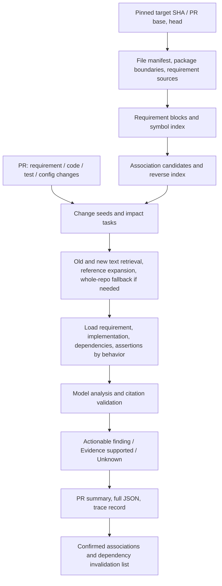
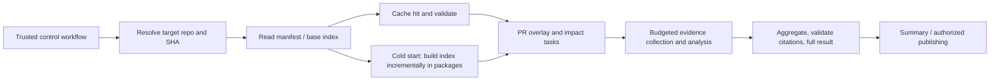

# Bidirectional requirement–code–test location in complex external repositories: research and a SpecGuard landing plan

> **Disposition status (2026-10-17, main 45713a2):** research proposal, not implemented; the recall of the existing retrieval is being measured on fastify before any index is built; that scan_paths restricts requirement/test search at the same time has been verified and a fix is in progress; #235 throughput has been measured (nest 24+8, TypeScript 17+7 units per run). Line numbers and SHAs are as of the time this document was written.

Date: 2026-10-17 (Australia/Sydney). The research uses public primary sources, and, through the GitHub plugin, read the seven collection/execution-related files and post.js of the pinned SpecGuard version da1579313a856edced3516021c827e6cd502c57b (00:36:18 UTC, when #233 was merged). At the end, the increment of the newly merged #235 was also checked; the latest observed main branch is 45713a26e62b60db0b8474bbd4eb42894e1fbbfa. The root workspace is still on the older branch b1aaf113; this document separates the pinned source baseline from later increments, to avoid taking old local code for current capabilities.

**Core recommendation: build a version-maintained "requirement–behavior–symbol–test" association index, use it to narrow the PR's impact scope, and then organize cross-file evidence by behavior obligation.** A thousand-line file is not in itself a reason to hand it whole to the model; locating one match is also not proof that the implementation or the tests are sufficient. First supply stable identity, association provenance, incremental invalidation and evidence collection, and then use benchmarks to decide whether to add semantic vectors, an exact symbol index or dedicated data-flow analysis.

The deliverable of this round is a research and design report; it did not implement a new index, start an external scan, run a paid model, install analysis tools or measure latency. The new data structures, process budgets and performance targets in the text are all proposals, not interfaces the current Action supports. The implementation files and the list of 18 primary sources are in the [research sources and baseline record](/C:/Files/Projects/SpecGuard/docs/complex-repository-traceability-research-sources-2026-10-17.json).

## 1. Understanding the requirement: which practical questions to answer

The capability you want can be split into five acceptable questions:

1. Given an unfamiliar external repository, quickly know where the requirements are, which modules implement them, and which tests protect those modules.
2. In a 1000–5000 line file where only a little code changed, locate the complete related behavior and its cross-file dependencies.
3. When a PR changes only a requirement, still find the implementations and tests that were not changed together but should be affected.
4. When a PR changes only code, find the unchanged requirements that constrain it, and identify the case where the code and tests deviate from the requirement together.
5. For each PR, do not repeatedly pay to read the whole repo, while stating clearly which relationships are reliable, which are only candidates, and which have not yet been searched.

What is finally handed to the author should be "this requirement change affects these implementations and these assertions; of these, this one behavior is still unproven, and the next step is to check what", not a long list of similar files.

Three more questions need to be distinguished: **locating related positions, analyzing change impact, and verifying that behavior matches the requirement**. The three can share evidence, but cannot share a single "covered" state.

## 2. What SpecGuard can currently do, and the real boundaries

The following are code facts at the pinned SHA, not a list of new features.

| Capability | Current implementation | Boundary in complex repositories |
|---|---|---|
| Requirement discovery | Identify documents by content, supports Markdown/text/Gherkin etc.; requirements_paths is configurable | Not every product requirement carries a MUST, nor is it necessarily in docs; external documents and unreadable formats will be missing |
| Requirement change recognition | Pair base/head entries, and identify modification, addition and deletion by ref, heading and similarity | Large-scale rewrites, moves, and splits/merges cannot be guaranteed identity continuity by text similarity alone |
| code→requirement | Retrieve requirements by the hunk's identifiers, context, path and added/removed literals, ranked by BM25 | Synonyms, cross-language and behavior expressed through callers do not necessarily share surface words |
| requirement→code | 40-line window, 20-line step; query production/test candidates by old and new requirement text and literals | Not type resolution or a complete call graph; a text window may cut control flow |
| Indirect test candidates | Rare identifiers in the production window, then look up test references | A same-name text reference is not a call to the same symbol, nor does it prove the assertion constrains the target behavior |
| Long code | scan splits equal-line parts by file size/budget; has a version and shard cursor | Equal-line splits may cut a function; a single-part judgment cannot represent the complete cross-part behavior |
| Long tests | Find test fragments by changed lines and symbols; record truncation and unread | Recognized with regexes of common language forms, not a complete AST; fixtures/helpers may still be outside the window |
| Requirement block batching | scan-parts.js separates unit and document-block calls, and loads evidence windows | Batching controls cost, but global behavior still needs cross-task aggregation and validation |
| Partial dependency invalidation | audit-units versions JS/TS first-level relative import blobs | The current comment states explicitly: does not follow a second level, and does not handle bare packages or Python/Go imports |
| External repository entry | The manual workflow resolves the target repository/PR, checks out, and uses a trusted SpecGuard | An existing entry is not the same as having a persistent whole-repo semantic index |

Code basis: [bidirectional retrieval in trace.js](https://github.com/Mira190/SpecGuard/blob/da1579313a856edced3516021c827e6cd502c57b/src/trace.js#L691), [indirect test candidates](https://github.com/Mira190/SpecGuard/blob/da1579313a856edced3516021c827e6cd502c57b/src/trace.js#L793), [file and import versions](https://github.com/Mira190/SpecGuard/blob/da1579313a856edced3516021c827e6cd502c57b/src/audit-units.js#L23), [context organization](https://github.com/Mira190/SpecGuard/blob/da1579313a856edced3516021c827e6cd502c57b/src/engines/claude-api.js#L90), [batch plan](https://github.com/Mira190/SpecGuard/blob/da1579313a856edced3516021c827e6cd502c57b/src/scan-parts.js#L12).

These existing limits especially need to be remembered:

- The limit for ordinary candidate files of requirementToCode is 256 KiB; a thousand-line file may be entirely within the limit, and a file with a few very long lines may also exceed it. Line count is not the only measure.
- The trace resolution budget is 40 seconds; at most 25 larger requirement changes are traced in depth, and the PR output usually keeps only the first three code/test windows per requirement. Candidates not retained cannot be treated as excluded.
- The audit-units source inventory reads at most 6000 candidates and tests at most 4000, and source files over 512 KiB do not enter that inventory. These are current protection budgets, not proof of supporting whole-repo scale.
- The current API already has a context pack of about 250000 bytes by default; bytes cannot be taken directly as tokens.
- scan_paths currently restricts the requirement, code and test searches at the same time. Setting only some package subtree makes the real associations under central docs or shared fall outside this round's scope.

The numbers above come from the [trace constants](https://github.com/Mira190/SpecGuard/blob/da1579313a856edced3516021c827e6cd502c57b/src/trace.js#L16), [deep tracing and candidate trimming](https://github.com/Mira190/SpecGuard/blob/da1579313a856edced3516021c827e6cd502c57b/src/trace.js#L986), the [inventory limits](https://github.com/Mira190/SpecGuard/blob/da1579313a856edced3516021c827e6cd502c57b/src/audit-units.js#L13) and the [Action inputs](https://github.com/Mira190/SpecGuard/blob/da1579313a856edced3516021c827e6cd502c57b/action.yml).

**Therefore the existing retrieval and evidence layers should be extended; the scan product need not be reinvented, and simply raising the existing limits should not be used to claim complex repositories are solved.**

### 2.1 Which problems this round's new fixes have solved

The pinned baseline of this round already contains several fixes from #226–#234, so the problems in the previous actual-run report cannot be taken as still existing as they were:

- [#229](https://github.com/Mira190/SpecGuard/pull/229) has normalized requirement sources with an entry suffix and adjusted the handling of the missing-test layer; canonSource in post.js can accept a collected source followed by a tag such as U1. The persistent logical_id/revision and the cross-version relationship invalidation recommended by this report are further work on this basis, not redoing the source-string fix.
- [#232](https://github.com/Mira190/SpecGuard/pull/232) decouples bad requirement links from valid test gaps; [#227](https://github.com/Mira190/SpecGuard/pull/227) adjusts the spec-conflict feedback and does not by default require rolling back the implementation. These are product improvements already advanced.
- [#234](https://github.com/Mira190/SpecGuard/pull/234) strengthens slicing of long tests by the diff's own changed lines; [#231](https://github.com/Mira190/SpecGuard/pull/231) allows a unit whose tests cannot fit to advance as unsure; they improve evidence loading and scheduling, and do not mean a cross-file semantic graph has been built.
- [#235](https://github.com/Mira190/SpecGuard/pull/235), newly merged at the end: the Claude API scan arranges multiple unit packs within the same run by budget, with at most 8 unit calls; max_units changes from that engine's per-run selection cap to a per-call cap, and other engines remain single-pack. The plan order is the first unit pack, the document blocks, then the remaining unit packs; units for which the budget is insufficient are recorded as not reached and left for later. It also limits the share taken by very large test collections, so that one unit does not eat the whole pack.

#235 directly improves large-repo throughput and should be reused. Numbers such as "43 Kite units can go from multiple rounds to one round" in its PR are budget estimates / constructed tests and expectations; this round has no new external-repo live run proving that the real functions, tests and requirements have all been fully reviewed. Multiple packs also do not automatically solve cross-pack dependencies, giant-function boundaries or stable requirement identity.

This increment is checked against the PR patch; the other line-number citations remain pinned to da157931, to stay verifiable. Later acceptance should pin the updated tool SHA, and check the number of units selected, the number actually read completely, the number of unsure and not-reached-by-budget, and not just look at the increase in calls.

## 3. External research: which practices are worth borrowing

| Primary source | Practice worth borrowing | Implication and limit for this project |
|---|---|---|
| Anthropic: Context Engineering | Small, relevant context, retrieved on demand; Claude Code combines preset instructions with glob/grep | First have retrieval tools and evidence boundaries; do not preload the whole repo each time. The article is not a completeness guarantee for requirement mapping |
| Anthropic: Contextual Retrieval | Blocks carry context, lexical and semantic hybrid retrieval, candidate rerank | Path, heading, symbol and business context can help recall; a generated summary cannot replace the original text |
| Google: large-scale migrations | Use Code Search, Kythe and static tools to locate, then expand to related tests, interfaces and dependencies | Locate and expand first, then let the model analyze; do not give the model just one huge diff |
| GitHub code navigation | Extract symbol definitions and references, support jumping | The "skeleton first, body later" idea can be borrowed; page navigation is not an API for a complete graph of an arbitrary SHA that can be consumed directly |
| Tree-sitter | Incremental syntax trees, language structure boundaries | Can avoid cutting a function at an arbitrary line count; a syntax tree alone cannot resolve all dynamic calls |
| SCIP | A general index protocol for definitions, references and implementations | Plug in an off-the-shelf indexer for languages needing exact symbol resolution; it is not a complete call graph or a requirement-tracing solution |
| StrictDoc | Explicit requirement UIDs, requirement/source-file and range relationships | Allows manual confirmation of relationships for key requirements; old repos without annotations still need automatic retrieval, and a whole-repo migration cannot be forced |
| Microsoft GraphRAG | Text entity relationships, local and global queries | Can be used for architecture Q&A; an LLM-generated graph cannot serve as compiler semantics or proof that "the implementation satisfies the requirement" |

Sources: [Anthropic context engineering](https://www.anthropic.com/engineering/effective-context-engineering-for-ai-agents), [Contextual Retrieval](https://www.anthropic.com/engineering/contextual-retrieval), [Google migration practice](https://research.google/blog/accelerating-code-migrations-with-ai/), [GitHub code navigation](https://docs.github.com/en/repositories/working-with-files/using-files/navigating-code-on-github), [Tree-sitter](https://tree-sitter.github.io/tree-sitter/), [SCIP](https://github.com/scip-code/scip), [StrictDoc traceability guide](https://strictdoc.readthedocs.io/en/stable/stable/docs/strictdoc_01_user_guide-TRACE.html), [GraphRAG](https://microsoft.github.io/graphrag/).

The inference for SpecGuard is: **lexical retrieval as the reliable base, structure and references provide relationships, semantic retrieval fills expression differences, the model judges concrete behavior, and the validator constrains evidence.** No single source can prove that "adding GraphRAG automatically gets bidirectional requirement assurance". Anthropic's retrieval-improvement numbers also belong to its own test set and cannot be carried over as our effect metrics.

## 4. Recommended architecture: the index may be broad, the model context must revolve around the task



"The index covers the whole repo" means building a manifest and searchable structure for readable assets within budget; "the model reviews the whole repo" requires an actual task and a completion record for each item. The two must be counted separately.

The first version can use compressed JSONL plus a local SQLite or existing storage to implement nodes, edges and inverted retrieval. Stabilize the persistence format first, and the query implementation can be swapped. Do not immediately introduce a separate graph database, vector service or external search cluster just because the relationships look like a graph.

Each package is the preferred retrieval scope and cannot become an uncrossable evidence boundary. It is suggested to distinguish in future:

- primary_scope: which behaviors this round is mainly responsible for judging.
- evidence_scope: which requirements, shared dependencies, tests and contracts may be read.
- excluded_scope: which paths are explicitly not read.

These are proposed semantics; the Action currently has only existing parameters such as scan_paths, and the names above cannot be passed to it directly.

## 5. How requirements should be discovered, chunked and located

### 5.1 First determine the requirement source and the applicable version

Look in the following order, rather than treating all Markdown as requirements:

| Source | Usable content | Handling |
|---|---|---|
| Product specifications and acceptance items designated by maintainers | User-observable behavior, constraints, boundary values | Use as the primary oracle, saving the original text and version |
| PR body / linked issue | The intent of this change, local AC | Record the time the body was fetched and the digest hash; they can be edited independently of commits |
| OpenAPI, Proto, configuration schema | Interface fields, types, ranges, defaults, operation identifiers | Parse structurally first, as a contract anchor; do not treat the whole schema as all the business semantics |
| ADR, design documents | Decision rationale and design constraints | Distinguish still valid, superseded and proposal status |
| README, operating instructions, user-facing copy | User-visible conventions | Judge by content, and allow adding them explicitly; do not exclude or admit them across the board by file name |
| Tests, implementation comments, historical code | Current behavior and background | Provide leads; cannot prove by themselves that "the requirement was originally like this" |
| External document systems | Cross-repo product rules | On integration pin the document revision and permissions; report unknown if inaccessible |

An OpenAPI operationId can serve as an explicit anchor within its document scope, and across services a repository/service namespace must still be added; it cannot represent all the non-functional requirements of an operation. [OpenAPI specification](https://spec.openapis.org/oas/v3.1.0).

Do not set an unconditional rule that "the PR body always overrides the product documents". When sources conflict, output the conflict and the intent to be confirmed; when requirement, implementation and tests are all changed at the same time, they may also be jointly weakening an existing commitment.

### 5.2 One record should correspond as far as possible to one verifiable behavior

Keep for the requirement:

- Stable identity, current revision, source/path/ref/range, heading chain.
- The original text and its conditions, actions, expected results, units, defaults, exceptions, and platform/tenant/version conditions.
- Type: behavior, interface constraint, performance target, UX manual acceptance, background or not yet decided.
- Parent requirement / child requirements, applicable module, owner (if declared).
- Source credibility and status; conditions extracted by a model must not pose as the original text.

For example "before recording starts, the directory must exist, be writable, and have enough space" should be split into related sub-obligations, while keeping the combination relation of the parent entry. When a helper test can prove only one of the conditions, the whole parent behavior cannot be marked green.

When splitting a table into blocks, carry the column names; lists carry the upper-level conditions; Gherkin carries Background and Examples; removing this context makes the independent block meaningless.

### 5.3 Stable identity cannot use only the line number or a content hash

It is recommended to distinguish logical_id from revision:

```json
{
  "logical_id": "repo:example/product:req:REC-DISK-001",
  "revision": "sha256:<normalized-content-and-context>",
  "source": {
    "repository": "example/product",
    "commit": "<full-sha>",
    "path": "docs/recording.md",
    "start_line": 81,
    "end_line": 84
  },
  "heading": ["Recording", "Preconditions"],
  "text": "<exact requirement text>",
  "status": "accepted",
  "applicability": ["desktop"],
  "identity_method": "explicit-id"
}
```

An explicit ID takes priority; without an ID, generate a persistent ID, and use path moves, heading, adjacent blocks and semantic similarity to assist pairing. A content hash denotes only a revision and should not directly bear the identity of "the same requirement".

When one requirement is split into two or two are merged into one, keep supersedes / split_from / merged_from; if the match is ambiguous, leave it to be confirmed, and do not automatically inherit all verified edges. A duplicate ID must be reported as a conflict and not silently overwritten.

## 6. Code over a thousand lines: handle by structure and behavior

### 6.1 A file first gets a "navigable skeleton"

First generate the file summary facts: language, module, imports/exports, the list of definitions and their ranges, key constants/types, route/event/configuration entry points, and the list of test definitions. Generated descriptions are used only to help retrieval, and the source of fact still points back to the code range.

Take a 2400-line recorder.ts as a hypothetical example: the model first sees a few dozen symbols and ranges; the change is in the guard of startRecording, so it locates that function and the precondition checks it calls, rather than first stuffing in the first 600 lines.

Tree-sitter can provide syntactic structure and incremental parsing; language services / SCIP can further resolve reference identity. For parse failures, macros, templates, dynamic construction and unsupported languages, a fallback status must be kept, and an empty index must not be used to mean no relationship. [Tree-sitter](https://tree-sitter.github.io/tree-sitter/), [SCIP](https://github.com/scip-code/scip).

### 6.2 Four long-file situations handled separately

| Situation | Unit of handling | Required context |
|---|---|---|
| Many independent small functions | The changed function/method | Signature, related types and constants, callers/callees, tests |
| One giant function | Branches, state transitions, loop phases | The complete guard, return/throw, shared-state reads and writes, conditions before and after the branch |
| Registry / configuration / large switch | The entry and the dispatch rules | Default branch, key normalization, priority and the registered consumers |
| Large test file | The complete target test / parameterized cases | setup, fixture, mock, helper and the actual assertions |

Do not treat a complete function merely as the upper bound of the chunk size; a single function can also exceed the context budget. In that case first build a control-flow skeleton, split it into sub-obligations, attach to each sub-obligation the key dominating conditions, exception paths and state dependencies, and finally do one overall invariant check.

### 6.3 Semantic chunking first, line windows as a fallback

Each chunk keeps the symbol identity, parent scope, original file SHA and real line numbers, imports, related definitions, and the connection points before and after. The necessary overlap is not a fixed extra 20 lines, but brings along the control-flow and dependency boundaries.

Three kinds of cross-chunk content are especially easy to miss:

1. The guard is in the upper half, the state change in the lower half, and the failure return at the end of the function.
2. The constant is in another file, the unit conversion in the caller, and the comparison condition in a helper.
3. The test calls a wrapper, while the real assertions and fixture are in other files.

Fixed line windows can still serve as a usable fallback for languages without a parser, but must be marked as having insufficient structural completeness. If a boundary needed by a conclusion was not loaded, the conclusion is Unknown, or retrieval continues.

### 6.4 Finishing a fragment is not finishing the file

It is suggested to save at least separately:

- source_ranges_seen: which ranges were actually read.
- structure_complete: whether the structure needed by the target function/branch is complete.
- dependencies_resolved: the dependencies that were resolved, unresolved and truncated.
- obligations_assessed: the behavior obligations already judged.
- counterexamples_checked: which counterexamples were specifically checked this round.

Having read all the lines also does not mean all behaviors have been tested; having reviewed all the shards also cannot automatically prove cross-shard data flow is correct. The case of Kite's old run where app.cjs showed only part 1/2 shows that file-count and line-count progress cannot replace behavior progress.

## 7. Multi-file association: how to expand to the correct call chain

Build typed, sourced edges, and do not call all relationships "related":

| Relationship | Source | What it can prove |
|---|---|---|
| imports / exports / references | parser, module resolver, SCIP | Structural dependency or symbol reference |
| calls / implements | type/call resolution, existing index | A call or implementation relation within the capability scope |
| registers / handles / emits | Recognition of routes, events, DI, message contracts | Entry points and the handling chain; dynamic scenarios may be only candidates |
| reads_config / writes_state | Static analysis or constrained rules | Which configuration/state a behavior depends on |
| requirement_candidate_for | Retrieval and rerank | Candidate positions worth verifying |
| implements_requirement | Confirmed semantic check | Which sub-obligations are implemented in that version |
| test_executes / test_asserts | coverage, call relationships, assertion verification | Executed and actually constraining the behavior must be kept separate |

A relationship stores together method, source ref, evidence, resolution_status and validity_dependencies. A same-name text retrieval is labelled lexical_candidate; a resolved confirmation is labelled resolved_reference, without covering the difference with a uniform confidence score.

Suggested expansion order:

1. The behavior that the changed symbol belongs to and the existing requirement edges.
2. Direct callers, key callees, and the sources of constants/types/configuration.
3. The next hop that may change preconditions or observable results.
4. The execution paths and assertions of related tests; cross-package public APIs, routes, event entry points.
5. Unresolved dynamic edges are searched by string, registered name and contract field; if still unclear, leave a frontier.

The first version can use a regular budget of 1–2 hops, but "done once two hops are reached" does not hold: whatever goes beyond should be listed in the scope to be checked. A shared high-fan-out helper should not stuff the whole repo into the PR; first group by entry point, business domain and change semantics, and then check the high-risk consumers first.

SCIP provides an index protocol for references/definitions and so on, but the capabilities of indexers differ by language, and it cannot automatically be taken as a complete call graph. When cross-function data origin/destination is needed, analyses of the CodeQL kind can be reused for a small number of high-risk tasks; global data flow is more expensive than local, and dynamic calls and aliasing also have bounds. [CodeQL official description](https://codeql.github.com/docs/writing-codeql-queries/about-data-flow-analysis/).

## 8. When a requirement changes, how to quickly find the corresponding code

### 8.1 Recommended step-by-step algorithm

1. Compute the PR's requirement-entry differences, identify additions, modifications, deletions, moves and splits/merges; save both the base/head versions.
2. Extract the concrete semantics of the change: conditions, ranges, values and units, defaults, negation, exceptions, platforms and effective versions.
3. First look up the old associations and explicit IDs/paths/contract anchors; invalidated associations can still serve as location leads, but not as conclusions.
4. Search code and tests with both the old and the new wording; searching the old value is especially important, because an implementation not yet modified retains only the old value.
5. After a lexical search hit, expand to the complete symbol and the related call chain; fuse candidates by module ownership, exact identifiers, values and units, and semantic matching.
6. For new expressions or cross-language concepts, use a controlled glossary or optional semantic retrieval; keep the original query and the expansion source.
7. Rerank the top candidates, and de-duplicate by behavior domain / entry point, to prevent similar windows from one file from crowding out other necessary implementations.
8. Look for implementations, interfaces, clients and tests that are "unchanged but should be affected"; they may not be in the PR diff.
9. Check code and assertions by sub-obligation, and output whether the change is satisfied, to be confirmed, confirmed conflicting, or evidence insufficient.

"Not found" should be subdivided at least into: out of scope, not indexed, parsing unsupported, budget exhausted, unresolved relationship, and no candidate even after the complete set search strategy. The last one is also only "not located at present", not that the implementation does not exist in a mathematical sense.

### 8.2 The type of change determines the query and the verification method

| Requirement change | Retrieval focus | Protection to check |
|---|---|---|
| 100→128 MiB | Old and new values, fields, unit conversion, comparison operator | Both sides of the boundary and the equality semantics; tests must not just reuse the same wrong constant |
| Must be writable→only needs to exist | writable/permission/precheck/directory error paths | Whether it is a deliberate relaxation; whether other upper-level constraints still require writability |
| Default off→default on | Default configuration, migration, UI initial state, client cache | Verify the fresh-install and upgrade-user paths separately |
| At least→strictly greater than | Comparison operator, constraint conversion, validator | The equality boundary |
| Delete requirement | Old ID, old implementation, tests, upper-level dependencies | Do not automatically suggest deleting protection; other requirements may still depend on it |
| Add requirement | Business terms, contracts, similar existing capabilities | Existing code may already satisfy it, but independent evidence is needed |
| Pure rewording or section move | Identity and normative difference | Not all text diffs can be treated as behavior changes |

Numeric search must carry the field and semantics. Searching only "128" will hit buffer, UI, timeout and other irrelevant places; unit normalization must also keep the original text, to avoid confusing MB/MiB, percentage/decimal and seconds/milliseconds.

### 8.3 Fast path after a cache hit

If the old requirement already has valid associations, after the requirement is modified take those symbols and tests directly as the first batch of candidates, and then do one more old/new-term query to check for missed new entry points. Do not look only at the old graph: the new requirement may apply to paths that did not exist before.

The source of speed is avoiding re-understanding the whole repo each time, not reducing refutation or reusing historical conclusions directly as passes.

## 9. When code changes, how to quickly find the corresponding requirement

It is recommended to start from "what behavior does the change represent":

1. Use the merge-base→head difference to determine the introduced change; function deletions and renames must read the base version.
2. Map hunks to symbols and sub-behaviors, and extract the added and removed conditions, literals, error messages, defaults and data access.
3. Look up the symbol→requirement reverse edges, and then find the requirements associated with them through the affected callers / entry points.
4. Retrieve unchanged requirements with old and new identifiers, strings, numbers and business terms; do not look only at this PR's document diff.
5. Read the related test differences together, distinguishing newly added protection, weakened assertions, deleted boundaries, and migration to other files.
6. Check whether the valid requirement conflicts with the new behavior; if it is only a structural refactor, verify that the reference/state/exception semantics are preserved.
7. When no requirement is found, mark the behavior as unassociated or its intent as to be confirmed; do not automatically manufacture a product requirement for every internal helper.

Example: deleting the dirWritable check gives a very short diff, but the association can be located through the variable names, the error path, the precheck callers and the "output directory is writable" requirement. Even if the test is changed in step to allow an unwritable directory, "the test has been updated" cannot be used to prove the implementation conforms to the unchanged requirement. Kite [PR #16](https://github.com/Mira190/Kite/pull/16) is a real seeded case of this kind; see the [actual review re-check](/C:/Files/Projects/SpecGuard/docs/shift-left-live-review-specguard-kite-2026-10-17.md) for details.

Inputs outside the code should also be checked in reverse:

- Changing only a configuration default, feature flag or schema can also change product behavior.
- Changing only tests may remove the original protection, and the affected behavior and requirement still need to be located.
- Changing only a public interface, serialization or event name may affect unmodified consumers.
- Changing only a dependency version, the behavior change does not necessarily have a source hunk, and needs a contract difference or related regression; one cannot pretend that a text diff has analyzed the changes inside the dependency.

## 10. Requirement and code changing at the same time: four states must be looked at

```text
base requirement R0   ↔   merge-base code C0
        ↓ ΔR                     ↓ ΔC
head requirement R1   ↔   head code C1
```

At least four things must be answered:

1. Whether C0 already had a historical deviation relative to R0.
2. Whether R0→R1 is an approved behavior change, an editorial tidy-up, or a weakening of constraints.
3. Whether C1 satisfies the applicable R1, and which retained R0 obligations remain valid.
4. Whether test T1 can independently constrain R1, without losing the old protection that still applies.

| PR situation | Correct handling |
|---|---|
| Requirement changed, code not changed | May already be satisfied, or the implementation may be missing; check the evidence |
| Code changed, requirement not changed | May be a refactor, or may be drift; do not assume the requirement must change along with it |
| Both sides changed and consistent | The change intent, upper-level contracts and migration plan still need to be confirmed |
| Neither side changed but a deviation is found | Record historical debt, and do not attribute it to the current PR |
| Requirement is only a proposal, implementation released in stages | Judge by status and rollout conditions, and keep the deferred obligation |
| Documents conflict with each other | Name the conflict and the owner; do not let the model pick the convenient one |

The roles of the PR's main-branch tip, merge-base, head and the optional merge result must be kept separate: for introduced changes one usually looks at merge-base→head; contracts newly added on the main branch can get a separate integration-risk check; testing of the actual merge result is then bound to the merge SHA. The line numbers and evidence of the three versions must not be mixed together.

The three-dot diff semantics of a GitHub PR start from the common ancestor, so the analyzer should explicitly record the merge-base, and not only some SHA called base. [GitHub diff description](https://docs.github.com/en/pull-requests/reference/branches).

## 11. Data structures and credibility of the association index

### 11.1 Save at least four kinds of records

| Record | Main fields |
|---|---|
| Requirement | logical_id, revision, source, original text, conditions, applicable scope, status |
| Symbol / code region | repo, tree, blob, path, language, qualified name, signature, range, resolution capability |
| Test / assertion | test identity, range, fixture/helper, target behavior, layer, source of execution and results |
| Link / assessment | revisions at both ends, relation type, method, evidence, valid dependencies, confirmer / analysis version, status |

Line numbers are used for navigation within the current version; symbol identity is used for cross-version association; blob and revision are used to prevent misuse of old evidence. Function names are also not permanently stable: a rename needs a resolved relation or similarity migration, and when ambiguous it must not be silently carried over.

### 11.2 An example of a proposed relationship

```json
{
  "link_id": "link:example-001",
  "requirement": {
    "logical_id": "repo:example/product:req:REC-DISK-001",
    "revision": "<requirement-revision>"
  },
  "code": {
    "repository": "example/product",
    "commit": "<target-sha>",
    "path": "src/recording/precheck.ts",
    "symbol": "checkDiskSpace",
    "blob": "<blob-sha>",
    "range": [62, 91]
  },
  "relation": "candidate_implements",
  "discovered_by": ["explicit-id", "lexical", "resolved-reference"],
  "validation": "pending",
  "depends_on": [
    "src/recording/constants.ts:<blob-sha>",
    "test/precheck.test.ts:<blob-sha>",
    "config/defaults.json:<blob-sha>"
  ],
  "unresolved": ["runtime plugin threshold override"]
}
```

This is an illustrative schema, not the current SpecGuard JSON format. Candidate relationships and verified assessments can be stored separately; an explicit manual link also only means the author declared a relationship, and cannot automatically prove that the current implementation satisfies the requirement.

### 11.3 Status on at least three axes

- Location: candidate / confirmed_relation / unresolved / out_of_scope.
- Behavior judgment: supported / contradicted / unknown / not_applicable.
- Verification: static_only / test_executed / counterexample_verified / human_confirmed.

In addition keep the evidence layer unit / integration / e2e / manual. Do not count integration directly as unit, and do not describe "has suitable integration protection" as "has no test at all".

## 12. How to run an external repository scan in GitHub Actions

### 12.1 Separate cold start from the PR fast path



Index initialization can cover the readable assets of the whole repo, but the model first reviews only the high-risk behaviors. If the index is not yet complete at the first PR, review the paths related to it and report the initialization gap, and do not wait for the whole-repo scan to finish before starting feedback.

The baseline index of the trusted default branch is refreshed by trusted push/periodic builds; a PR builds its own overlay. A PR result must not directly overwrite the trusted baseline, and is rebuilt from the merge result or confirmed for promotion after merging.

### 12.2 Boundaries of using the existing entry points

The current [manual workflow](https://github.com/Mira190/SpecGuard/blob/da1579313a856edced3516021c827e6cd502c57b/.github/workflows/specguard-run.yml) already supports:

- target: repository, branch or PR link.
- design_docs, rules_docs, test_dirs.
- model, max_units, max_budget_usd, max_output_tokens.
- post_to_pr and scan_issue for where results go.

Compared with the earlier report, model and some budget inputs are now exposed; the old conclusion that "the interface has none of these switches" cannot be carried over. The manual workflow still does not expose an independent evidence_scope, a general persistent index or the parameters of the full impact tasks; ctx_retention_days is 0 in that workflow, so downloading the raw context cannot be promised.

The existing Action supports configuration such as scan_paths, which a custom adopter workflow can use; they cannot pose as inputs that manual does not provide.

### 12.3 The trust boundary toward external source repositories directly affects the architecture

The control code, the parser version and the model keys are provided by the trusted workflow; external source code, documents, indexes and model answers are all treated as data. Static collection does not need to execute the target's npm install, build scripts, hooks, agent instructions or tests.

If the target tests are to be run or an exact index that must depend on a build is to be generated, put it in an isolated execution environment with no model/write credentials; the artifacts are read only after identity, size, schema and citation checks. For the sake of a "more complete call graph" an untrusted build must not enter a job with a privileged token.

GitHub's job token is mainly limited to the repository of the calling workflow; cross-private-repo reads use appropriately scoped credentials such as a scope-limited App installation token. Reading source code, model processing, posting comments and saving artifacts are different permissions; the readers of the central report and of the index storage cannot be broader than those of the source material. [GitHub token scope](https://docs.github.com/en/actions/concepts/security/compromised-runners), [risks of running untrusted PRs](https://docs.github.com/en/actions/reference/security/securely-using-pull_request_target).

### 12.4 The "change list" of a large PR must not itself be truncated

The PR files REST endpoint is paginated and returns at most 3000 files; the GitHub Actions paths filter also has a file limit on the diff it generates. An important review should not rely only on a narrow path filter, otherwise paths late in a docs-only or large change may not trigger.

After triggering, it is suggested to verify the complete list from the pinned Git objects, using NUL-safe path handling, the actual merge-base and the necessary history; use the API as metadata and a supplement. When a patch is missing, pagination is unfinished, a shallow clone lacks the base, or LFS/submodules are not expanded, record the content not obtained, and do not treat it as no change. [PR files endpoint](https://docs.github.com/en/rest/pulls/pulls#list-pull-requests-files), [workflow syntax and diff limits](https://docs.github.com/en/actions/reference/workflows-and-actions/workflow-syntax).

Do not run textconv/filter or arbitrary diff helpers defined by the external repository in a privileged job; the parsing of untrusted data should also limit resources and path access.

## 13. Incremental updates, caching and evidence invalidation

### 13.1 Cache layers

| Layer | Recommended key composition | Reuse condition |
|---|---|---|
| File parsing | blob SHA + parser/grammar/version + options | Content and parsing semantics are the same |
| Requirement extraction | original text / parent-context hash + extractor/schema | Conditions, heading context and extraction rules are all unchanged |
| Retrieval index | repo/tree, scope, tokenization/embedding version | Version and retrieval space are explicit; PR has an overlay |
| Association candidates | Revisions at both ends + method/config | Can serve for location, does not automatically serve as a behavior pass |
| Verified judgment | Requirement, implementation, tests, dependencies, configuration and analysis protocol version | All relevant dependencies are still valid and the applicable conditions are the same |

An identical blob allows file parsing to be reused; but a change in package resolution configuration, in tsconfig path aliases, in interface types, or in the dependency lockfile may make the reference relationships different for the same source code.

### 13.2 Invalidating only the "directly modified files" is not enough

After reverse dependencies are built, look up the affected assessments in reverse from the modified node. Related categories include imports, callers, configuration reads, generation sources, contracts, inheritance/implementation, test helpers/fixtures and runtime flags.

For a resolved graph, the closure can be computed along the reverse edges; a high-fan-out or incomplete graph needs limited scheduling and a report of the pending set. For dynamic relationships whose completeness cannot be guaranteed, make up for it with package contract versions, configuration fingerprints, conservative re-checks and periodic reconciliation. "Not touched this round" must not be mistaken for "not affected".

Two kinds of change that are easy to miss deserve special attention:

- The original retrieval graph had no certain edge, but a new requirement or a new file creates it: the affected task should still get one round of old/new text retrieval.
- Changes in the global document statistics of BM25, or an upgrade of the vector model or tokenization, may change the ranking: do not reuse old top-K results indefinitely.

### 13.3 Merging the trusted baseline with the PR overlay

Results of the same PR at different heads are distinguished by head and run attempt; when an older run finishes it cannot overwrite the latest summary or cursor. Cross-job aggregation is de-duplicated by the determined task ID and target SHA, and failed items are kept separately.

Publication of a new main-branch index uses an immutable version + an updated pointer; concurrent updates use version conditions to avoid overwriting each other. A rename keeps a migration record, and a deleted node keeps a tombstone to explain historical links.

The GitHub cache is an acceleration tool, not an immutable evidence store; its accessibility is tied to the branch/fork scope, credentials should not be put in it, and the audience of a shared cache across private repos in particular needs to be checked. The small result ledger and the full evidence should be stored separately and have their own retention. [GitHub cache documentation](https://docs.github.com/en/actions/reference/workflows-and-actions/dependency-caching).

Sourcegraph likewise treats indexing frequency and commit freshness as a practical trade-off; its approach does not exempt us from version-checking each piece of evidence. [Description of integrating SCIP into CI](https://7.3.sourcegraph.com/code-navigation/how-to/adding-scip-to-workflows).

## 14. How to be "fast", and know where the speed comes from

The first version is recommended to use three tiers of retrieval:

| Tier | Operation | When to escalate |
|---|---|---|
| Fast path | Old associations, explicit IDs, exact symbols/strings, old and new literals, lexical index | No candidates, conflicting candidates, or missing cross-file evidence |
| Expansion path | Package neighborhood, reference relationships, configuration/types/entry points, candidate rerank | No lexical overlap, multiple domains competing for candidates, dynamic relationships |
| Deep path | Optional embedding, controlled agent retrieval, dedicated data flow or isolated verification | High risk and the existing paths are still insufficient |

Semantic retrieval first helps with cross-language, domain synonyms and conceptual expression; exact values, negation, paths and symbols still need independent channels. Rank fusion can merge the rankings of different retrievers, and then candidates are kept by source and behavior domain; do not directly add uncalibrated BM25, vector and model scores.

Keep a minimum evidence budget for each behavior, and split oversized tasks; continue retrieval only for unresolved obligations. Caching repeated fragments, reading Git blobs in batches, reusing parsing and updating only the delta are usually more valuable than traversing all files once per requirement. The existing batched cat-file and the one-time candidate window index should be reused.

An example of an engineering budget to be tested: for a medium-sized repository whose initialization is complete, the warm-state location phase has an initial target of 5–20 seconds, and the first batch of actionable PR feedback has a target of 60–120 seconds; cold start and deep verification are reported separately. **These are not existing measured SLOs, nor commitments for repositories of any scale.** Not having reached the time budget cannot be treated as completion, and when the budget is reached the unresolved tasks and a resumable cursor are output.

Resource allocation must also ensure: reserve the whole-run budget before shard concurrency; each task's failure/timeout can be recovered separately; high-risk tasks go first, but low-priority tasks must not starve forever. Report the age of pending items and the actual progress, and not just that the model was called once more.

## 15. How a PR report should be presented

### 15.1 The first screen answers the author's four questions

The first screen is recommended to contain only:

1. The behavior and requirement this PR actually changes.
2. The concrete differences and evidence that the author needs to handle.
3. The affected but unmodified key code/tests.
4. The scope not completed this round and the reason.

Each finding provides the requirement original text / version, the implementation range, the test/assertion, the concrete counterexample or unmet condition, and the minimal next step. Format/source protocol errors should be fixed by the tool first, rather than directly asking the author to "write another test".

### 15.2 The full result can be traced back item by item

Three tables are recommended to be delivered together:

- Requirement impact table: changed entry → old/new implementation → tests → status.
- Code impact table: changed symbol → applicable requirements → unchanged consumers → relationships to be confirmed.
- Scope ledger: the denominators for the index, actual reads, unresolved, budget deferrals and executed verification.

For example the following purely hypothetical report rows:

| Change | Location result | Judgment | Next step |
|---|---|---|---|
| REC-DISK-001: 100→128 MiB | precheck.ts, constants.ts, precheck.test.ts, settings-UI hint | The constant is updated; no independent assertion for the 127/128 boundary was seen | Add behavior assertions on both sides, confirm the UI copy |
| settings default value change | The spec is still the old one; two consumers, migration and UI | The fresh-install path is supported, the upgrade path is Unknown | Check the migration / existing user configuration |
| Failure return at the end of a very long function | The function it is in has been read, the external event handler is unresolved | No overall-conformance conclusion can be given | Extend to the handler, or list as to be confirmed |

Show first what helps the author's decision; the full trace is expanded for troubleshooting, and implementation-internal enumeration is not piled into the user's flow.

## 16. Observability: requirement tracing and run tracing must be separate

"Requirement-to-code traceability" denotes an evidence relationship; the "run trace of a scan" denotes the execution process of collection, retrieval, model, validation and publishing. The two are linked by assessment/task IDs, but cannot be mixed into one thing.

Recommended run spans:

```text
review.run
 ├─ target.resolve
 ├─ index.restore / index.delta
 ├─ requirement.diff
 ├─ impact.plan
 ├─ task.retrieve
 ├─ task.expand_dependencies
 ├─ task.pack
 ├─ model.call
 ├─ evidence.validate
 └─ result.persist / result.publish
```

Record at least target/base/merge-base/head, tool SHA, schema, run/attempt, task ID, source revision, index version, number of candidates, selection reason, unread scope, tokens/bytes, model cost, per-stage duration and the final degradation reason.

OpenTelemetry's spans, attributes and asynchronous span links can carry these run records; across GitHub jobs, links can be used to associate, without forcing them into a single parent-child call. The first version can also save JSON with the same semantics first and then decide whether to connect an observability backend. [OpenTelemetry Traces](https://opentelemetry.io/docs/concepts/signals/traces/).

Metrics must not treat execution success as semantic correctness: an HTTP 200 with no valid source citation should count as model call completed and evidence validation failed; when the budget ends it is deferred, not missing implementation. Logs do not upload complete private source by default, and metrics do not make all requirement IDs / paths into high-cardinality labels.

## 17. How to prove that this plan is indeed better for shift left

### 17.1 Evaluate retrieval, relationships and the final review separately

| Layer | Metric | What must not be confused |
|---|---|---|
| Candidate retrieval | recall@K and MRR for code→req and req→code separately; recall of the set of key entry points | Finding any one similar file does not mean all required implementation sites were found |
| Relationship accuracy | Precision of verified candidates, wrong associations, unresolved rate | An explicit link or the same name does not automatically equal a correct implementation |
| Evidence loading | Proportion of original candidates hit but whose context was not loaded, structural completeness rate | Retrieval failures and pack failures are separated |
| Behavior judgment | Valid gaps, wrong missing/covered, requirement-drift detection | The model's self-reported confidence is not calibrated accuracy |
| Incremental consistency | Differences in tasks/relationships between delta and a same-version full rebuild, misuse of old evidence | Incremental that is fast but misuses historical conclusions is unacceptable |
| Engineering performance | Cold/warm p50/p95, peak memory, total run cost, scan progress | A single model latency does not represent the user's wait |
| Actual value | Confirmation before merge, adding protection / fixing implementation, later CI, valid unique findings | Many runs and many comments cannot prove QA rework was saved |

The qrels (the human-annotated set of correct relevant items) should allow multiple necessary implementations for one requirement and multiple requirements for one symbol; labels that cannot be determined keep unsure. For key entry points, a metric of "the necessary set fully recalled" is also needed, so that recall does not reward hitting just one of the files.

### 17.2 Build an evaluation set representative of the complexity

It is suggested to first sample in strata the following situations, each with normal controls and real gaps, rather than only doing positive seeds that are easy to hit:

- Head/middle/tail changes in files of 1000+ lines; a giant function's cross-chunk guard, state and return.
- Multiple packages, aliases, barrel re-exports, wrappers, inheritance/interfaces, events and DI.
- Chinese requirements / English implementation, different business terms, similar modules and same-name symbols.
- Requirement-only, code-only, test-only, both sides modified in sync, existing drift.
- Changes in values/units/negation/exceptions/defaults/platform conditions.
- Rename, move, split/merge, deletion; external document revision and independent PR body edits.
- Dependency changes of one level, two levels and deeper, configuration and fixture changes; unchanged files being affected.
- New modules creating edges that did not exist before, index cold start / staleness, parse failures, budget interruption and concurrent old runs.

Pin the repository SHA, tool/model/prompt/budget, and annotate the candidate-location layer and the final-judgment layer separately. The tuning set is separate from the held-out repositories/samples; historical bug replay may only be given the requirements and code visible at that time, and the later fix text must not leak into query hints.

The new basic correctness thresholds can be set as: invalid/expired citations must not produce "evidence supported", deferred scope must not disappear from the denominator, and an old run does not overwrite a new head. Recall, precision and latency targets are then determined by experiments, and cannot be declared met before there is an annotated set.

## 18. Phased landing: what to do first, what to defer

| Order | Work | Reviewable deliverable and acceptance |
|---|---|---|
| P0 | On top of the existing source normalization, add persistent requirement identity, revision, evidence status and unresolved reasons | Does not repeat #229; moving/modifying the same requirement does not silently mix things up, and a format error does not pose as a missing test |
| P0 | Structured impact tasks, reading both old and new versions of the requirement and both sides of the code | docs-only/code-only/test-only all generate related obligations; deletion evidence is not lost |
| P0 | Behavior evidence pack and full result saving | The tail of a thousand-line file, long tests and helpers can be located; gaps are explicitly Unknown |
| P1 | Reuse the existing lexical retrieval, persist nodes/reverse relationships and the PR overlay | Incremental and full runs are consistent; includes configuration/dependency invalidation and re-checking for new edges |
| P1 | Prioritize structural parsing and module resolution for JS/TS, with an explicit fallback for other languages | Aliases, re-exports and cross-file tests are verifiable; unsupported edges do not pose as successfully resolved |
| P1 | Cold/warm benchmarks for external repositories and a version-controlled canary | Independent retrieval and review metrics, real cost and unfinished scope |
| P2 | Add semantic retrieval and rerank for tasks that genuinely lose out on lexical differences | The held-out set shows incremental gain, and no more wrong covered is caused |
| P2 | Reuse the target's existing SCIP / language-service indexes; connect dedicated analysis for high-risk tasks | Connect by language/repository benefit, without requiring every repository to install a full build environment |
| P2 | Link fix commits, CI and manual confirmation, and run a real team pilot | Connect early discovery to effective fixes, and evaluate the incremental value |

The first version needs no dedicated trained model, no self-built call graph for every language, no expensive per-chunk summary generation across the whole repo, and no separate GraphRAG platform. Whether to upgrade these capabilities is decided by "on which kinds of real samples the location is missed, how large the impact is, and what the minimal remedy is".

The next concrete engineering task is suggested to be limited to: **add a reviewable behavior impact task between the existing trace-candidates and the pack, first solving requirement identity, old/new two-sided retrieval, structural context and the unresolved frontier; verify first with JS/TS and complex Kite/SpecGuard files.** A persistent index is then used to accelerate the retrieval flows already shown to be effective, rather than building a large index first and then looking for a use.

## 19. Finally answering the initial questions

- **How to scan a large external repo?** Pin the trusted tool and the target version, first build a manifest of assets / packages / requirements / symbols; schedule incrementally by behavior task, the model handles only the relevant evidence, and unfinished tasks are persisted.
- **What about files over 1000 lines?** Locate the function/branch by structure, attaching global dependencies and tests; split a giant function into sub-obligations and then aggregate, without relying on reading the first N lines.
- **When a requirement changes, how to find the code?** Old associations + explicit anchors + old/new text/value retrieval + reference expansion, especially looking for unchanged implementations and tests.
- **When code changes, how to find the requirement?** Changed symbols / old and new behavior + reverse associations + affected entry points + retrieval of unchanged requirements, without requiring every helper to carry a requirement label.
- **How to ensure it serves the goal?** Accept by retrieval recall, evidence accuracy, effective pre-merge intervention and a fix loop; expanding scan volume and adding context can only count as means.

At this stage it cannot be guaranteed that all requirement relationships will be found or all errors discovered; what can be guaranteed by engineering is version consistency, visible scope, reviewable evidence, unknowns not posing as coverage, and every confirmed finding being traceable to its later disposition.

## 20. End-to-end example: an 1800-line file, multiple entry points and a requirement threshold change

The following is entirely a hypothetical repository, used to show the algorithm and acceptance, and is not the conclusion of a real scan:

```text
docs/recording.md                  REC-DISK-001: free space before start must not be below 100 MiB
src/recording/recorder.ts          1800 lines; startRecording at lines 1450–1540
src/recording/precheck.ts          checkDiskSpace at lines 60–90
src/recording/constants.ts         MIN_FREE_BYTES = 100 * 1024 * 1024
src/ui/StartPanel.tsx              UI entry point, calls startRecording
src/cli/record.ts                  CLI entry point, may pass in a threshold override
test/precheck.test.ts              tests the helper directly
test/recording.integration.ts      integration protection for the end-to-end start flow
```

### 20.1 Only the requirement changes 100→128 MiB, the code is not changed

Step one, the requirement difference keeps R0=100, R1=128, the unit MiB, the pre-start condition and the comparison boundary. Searching the new value 128 alone is likely to find no old implementation at all; so search at the same time for 100, free space, the start check, the explicit requirement ID and the old associations.

Step two, the lexical hit is the 100 in constants.ts, but that is just a constant. Following references finds the comparison in precheck.ts, and then startRecording in recorder.ts. Load only the complete function at 1450–1540 and the related types/imports, and do not treat the first 1000 lines as necessary context.

Step three, check the two entry points: the UI uses the default threshold, and whether the CLI passes its own value. The helper's test may protect the default path but does not guarantee the CLI override path. A dynamic override that cannot be resolved keeps that item Unknown.

Step four, give the new requirement a verifiable counterexample: if the current default implementation allows starting at 127 MiB, it conflicts with the new requirement. Whether the 128 MiB boundary should be allowed or rejected is determined by the semantics of "not below"; also check the existing contract for unknown remaining space null, negative values and unit conversion.

Step five, the report asks only for the relevant fixes: align the default implementation with the applicable entry points, and add independent 127/128 MiB behavior assertions. A test that constructs its input only with MIN_FREE_BYTES - 1 may still pass while the production threshold is still 100, and cannot independently verify the new requirement.

The final output should be similar to:

| Sub-obligation | Evidence | Status |
|---|---|---|
| The default start path conforms to the new 128 MiB limit | Requirement R1, constants, precheck, startRecording | A conflict can be statically confirmed; can be verified further with the 127 MiB counterexample |
| The CLI does not bypass the same limit | The source of the CLI override is unresolved | Unknown, pointing out the specific unresolved edge |
| The new boundary has an independent assertion | The target tests, fixtures and related assertions have been read | If there really is no corresponding assertion, a gap can be reported; if not fully read, Unknown |

### 20.2 Only the code changes 100→128, the requirement is still 100

The reverse index finds REC-DISK-001 from the constant and precheck; the query for the old value 100 provides another independent candidate. The old requirement allows 110 MiB and the new implementation rejects it; it may be a tightening not confirmed by the spec, or a deliberate change where the acceptance text was forgotten.

At this point the conflict and the affected inputs should be shown, and confirmation of the intent requested. Do not uniformly demand that the code revert to 100, and do not automatically change the document to 128. The behavior changes for existing users, the CLI and the UI all belong to impact analysis.

### 20.3 Requirement, constant and unit test all changed to 128

All three being consistent is still not enough: the CLI may keep a hard-coded 100, an upgraded configuration may still write the old value, or the UI hint may still claim 100. Cross-file relationships let the analyzer include these unchanged consumers, instead of reviewing only the three changed files.

If these places explicitly do not fall within the applicable scope of this requirement, record not applicable and the basis; if they belong to a later phase of the rollout, keep the deferred obligation; without evidence they cannot be silently excluded.

These three situations use the same set of nodes, bidirectional relationships and original-text evidence, but the query seeds and conclusions differ. It shows why "persistent association + old/new retrieval + reference expansion + applicability-condition checking" is closer to the goal than "finish once a similar chunk finds one".

## 21. What was not verified this round

No new index/chunking scheme was implemented or measured; no arbitrary large external repository was read completely, none of its code was executed, no SCIP integration was tested, and the actual gain of embeddings or a deep call graph was not measured. The existing source constants and workflow inputs are as of the SHA pinned in this document; later changes should be re-checked. The product capabilities in the research all come from public materials, and do not represent knowledge of vendors' internal, non-public requirement review processes.
