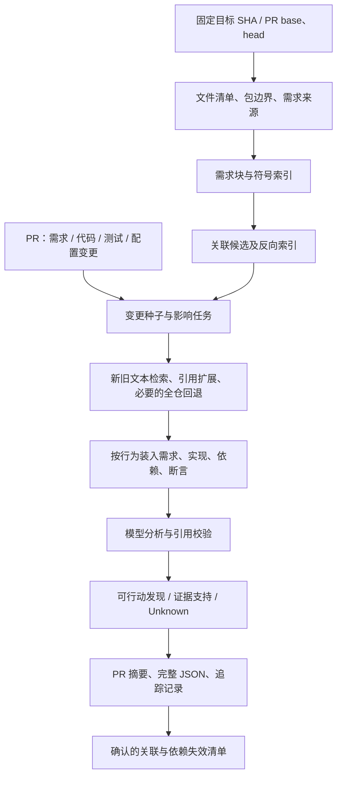

# 复杂外部仓库的需求—代码—测试双向定位：调研与 SpecGuard 落地方案

> **处置状态（2026-10-17，main 45713a2）：** 研究提案，未实现；建索引前正在 fastify 上实测现有检索召回；scan_paths 同时限制需求/测试搜索已核实，修复进行中；#235 吞吐已实测（nest 24+8、TypeScript 17+7 个 unit/次）。行号与 SHA 以本文写作时为准。

日期：2026-10-17（Australia/Sydney）。调研使用公开一手资料，并通过 GitHub 插件读取 SpecGuard 固定版本 da1579313a856edced3516021c827e6cd502c57b（00:36:18 UTC，#233 合入）的七个收集/执行相关文件及 post.js。另在收尾核查了新合入 #235 的增量，最新观察主分支为 45713a26e62b60db0b8474bbd4eb42894e1fbbfa。根工作区仍为较旧分支 b1aaf113；本文区分固定源码基线与后续增量，避免把旧本地代码当成当前能力。

**核心建议：建立按版本维护的“需求—行为—符号—测试”关联索引，用它缩小 PR 的影响范围，再按行为义务组织跨文件证据。** 千行文件本身不是必须交给模型整读的理由；定位到一处匹配也不是实现或测试充分性的证明。先补稳定身份、关联来源、增量失效和证据收集，再用基准决定是否加入语义向量、精确符号索引或专门数据流分析。

本轮产物是研究与设计报告，没有实现新索引、启动外部扫描、运行付费模型、安装分析工具或实测延迟。文中的新数据结构、流程预算、性能目标均为提案，不是当前 Action 已支持的接口。实现文件与 18 项一手来源清单见[调研来源与基线记录](/C:/Files/Projects/SpecGuard/docs/complex-repository-traceability-research-sources-2026-10-17.json)。

## 1. 对需求的理解：要回答哪些实际问题

你要的能力可以拆成五个可验收问题：

1. 给一个陌生外部仓库，快速知道需求在哪里、由哪些模块实现、哪些测试保护它们。
2. 一个 1000–5000 行文件中，只改了很少代码，能定位到相关完整行为及其跨文件依赖。
3. PR 只改 requirement，仍能找到没有一起修改、但应受影响的实现和测试。
4. PR 只改 code，能找到约束它的未变需求，识别代码与测试一起偏离需求的情况。
5. 每次 PR 不重复花钱读全仓，同时明确哪些关系可靠、哪些只是候选、哪些还没搜到。

最终交给作者的应是“这条需求变化影响这几处实现和这些断言；其中这一个行为仍未证实，下一步应核对什么”，而不是一大串相似文件。

还要区分三个问题：**定位相关位置、分析变更影响、验证行为符合需求**。三者可以共用证据，但不能共用一个“covered”状态。

## 2. 当前 SpecGuard 已有能力与真实边界

以下是固定 SHA 的代码事实，不是新增功能清单。

| 能力 | 当前实现 | 复杂仓库中的边界 |
|---|---|---|
| 需求发现 | 按内容识别文档，支持 Markdown/文本/Gherkin 等；可配置 requirements_paths | 不是所有产品需求都带 MUST，也不一定在 docs；外部文档、不可读格式会缺失 |
| 需求变更识别 | base/head 条目配对，按 ref、heading 和相似度识别修改、增删 | 大规模重写、移动、拆分/合并不能仅靠文本相似度保证身份连续 |
| code→requirement | hunk 的标识符、上下文、路径、增删字面值检索需求，BM25 排序 | 同义词、跨语言和通过调用者体现的行为不一定有词面重合 |
| requirement→code | 40 行窗口、20 行步长；新旧需求文本与字面值查生产/测试候选 | 不是类型解析或完整调用图；文本窗口可能切开控制流 |
| 间接测试候选 | 生产窗口中的稀有标识符，再查测试引用 | 文本同名引用不等于调用相同符号，也不证明断言约束目标行为 |
| 长代码 | scan 按文件大小/预算拆等行数 part；有版本与分片 cursor | 等行数可能切断函数；单片判断不能代表完整跨片行为 |
| 长测试 | 根据变更行和符号找测试片段；记录截断与未读 | 使用常见语言形式的正则识别，不是完整 AST；fixture/helper 仍可能在窗口外 |
| 需求块分批 | scan-parts.js 分离 unit 与文档块调用，装入证据窗口 | 分批可控制成本，但全局行为还需跨任务汇总和校验 |
| 部分依赖失效 | audit-units 对 JS/TS 第一层相对 import 的 blob 计版本 | 当前注释明确：不追第二层，不处理 bare package、Python/Go import |
| 外部仓库入口 | manual workflow 解析目标仓库/PR，checkout，使用受信 SpecGuard | 已有入口不等于具有持久化的全仓语义索引 |

代码依据：[trace.js 的双向检索](https://github.com/Mira190/SpecGuard/blob/da1579313a856edced3516021c827e6cd502c57b/src/trace.js#L691)、[间接测试候选](https://github.com/Mira190/SpecGuard/blob/da1579313a856edced3516021c827e6cd502c57b/src/trace.js#L793)、[文件与 import 版本](https://github.com/Mira190/SpecGuard/blob/da1579313a856edced3516021c827e6cd502c57b/src/audit-units.js#L23)、[上下文组织](https://github.com/Mira190/SpecGuard/blob/da1579313a856edced3516021c827e6cd502c57b/src/engines/claude-api.js#L90)、[分批计划](https://github.com/Mira190/SpecGuard/blob/da1579313a856edced3516021c827e6cd502c57b/src/scan-parts.js#L12)。

需要尤其记住这些现有限制：

- requirementToCode 的普通候选文件上限为 256 KiB；千行文件可能完全在上限内，少量超长行的文件也可能超限。行数不是唯一尺度。
- trace 解析预算为 40 秒；最多 25 个较大需求变更深入追踪，PR 输出最终通常只保留每条需求前三个代码/测试窗口。没有保留的候选不能当作已排除。
- audit-units 的源码清单最多读取 6000 个候选、测试最多 4000，源码文件超过 512 KiB 不进入该 inventory。它们是当前保护预算，不是可支持全仓规模的证明。
- 当前 API 默认已有约 250000 bytes 的 context pack；bytes 不能直接视为 tokens。
- scan_paths 当前同时限制需求、代码与测试搜索。只设某个 package 子树，会让位于中央 docs 或 shared 下的真实关联在本轮范围外。

上述数字来自[trace 常量](https://github.com/Mira190/SpecGuard/blob/da1579313a856edced3516021c827e6cd502c57b/src/trace.js#L16)、[深入追踪和候选裁剪](https://github.com/Mira190/SpecGuard/blob/da1579313a856edced3516021c827e6cd502c57b/src/trace.js#L986)、[inventory 上限](https://github.com/Mira190/SpecGuard/blob/da1579313a856edced3516021c827e6cd502c57b/src/audit-units.js#L13)、[Action 输入](https://github.com/Mira190/SpecGuard/blob/da1579313a856edced3516021c827e6cd502c57b/action.yml)。

**因此，应扩展现有检索与证据层，不必重新发明 scan 产品；也不应仅把现有上限调大就宣称解决复杂仓库。**

### 2.1 本轮新 fix 已解决哪些问题

本轮固定基线已经包含 #226–#234 中的多项修复，不能把上一份实际运行报告里的问题原样认定为仍存在：

- [#229](https://github.com/Mira190/SpecGuard/pull/229) 已规范化带条目后缀的需求来源，并调整缺失测试层级的处理；post.js 的 canonSource 可接受已收集来源后附 U1 等标签。本报告建议的持久 logical_id/revision、跨版本关系失效，是在此基础上的进一步工作，不是重做来源字符串修复。
- [#232](https://github.com/Mira190/SpecGuard/pull/232) 将坏需求链接与有效测试缺口解耦；[#227](https://github.com/Mira190/SpecGuard/pull/227) 调整规格冲突反馈，不默认要求回退实现。这些属于已推进的产品改进。
- [#234](https://github.com/Mira190/SpecGuard/pull/234) 加强长测试按 diff 自身变更行切片；[#231](https://github.com/Mira190/SpecGuard/pull/231) 允许测试装不下的 unit 以 unsure 推进；它们改善证据装入和调度，不等于已经建立跨文件语义图。
- 收尾时新合入 [#235](https://github.com/Mira190/SpecGuard/pull/235)：Claude API scan 在同一 run 内按预算安排多个 unit pack，最多 8 次 unit 调用；max_units 从该引擎每 run 的选择上限变为每 call 的上限，其他引擎仍单 pack。计划顺序为首个 unit pack、文档块、其余 unit packs；预算不足的 unit 记 not reached 并留待后续。另限制超大测试集合所占份额，避免一个 unit 吃掉整个 pack。

#235 直接改善大仓吞吐，应复用。其 PR 中“43 个 Kite 单元可从多轮变一轮”等数字属于预算推算/构造测试及预期，本轮没有新外仓实跑来证明真实函数、测试和需求都已完整审查。多 pack 也没有自动解决跨 pack 依赖、巨型函数边界或稳定需求身份问题。

这一增量以 PR patch 为核查依据；其余行号引用仍固定于 da157931，保持可复核性。后续验收应固定更新后的工具 SHA，并检查 unit 选择数、实际完整读取数、unsure 与未达到预算的数量，而不是只看 calls 增加。

## 3. 外部调研：哪些做法值得借鉴

| 一手来源 | 可借鉴的做法 | 对本项目的启示与限制 |
|---|---|---|
| Anthropic：Context Engineering | 小而相关的上下文，按需检索；Claude Code 结合预置说明与 glob/grep | 先有检索工具和证据边界；不用每次预装整仓。其文章不是需求映射完整性保证 |
| Anthropic：Contextual Retrieval | 块附带上下文，词法与语义混合检索，候选 rerank | 路径、标题、符号和业务上下文可帮助召回；生成摘要不能替代原文 |
| Google：大规模迁移 | 用 Code Search、Kythe、静态工具定位，再扩展相关测试、接口及依赖 | 先定位与扩展，再让模型分析；不是只给模型一个巨大 diff |
| GitHub 代码导航 | 提取符号定义与引用，支持跳转 | 可借鉴“先骨架后正文”；页面导航不等于可直接消费的任意 SHA 完整图 API |
| Tree-sitter | 增量语法树、语言结构边界 | 可以避免按任意行数切断函数；单靠语法树不能解析所有动态调用 |
| SCIP | 定义、引用、实现的通用索引协议 | 对需要精确符号解析的语言接现成 indexer；它不是完整调用图或需求追踪方案 |
| StrictDoc | 显式需求 UID、需求/源文件和范围关系 | 对关键需求允许人工确认关系；没有标注的旧仓仍需自动检索，不能强制全仓迁移 |
| Microsoft GraphRAG | 文本实体关系、局部与全局查询 | 可用于架构问答；LLM 生成的图不能充当编译语义或“实现满足需求”的证明 |

来源：[Anthropic 上下文工程](https://www.anthropic.com/engineering/effective-context-engineering-for-ai-agents)、[Contextual Retrieval](https://www.anthropic.com/engineering/contextual-retrieval)、[Google 迁移实践](https://research.google/blog/accelerating-code-migrations-with-ai/)、[GitHub 代码导航](https://docs.github.com/en/repositories/working-with-files/using-files/navigating-code-on-github)、[Tree-sitter](https://tree-sitter.github.io/tree-sitter/)、[SCIP](https://github.com/scip-code/scip)、[StrictDoc 追踪说明](https://strictdoc.readthedocs.io/en/stable/stable/docs/strictdoc_01_user_guide-TRACE.html)、[GraphRAG](https://microsoft.github.io/graphrag/)。

对 SpecGuard 的推论是：**词法检索作为可靠底座，结构与引用提供关系，语义检索补表达差异，模型判断具体行为，验证器约束证据。** 不存在一篇资料能证明“加 GraphRAG 就自动获得双向需求保障”。Anthropic 的检索改进数字也属于它的测试集，不能搬成我们的效果指标。

## 4. 推荐架构：索引可以广，模型上下文必须围绕任务



“索引覆盖全仓”指在预算内对可读资产建立清单和可检索结构；“模型审查全仓”则要逐项有实际任务与完成记录。二者必须分别统计。

第一版可用压缩 JSONL 加本地 SQLite 或已有存储实现节点、边和倒排检索。持久化格式先稳定，查询实现可替换。不因关系像图，就立刻引入独立图数据库、向量服务、外部搜索集群。

每个 package 是检索优先范围，不能成为不可穿越的证据边界。建议未来区分：

- primary_scope：本轮主要负责判断哪些行为。
- evidence_scope：允许读取哪些需求、共享依赖、测试与契约。
- excluded_scope：哪些路径明确不读取。

这是拟议语义，目前 Action 只有 scan_paths 等既有参数，不能把上述名称直接传给它。

## 5. 需求应该如何被发现、分块和定位

### 5.1 先判断需求来源与适用版本

按以下顺序找，而不是把全部 Markdown 当需求：

| 来源 | 可用内容 | 处理方式 |
|---|---|---|
| 维护者指定的产品规格、验收条目 | 用户可观察行为、约束、边界值 | 作为主要 oracle，保存原文与版本 |
| PR body / 已关联 issue | 本次变更意图、局部 AC | 记录正文获取时间和摘要 hash；它们可独立于 commit 修改 |
| OpenAPI、Proto、配置 schema | 接口字段、类型、范围、默认值、操作标识 | 先结构化解析，作为契约锚点，不把整个 schema 当全部业务语义 |
| ADR、设计文档 | 决策理由及设计约束 | 区分仍有效、已替代、提案状态 |
| README、操作说明、用户文案 | 用户可见约定 | 内容判断，允许显式加入；不要因文件名一概排除或接纳 |
| 测试、实现注释、历史代码 | 当前行为及背景 | 提供线索；不能自证“需求本来就是这样” |
| 外部文档系统 | 跨仓产品规则 | 接入时固定文档 revision 与权限；不可访问就报告未知 |

OpenAPI 的 operationId 可作为其文档范围内的显式锚点，跨服务仍要加仓库/服务命名空间；它不能代表一个操作的全部非功能要求。[OpenAPI 规范](https://spec.openapis.org/oas/v3.1.0)。

不要设一条无条件的“PR body 永远覆盖产品文档”规则。来源冲突时输出冲突和待确认意图；需求、实现和测试同时改动，也可能是在共同削弱某个既有承诺。

### 5.2 一条记录应尽量对应一个可验证行为

保留需求的：

- 稳定身份、当前 revision、source/path/ref/range、heading 链。
- 原文及其条件、动作、预期结果、单位、默认值、例外、平台/租户/版本条件。
- 类型：行为、接口约束、性能目标、UX 人工验收、背景或尚未决定。
- 父需求/子需求、适用模块、owner（若已声明）。
- 来源可信度与状态；模型提取的条件不能伪装为原文。

例如“在开始录制前，目录必须存在、可写，且空间充足”应拆出相关子义务，但保留父条目的组合关系。一个 helper 测试只能证明其中一个条件时，不能把父行为整条标绿。

表格拆块时带列名，列表带上层条件，Gherkin 带 Background 与 Examples；删除这些上下文会让独立块失去意义。

### 5.3 稳定身份不能只用行号或内容 hash

推荐区分 logical_id 与 revision：

```json
{
  "logical_id": "repo:example/product:req:REC-DISK-001",
  "revision": "sha256:<normalized-content-and-context>",
  "source": {
    "repository": "example/product",
    "commit": "<full-sha>",
    "path": "docs/recording.md",
    "start_line": 81,
    "end_line": 84
  },
  "heading": ["Recording", "Preconditions"],
  "text": "<exact requirement text>",
  "status": "accepted",
  "applicability": ["desktop"],
  "identity_method": "explicit-id"
}
```

显式 ID 优先；无 ID 时生成持久 ID，并用路径移动、heading、邻接块和语义相似度辅助配对。内容 hash 只表示 revision，不宜直接承担“同一个需求”的身份。

一条需求拆成两条、两条合成一条时，保留 supersedes / split_from / merged_from；匹配含糊就待确认，不要自动继承所有 verified 边。重复 ID 必须报冲突，不能静默覆盖。

## 6. 千行以上代码：按结构与行为处理

### 6.1 文件先有“可导航骨架”

先生成文件摘要事实：语言、模块、imports/exports、定义列表与范围、关键常量/类型、路由/事件/配置入口、测试定义列表。生成式说明只用于帮助检索，事实来源仍指回代码范围。

以 2400 行 recorder.ts 为假设例子：模型先看到几十个符号与范围，变更在 startRecording 的 guard，就定位该函数及其调用的前置检查，而不是先塞前 600 行。

Tree-sitter 可提供语法结构和增量解析；语言服务/SCIP 可进一步解析引用身份。对解析失败、宏、模板、动态构造和不支持语言必须保留 fallback 状态，不能用空索引表示无关系。[Tree-sitter](https://tree-sitter.github.io/tree-sitter/)、[SCIP](https://github.com/scip-code/scip)。

### 6.2 四种长文件情况分别处理

| 情况 | 处理单位 | 必需上下文 |
|---|---|---|
| 很多独立小函数 | 改动函数/方法 | 签名、相关类型与常量、调用者/被调用者、测试 |
| 一个巨型函数 | 分支、状态转移、循环阶段 | 完整 guard、return/throw、共享状态读写、分支前后条件 |
| 注册表/配置/大型 switch | 条目及分派规则 | 默认分支、key 归一化、优先级和注册消费者 |
| 大型测试文件 | 完整目标 test/参数化用例 | setup、fixture、mock、helper 和实际断言 |

不要把完整函数仅当作 chunk 大小上限；单函数也可能超过上下文预算。此时先建立控制流骨架，拆成子义务，在每个子义务附上关键支配条件、异常路径和状态依赖，最后做一次整体不变量核对。

### 6.3 语义分块优先，行窗口作为兜底

每块保留符号身份、父作用域、原文件 SHA 与真实行号、imports、相关定义、前后连接点。必要的重叠不是固定加 20 行，而是带上控制流和依赖边界。

三处跨片内容尤其容易漏：

1. guard 在上半部，状态变更在后半部，失败返回在函数末尾。
2. 常量在另一文件，单位转换在调用者，比较条件在 helper。
3. 测试调用 wrapper，真正断言与 fixture 在其他文件。

固定行窗口仍可作为无 parser 语言的可用 fallback，但需标注结构完整性不足。如果某个结论需要的边界没装入，结论是 Unknown 或继续检索。

### 6.4 片段完成不等于文件完成

建议至少分别保存：

- source_ranges_seen：实际读了哪些范围。
- structure_complete：目标函数/分支所需结构是否完整。
- dependencies_resolved：依赖已解析、未解析和截断项。
- obligations_assessed：已判断的行为义务。
- counterexamples_checked：本轮具体核对过什么反例。

读完所有行，也不意味着测试过所有行为；审完所有分片，也不能自动证明跨片数据流正确。Kite 旧运行 app.cjs 只看 part 1/2 的案例说明，文件数和行数进度无法替代行为进度。

## 7. 多文件关联：怎样扩展到正确的调用链

建立带类型和来源的边，不把全部关系都叫“相关”：

| 关系 | 来源 | 能证明什么 |
|---|---|---|
| imports / exports / references | parser、模块解析器、SCIP | 结构依赖或符号引用 |
| calls / implements | 类型/调用解析、已有索引 | 特定能力范围内的调用或实现关系 |
| registers / handles / emits | 路由、事件、DI、消息契约识别 | 入口与处理链；动态场景可能仅候选 |
| reads_config / writes_state | 静态分析或限定规则 | 某行为依赖哪个配置/状态 |
| requirement_candidate_for | 检索与 rerank | 值得核验的候选位置 |
| implements_requirement | 已确认的语义核对 | 该版本下实现了哪些子义务 |
| test_executes / test_asserts | coverage、调用关系、断言核验 | 执行过与确实约束行为必须分开 |

一条关系同时保存 method、source ref、evidence、resolution_status 与 validity_dependencies。文本同名检索标成 lexical_candidate；解析确认标成 resolved_reference，不用统一置信分数掩盖差异。

扩展顺序建议：

1. 改动符号所属行为和现有需求边。
2. 直接调用者、关键 callee、常量/类型/配置来源。
3. 可能改变前置条件或可观察结果的下一跳。
4. 相关测试的执行路径和断言；跨包 public API、路由、事件入口。
5. 未解析动态边按字符串、注册名、契约字段检索；仍不明就留下 frontier。

第一版可采用 1–2 跳的常规预算，但“到了两跳就完成”不成立：超出部分应列入待检查范围。共享高扇出 helper 不宜把整仓都塞进 PR；先按入口、业务域与变更语义分组，再优先核对高风险消费者。

SCIP 提供引用/定义等索引协议，但不同语言 indexer 能力不同，不能自动当完整 call graph。需要跨函数数据来源/去向时，可以对少量高风险任务复用 CodeQL 一类分析；全局数据流比局部更昂贵，动态调用和别名也有边界。[CodeQL 官方说明](https://codeql.github.com/docs/writing-codeql-queries/about-data-flow-analysis/)。

## 8. requirement 变化，如何快速找到对应 code

### 8.1 推荐的逐步算法

1. 计算 PR 的需求条目差异，识别新增、修改、删除、移动和拆合；保存 base/head 两版。
2. 提取变化的具体语义：条件、范围、数值与单位、默认、否定、例外、平台和生效版本。
3. 先查旧关联及显式 ID/路径/契约锚点；已失效关联仍可作定位线索，不能作为结论。
4. 同时用旧表述与新表述检索代码和测试；查旧值尤其重要，因为尚未修改的实现只会保留旧值。
5. 词法搜索命中后扩展到完整符号和相关调用链；按模块归属、精确标识符、值与单位、语义匹配融合候选。
6. 对新表达或跨语言概念，使用受控术语表或可选语义检索；保留原始查询和扩展来源。
7. 对前几名候选做 rerank，并按行为域/入口去重，防止一个文件的相似窗口挤掉其他必要实现。
8. 查“未变化但应受影响”的实现、接口、客户端和测试；它们可能不在 PR diff。
9. 按子义务核对代码和断言，输出改动已满足、待确认、确认冲突或证据不足。

“未找到”至少细分为：范围外、未索引、解析不支持、预算用尽、未解析关系、完整既定搜索策略后仍无候选。后者也只是“当前未定位”，不是数学意义上的实现不存在。

### 8.2 变化类型决定查询与验证方式

| 需求变化 | 检索重点 | 应核对的保护 |
|---|---|---|
| 100→128 MiB | 新旧数值、字段、单位换算、比较符号 | 两侧边界及等号语义；测试不能只复用同一错误常量 |
| 必须可写→只要求存在 | writable/permission/precheck/目录错误路径 | 是否是有意放宽；其他上层约束是否仍要求可写 |
| 默认关→默认开 | 默认配置、迁移、UI 初态、客户端缓存 | 新装与升级用户路径分别核验 |
| 至少→严格大于 | 比较符、约束转换、校验器 | 相等边界 |
| 删除需求 | 旧 ID、旧实现、测试、上层依赖 | 不自动建议删除保护；可能还有其他需求依赖 |
| 新增需求 | 业务词、契约、相近已有能力 | 已有代码可能已满足，但需独立证据 |
| 纯措辞或章节移动 | 身份与规范性差异 | 不能把所有文本 diff 当行为变化 |

数值搜索必须附带字段与语义。只搜“128”会命中 buffer、UI、timeout 等无关位置；单位正规化也要保留原文，避免 MB/MiB、百分比/小数、秒/毫秒混淆。

### 8.3 缓存命中后的快路径

若旧需求已有有效关联，需求修改后直接取这些符号和测试作为第一批候选，再补一次新旧词查询检查遗漏的新入口。不能只查旧图：新需求可能适用于过去不存在的路径。

快的来源是避免每次重新理解全仓，而不是减少反证或把历史结论直接复用为通过。

## 9. code 变化，如何快速找到对应 requirement

推荐从“变化代表什么行为”出发：

1. 用 merge-base→head 的差异确定引入的变更；函数删除、改名必须读取 base 版本。
2. 把 hunk 映射到符号和子行为，提取新增与删除的条件、字面值、错误信息、默认和数据访问。
3. 查符号→需求反向边，再经受影响调用者/入口找到它们关联的需求。
4. 用旧新标识符、字符串、数值、业务词检索未变化需求；不能只查本 PR 的文档 diff。
5. 一并读取相关测试差异，区分新增保护、断言弱化、边界删除、迁移到其他文件。
6. 检查有效需求是否与新行为冲突；如果只是结构重构，则验证引用/状态/异常语义是否保留。
7. 未找到需求时，标记未关联行为或意图待确认；不自动给每个内部 helper 制造一条产品需求。

例子：删掉 dirWritable 检查，diff 很短，但可以由变量名、错误路径、precheck 调用者和“输出目录可写”的需求定位关联。即使测试同步改成允许不可写目录，也不能用“测试已更新”证明实现符合未变需求。Kite [PR #16](https://github.com/Mira190/Kite/pull/16) 是这类真实种子案例；详见[实际 review 复核](/C:/Files/Projects/SpecGuard/docs/shift-left-live-review-specguard-kite-2026-10-17.md)。

还要反查代码外的输入：

- 只改配置默认、feature flag 或 schema，也能改变产品行为。
- 只改测试可能移除原有保护，仍需定位受影响行为及需求。
- 只改公共接口、序列化或事件名，影响可能在未修改消费者。
- 只改依赖版本，行为变化未必有源码 hunk，需要契约差异或相关回归；不能假装通过文本 diff 已分析依赖内部变化。

## 10. requirement 与 code 同时变化：必须看四个状态

```text
base requirement R0   ↔   merge-base code C0
        ↓ ΔR                     ↓ ΔC
head requirement R1   ↔   head code C1
```

至少回答四件事：

1. C0 相对 R0 是否已有历史偏差。
2. R0→R1 是批准的行为变更、编辑整理，还是削弱约束。
3. C1 是否满足适用的 R1，以及哪些保留的 R0 义务仍有效。
4. 测试 T1 是否能独立约束 R1，且没有丢失仍然适用的旧保护。

| PR 情况 | 正确处理 |
|---|---|
| 需求改、代码没改 | 可能已满足，也可能漏实现；核查证据 |
| 代码改、需求没改 | 可能重构，也可能漂移；不默认需求必须跟着改 |
| 两侧都改且一致 | 还需确认变更意图、上层契约和迁移计划 |
| 两侧都未改但发现偏差 | 记录历史债务，不归因于当前 PR |
| 需求只是提案、实现分阶段发布 | 按状态和 rollout 条件判断，保留延期义务 |
| 文档彼此冲突 | 指明冲突和责任人，不能任由模型选择方便的一份 |

PR 主分支 tip、merge-base、head、可选 merge result 的角色要分开：引入变化通常看 merge-base→head；主分支新加入的契约可另做集成风险检查；真正的合并结果测试再绑定 merge SHA。不得把三个版本的行号与证据混在一起。

GitHub PR 的三点 diff 语义以共同祖先为起点，因此分析器应明确记录 merge-base，而不只记录名为 base 的某个 SHA。[GitHub diff 说明](https://docs.github.com/en/pull-requests/reference/branches)。

## 11. 关联索引的数据结构与可信度

### 11.1 最少保存四种记录

| 记录 | 主要字段 |
|---|---|
| Requirement | logical_id、revision、来源、原文、条件、适用范围、状态 |
| Symbol / code region | repo、tree、blob、path、语言、限定名、签名、范围、解析能力 |
| Test / assertion | 测试身份、范围、fixture/helper、目标行为、层级、执行与结果来源 |
| Link / assessment | 两端 revision、关系类型、方法、证据、有效依赖、确认人/分析版本、状态 |

行号用于当前版本导航；符号身份用于跨版本关联；blob 与 revision 用于防止旧证据误用。函数名也不永久稳定，改名需要解析关系或相似性迁移，存在歧义时不能静默沿用。

### 11.2 一个关系的提案示例

```json
{
  "link_id": "link:example-001",
  "requirement": {
    "logical_id": "repo:example/product:req:REC-DISK-001",
    "revision": "<requirement-revision>"
  },
  "code": {
    "repository": "example/product",
    "commit": "<target-sha>",
    "path": "src/recording/precheck.ts",
    "symbol": "checkDiskSpace",
    "blob": "<blob-sha>",
    "range": [62, 91]
  },
  "relation": "candidate_implements",
  "discovered_by": ["explicit-id", "lexical", "resolved-reference"],
  "validation": "pending",
  "depends_on": [
    "src/recording/constants.ts:<blob-sha>",
    "test/precheck.test.ts:<blob-sha>",
    "config/defaults.json:<blob-sha>"
  ],
  "unresolved": ["runtime plugin threshold override"]
}
```

这是示意 schema，不是当前 SpecGuard JSON 格式。候选关系与已核验 assessment 可以分开保存；一条显式人工链接也只表示作者声明了关系，不能自动证明当前实现满足需求。

### 11.3 状态至少分三轴

- 定位：candidate / confirmed_relation / unresolved / out_of_scope。
- 行为判断：supported / contradicted / unknown / not_applicable。
- 验证：static_only / test_executed / counterexample_verified / human_confirmed。

另外保留证据层级 unit / integration / e2e / manual。不要把 integration 直接算 unit，也不能把“有合适集成保护”描述成“完全没有测试”。

## 12. 如何在 GitHub Actions 中运行外部仓库扫描

### 12.1 冷启动与 PR 快路径分开


索引初始化可以覆盖全仓可读资产，但模型只先审高风险行为。第一次 PR 如果索引尚未完整，应审它相关路径并报告初始化缺口，不等全仓扫描结束才开始反馈。

可信默认分支的基线索引由受信 push/定期构建刷新；PR 建自己的 overlay。PR 结果不得直接覆盖可信基线，待合入后按合并结果重建或确认提升。

### 12.2 使用现有入口的边界

当前 [manual workflow](https://github.com/Mira190/SpecGuard/blob/da1579313a856edced3516021c827e6cd502c57b/.github/workflows/specguard-run.yml) 已支持：

- target：仓库、分支或 PR 链接。
- design_docs、rules_docs、test_dirs。
- model、max_units、max_budget_usd、max_output_tokens。
- post_to_pr 与 scan_issue 结果去向。

与早期报告相比，model 和部分预算输入现已暴露；不能沿用“界面完全没有这些开关”的旧结论。manual 当前仍未暴露独立 evidence_scope、通用持久化索引或完整影响任务参数；ctx_retention_days 在该 workflow 为 0，不能承诺下载 raw context。

现有 Action 支持 scan_paths 等配置，自定义 adopter workflow 可使用；它们不能冒充 manual 的未提供输入。

### 12.3 对外部源仓库的信任边界直接影响架构

控制代码、解析器版本和模型密钥由受信工作流提供；外部源码、文档、索引及模型回答均作为数据处理。静态收集不需要执行目标 npm install、构建脚本、hook、agent 指令或测试。

如要跑目标测试或生成必须依赖构建的精确索引，放在隔离、无模型/写入凭据的执行环境；产物经过身份、大小、schema 和引用核验后再被读取。不能为了“更完整调用图”让不可信构建进入带特权 token 的作业。

GitHub 的 job token 主要限于调用工作流的仓库；跨私有仓读取使用范围受限的 App 安装 token 等适当凭据。读取源代码、模型处理、发布评论和保存工件是不同权限；中央报告和索引存储的可读人群不能比源材料更广。[GitHub token 范围](https://docs.github.com/en/actions/concepts/security/compromised-runners)、[不可信 PR 执行风险](https://docs.github.com/en/actions/reference/security/securely-using-pull_request_target)。

### 12.4 大 PR 的“变更清单”本身不能被截断

PR 文件 REST 接口有分页且最多返回 3000 文件；GitHub Actions 的 paths 过滤也存在生成 diff 的文件限制。重要 review 不宜仅依赖狭窄路径过滤，否则 docs-only 或大变更中靠后的路径可能不触发。

建议触发后从固定 Git 对象核对完整清单，使用 NUL 安全的路径处理、实际 merge-base 和必要历史；API 作为元数据和补充。缺 patch、分页未完、浅 clone 缺 base、LFS/submodule 未展开时记录未获得的内容，不把它们视为没有变化。[PR 文件接口](https://docs.github.com/en/rest/pulls/pulls#list-pull-requests-files)、[workflow 语法及 diff 限制](https://docs.github.com/en/actions/reference/workflows-and-actions/workflow-syntax)。

不在 privileged job 中运行外部仓库定义的 textconv/filter 或任意 diff helper；对不可信数据的解析也应限制资源和路径访问。

## 13. 增量更新、缓存与证据失效

### 13.1 缓存分层

| 层 | 推荐键的组成 | 复用条件 |
|---|---|---|
| 文件解析 | blob SHA + parser/grammar/version + options | 内容与解析语义一致 |
| 需求提取 | 原文/父上下文 hash + extractor/schema | 条件、标题上下文和提取规则均未变 |
| 检索索引 | repo/tree、范围、分词/embedding 版本 | 版本与检索空间明确；PR 有 overlay |
| 关联候选 | 双端 revision + method/config | 可作定位，不自动作行为通过 |
| 已核验判断 | 需求、实现、测试、依赖、配置及分析协议版本 | 所有相关依赖仍有效且适用条件一致 |

blob 相同可以复用文件解析；但包解析配置变化、tsconfig 路径别名变化、接口类型变化、依赖锁文件变化，可能让相同源码的引用关系不同。

### 13.2 不能只失效“直接改过的文件”

建立反向依赖后，从修改节点反查受影响 assessment。相关类别包括 imports、调用者、配置读取、生成来源、契约、继承/实现、测试 helper/fixture 与 runtime flag。

对已解析图可沿反向边计算闭包；高扇出或不完整图需要限量调度并报告待处理集合。无法保证完备的动态关系，通过包契约版本、配置指纹、保守重查和周期 reconciliation 补足。不能把“本轮未触达”误写成“不受影响”。

特别注意两种容易遗漏的变化：

- 原来的检索图没有某条边，新需求或新文件却创造了它：受影响任务仍应有一轮新旧文本检索。
- BM25 的全局文档统计变化、向量模型或分词方式升级，可能改变排序：不要无限复用旧 top-K 结果。

### 13.3 可信基线与 PR overlay 的合并

同一 PR 不同 head 的结果按 head 和 run attempt 区分；较旧 run 完成时不能覆盖最新摘要或 cursor。跨 job 汇总按确定的 task ID 和目标 SHA 去重，失败项单独保留。

新主分支索引发布采用不可变版本 + 更新指针；并发更新用版本条件，避免互相覆盖。重命名保留迁移记录，删除节点保留 tombstone 以解释历史链接。

GitHub cache 是加速工具，不是不可变证据库；其可访问性与分支/fork 范围相关，不宜放凭据，跨私有仓的共享缓存尤其要核对受众。小型结果账本与完整证据应有独立保存和有效期。[GitHub cache 文档](https://docs.github.com/en/actions/reference/workflows-and-actions/dependency-caching)。

Sourcegraph 也把索引频率与 commit 新鲜度作为实际权衡；其方案不能免除我们对每条证据的版本校验。[SCIP 接入 CI 的说明](https://7.3.sourcegraph.com/code-navigation/how-to/adding-scip-to-workflows)。

## 14. 如何做到“快”，且知道快在哪里

第一版建议使用三档检索：

| 档位 | 操作 | 何时升级 |
|---|---|---|
| 快路径 | 旧关联、显式 ID、精确符号/字符串、新旧字面值、词法索引 | 无候选、候选冲突或缺跨文件证据 |
| 扩展路径 | 包邻域、引用关系、配置/类型/入口、候选 rerank | 词面不重合、多个域争夺候选、动态关系 |
| 深入路径 | 可选 embedding、受控 agent 检索、专门数据流或隔离验证 | 高风险且已有路径仍不足 |

语义检索优先帮助跨语言、领域同义词和概念表达；精确值、否定、路径和符号仍需独立通道。可用 rank fusion 合并不同检索器的排名，再按来源与行为域保留候选；不要直接相加未校准的 BM25、向量和模型分数。

为每个行为保留最低证据预算，超大任务拆分；只对未解决义务继续检索。缓存重复片段、批量读取 Git blobs、复用解析、只更新 delta，通常比每条需求遍历一次全部文件更有价值。当前已有批量 cat-file 和一次候选窗口索引，应复用。

一个待测的工程预算示例：已完成初始化的中型仓库，温态定位阶段以 5–20 秒为初始目标，PR 第一批可行动反馈以 60–120 秒为目标；冷启动和深层验证另报。**这些不是现有实测 SLO，也不是任意规模仓库承诺。** 未到时间预算不能视为完成，到了预算则输出未解决任务及可恢复 cursor。

资源分配还要保证：分片并发前先预留全 run 预算；每个任务失败/超时可单独恢复；高风险任务优先，但低优先任务不能永久饥饿。报告 pending 的年龄和实际进展，不能仅报告又调用了一次模型。

## 15. PR 报告应该怎样呈现

### 15.1 首屏回答作者的四个问题

建议首屏只有：

1. 本 PR 实际变化的行为与需求。
2. 需要作者处理的具体差异和证据。
3. 受影响但未修改的关键代码/测试。
4. 本轮未完成的范围及原因。

每条发现提供需求原文/版本、实现范围、测试/断言、具体反例或未满足条件、最小下一步。格式/来源协议错误优先由工具修复，不要直接让作者“再写测试”。

### 15.2 完整结果可逐条反查

推荐同时交付三张表：

- 需求影响表：变化条目→旧/新实现→测试→状态。
- 代码影响表：变化符号→适用需求→未变消费者→待确认关系。
- 范围账本：索引、实际读取、未解析、预算延期、执行验证各自的分母。

比如以下纯假设报告行：

| 变化 | 定位结果 | 判断 | 下一步 |
|---|---|---|---|
| REC-DISK-001：100→128 MiB | precheck.ts、constants.ts、precheck.test.ts、设置界面提示 | 常量已更新，127/128 边界未见独立断言 | 补两侧行为断言，确认 UI 文案 |
| settings 默认值改动 | 规格仍旧；迁移与 UI 两个消费者 | 新装路径支持，升级路径 Unknown | 核对迁移/已有用户配置 |
| 超长函数末尾失败返回 | 所在函数已读，外部事件 handler 未解析 | 不能给出整体符合结论 | 延伸 handler，或列为待确认 |

先展示对作者决策有帮助的内容；完整 trace 供排查展开，不把实现内部枚举堆到用户流程中。

## 16. Observability：需求追踪与运行追踪要分开

“需求到代码的 traceability”表示证据关系；“一次扫描的运行 trace”表示收集、检索、模型、校验和发布的执行过程。两者用 assessment/task ID 关联，但不能混为一个东西。

推荐的运行 span：

```text
review.run
 ├─ target.resolve
 ├─ index.restore / index.delta
 ├─ requirement.diff
 ├─ impact.plan
 ├─ task.retrieve
 ├─ task.expand_dependencies
 ├─ task.pack
 ├─ model.call
 ├─ evidence.validate
 └─ result.persist / result.publish
```

最少记录 target/base/merge-base/head、工具 SHA、schema、run/attempt、任务 ID、来源 revision、索引版本、候选数量、选择原因、未读范围、tokens/bytes、模型成本、阶段耗时和最终降级原因。

OpenTelemetry 的 span、attributes 和异步 span links 可以承载这些运行记录；跨 GitHub jobs 可用链接关联，不必强装成单一父子调用。第一版也可以先保存同语义 JSON，再决定是否接观测后端。[OpenTelemetry Traces](https://opentelemetry.io/docs/concepts/signals/traces/)。

指标不要把执行成功当语义正确：HTTP 200 但无有效来源引用，应计模型调用完成、证据校验失败；预算结束则是 deferred，不是 missing implementation。日志默认不上传完整私有源码，指标中也不把所有需求 ID/路径做高基数 label。

## 17. 怎么证明这个方案确实更有利于 shift left

### 17.1 单独评价检索、关系与最终 review

| 层 | 指标 | 不应混淆 |
|---|---|---|
| 候选检索 | code→req、req→code 各自 recall@K、MRR；关键入口集合召回 | 找到任一相似文件不等于所有必须实现处都找到 |
| 关系准确性 | 核验后的候选 precision、错误关联、未解析率 | 显式链接或同名不自动等于正确实现 |
| 证据装入 | 原始候选已命中但上下文没装入的比例、结构完整率 | 检索失败与 pack 失败分开 |
| 行为判断 | 有效缺口、错误 missing/covered、需求漂移检出 | 模型自报 confidence 不是校准准确率 |
| 增量一致性 | delta 与同版本全量重建的任务/关系差异、旧证据误复用 | 增量快但错用历史结论不可接受 |
| 工程性能 | 冷/温 p50/p95、峰值内存、run 总费用、扫描进展 | 单次 model latency 不代表用户等待 |
| 实际价值 | 合并前确认、补保护/修实现、后续 CI、有效独有发现 | 运行多、评论多不能证明节省 QA 返工 |

qrels（人工标注的正确相关集合）要允许一条需求多个必要实现、一个符号多个需求；无法确定的标签保留 unsure。对关键入口还需“必要集合全部召回”的指标，避免 recall 只奖励命中其中一个文件。

### 17.2 构建代表复杂度的评估集

建议先分层采样以下情况，各含正常对照与真实 gap，而不是只做容易命中的正种子：

- 1000+ 行文件中的头/中/尾变更；巨型函数跨片 guard、状态和返回。
- 多 package、别名、barrel re-export、wrapper、继承/接口、事件与 DI。
- 中文需求/英文实现、业务词不同、相似模块与同名符号。
- 需求-only、code-only、test-only、两侧同步修改、已存在漂移。
- 数值/单位/否定/例外/默认/平台条件变化。
- 改名、移动、拆合、删除；外部文档 revision 和 PR body 独立编辑。
- 一层、两层和更深的依赖变化，配置与 fixture 变化；未变文件受到影响。
- 新增模块创造此前不存在的边、索引冷启动/陈旧、解析失败、预算中断与并发旧 run。

固定仓库 SHA、工具/模型/提示/预算，给候选定位层和最终判断层分别标注。调优集与留出仓库/样本分离；历史 bug 回放只能给当时可见需求和代码，不能把后来的修复文本泄漏成查询提示。

新的基础正确性门槛可设为：无效/过期引用不得产生“证据支持”，延期范围不得从分母消失，旧 run 不覆盖新 head。召回、精度和时延目标则由试验确定，不能在没有标注集时先宣布达标。

## 18. 分阶段落地：先做哪些，哪些暂缓

| 顺序 | 工作 | 可评审交付与验收 |
|---|---|---|
| P0 | 在已有来源规范化之上，增加持久需求身份、revision、证据状态和未解决原因 | 不重复 #229；同一需求移动/修改不静默串错，格式错误不冒充缺测试 |
| P0 | 结构化影响任务，读取需求新旧版本与代码双侧 | docs-only/code-only/test-only 都生成相关义务；删除证据不丢 |
| P0 | 行为证据 pack 和完整结果保存 | 千行文件尾部、长测试与 helper 可定位；缺口显式 Unknown |
| P1 | 复用现有词法检索，持久化节点/反向关系与 PR overlay | 增量与全量对照一致；含配置/依赖失效和新边补查 |
| P1 | 优先支持 JS/TS 的结构解析与模块解析，其他语言明确 fallback | 别名、re-export、跨文件测试可复核；不支持的边不伪装解析成功 |
| P1 | 外部仓库冷/温基准及版本受控 canary | 独立检索和 review 指标，真实费用与未完成范围 |
| P2 | 对确有词面差异损失的任务增加语义检索与 rerank | 留出集显示增量收益，且没有造成更多错误 covered |
| P2 | 复用目标已有 SCIP/语言服务索引；高风险任务接专门分析 | 按语言/仓库收益接入，不要求每个仓库安装全套构建环境 |
| P2 | 关联修复提交、CI 与人工确认，开展真实团队试点 | 把提前发现连接到有效修复，评估增量价值 |

第一版不需要训练专用模型、为所有语言自建 call graph、全仓逐块生成昂贵摘要，也不需要独立 GraphRAG 平台。是否升级这些能力，由“在哪类真实样本上漏定位、影响多大、最小补救是什么”决定。

建议下一项具体工程任务限定为：**在现有 trace-candidates 和 pack 之间加入可复核的行为影响任务，优先解决需求身份、新旧双侧检索、结构上下文和未解析 frontier；先用 JS/TS 与 Kite/SpecGuard 复杂文件验证。** 持久化索引随后用于加速已证实有效的检索流程，而不是先建设大索引再寻找用途。

## 19. 最后回答最初的几个问题

- **外部大仓怎么扫描？** 固定受信工具与目标版本，先建资产/包/需求/符号清单；按行为任务增量调度，模型只处理相关证据，未完成任务持久化。
- **超过 1000 行怎么办？** 根据结构定位函数/分支，附全局依赖和测试；巨型函数拆子义务再汇总，不依赖读取前 N 行。
- **需求改了怎么找代码？** 旧关联 + 显式锚点 + 新旧文本/数值检索 + 引用扩展，特别找未改实现及测试。
- **代码改了怎么找需求？** 改动符号/旧新行为 + 反向关联 + 受影响入口 + 未变需求检索，不要求每个 helper 都有需求标签。
- **如何保证有利于 goal？** 用检索召回、证据准确性、合并前有效干预与修复闭环验收；扩大扫描量和增加上下文只能算手段。

现阶段不能保证找全所有需求关系或发现所有错误；可以工程化保证的是版本一致、范围可见、证据可复核、未知不冒充覆盖，以及每次已确认发现都能追到后续处置。

## 20. 端到端示例：1800 行文件、多入口和需求阈值修改

以下完全是假设仓库，用来展示算法和验收，不是一次真实 scan 的结论：

```text
docs/recording.md                  REC-DISK-001：启动前空闲空间不得低于 100 MiB
src/recording/recorder.ts          1800 行；startRecording 在 1450–1540 行
src/recording/precheck.ts          checkDiskSpace 在 60–90 行
src/recording/constants.ts         MIN_FREE_BYTES = 100 * 1024 * 1024
src/ui/StartPanel.tsx              UI 入口，调用 startRecording
src/cli/record.ts                  CLI 入口，可能传入 threshold override
test/precheck.test.ts              测试直接 helper
test/recording.integration.ts      端到端启动流程的集成保护
```

### 20.1 只把需求 100→128 MiB，代码没有改

第一步，需求差异保留 R0=100、R1=128、单位 MiB、启动前条件及比较边界。用新值 128 单独搜索，很可能完全找不到旧实现；所以同时检索 100、空闲空间、启动检查、明确需求 ID 和旧关联。

第二步，词法命中 constants.ts 的 100，但它只是常量。沿引用找到 precheck.ts 的比较，再找到 recorder.ts 的 startRecording。只装入 1450–1540 的完整函数及相关类型/导入，不把前 1000 行当必要上下文。

第三步，检查两条入口：UI 走默认阈值，CLI 是否传入自己的值。通过 helper 的测试可能保护默认路径，却不保证 CLI override 路径。动态 override 无法解析时保留该项 Unknown。

第四步，对新需求给出可核验反例：假设当前默认实现允许 127 MiB 启动，则它与新要求冲突。边界 128 MiB 应允许还是拒绝，由“不低于”的语义决定；另核对未知剩余空间 null、负值和单位转换的既有合同。

第五步，报告只要求相关修正：默认实现与适用入口对齐、增加独立的 127/128 MiB 行为断言。test 仅以 MIN_FREE_BYTES - 1 构造输入，可能在生产阈值仍为 100 时照样通过，不能独立验证新要求。

最终输出应类似：

| 子义务 | 证据 | 状态 |
|---|---|---|
| 默认启动路径符合新 128 MiB 限制 | 需求 R1、constants、precheck、startRecording | 静态可确认冲突；可用 127 MiB 反例进一步验证 |
| CLI 不绕过同一限制 | CLI override 来源未解析 | Unknown，指出具体未解析边 |
| 新边界有独立断言 | 已读目标测试、fixture 和相关断言 | 若确无相应断言，可报告缺口；未读完整则 Unknown |

### 20.2 只改代码 100→128，需求仍为 100

反向索引从常量及 precheck 找到 REC-DISK-001；旧值 100 查询提供另一条独立候选。旧需求允许 110 MiB，新实现拒绝，它可能是未经规格确认的收紧，也可能是有意变更但漏改验收说明。

此时应展示冲突和受影响输入，要求确认意图。不要一律要求代码恢复 100，也不要自动把文档改为 128。现有用户、CLI 与 UI 的行为变化都属于影响分析。

### 20.3 需求、常量和单测都改为 128

三者一致仍不够：CLI 可能保留硬编码 100，升级配置可能仍写入旧值，或 UI 提示还宣称 100。跨文件关系让分析器把这些未变消费者纳入，而不是仅评审三个改动文件。

如果这些位置明确不属于本次需求适用范围，就记录不适用及依据；如果属于 rollout 后续阶段，保留延期义务；没有证据时不能静默排除。

这三种情况使用同一套节点、双向关系和原文证据，但查询种子与结论不同。它展示了为什么“持久关联 + 新旧检索 + 引用扩展 + 适用条件核对”比“相似 chunk 找到一个就结束”更接近目标。

## 21. 本轮未验证的内容

未实现或实测新的索引/分块方案；没有完整读取任意大型外部仓库、执行其代码、测试 SCIP 接入、测量 embedding 或深度调用图的实际增益。现有源码常量和 workflow 输入以本文固定 SHA 为准；后续改动应重新核对。研究中的产品能力均来自公开资料，不代表掌握厂商内部未公开的需求审查流程。
