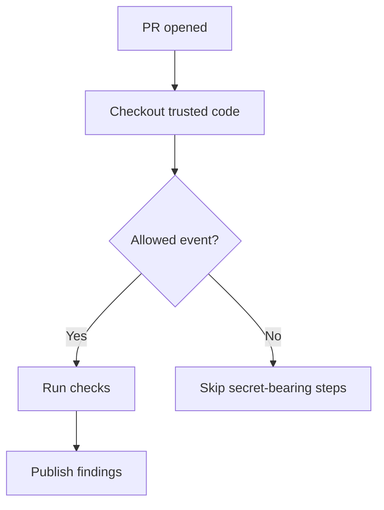
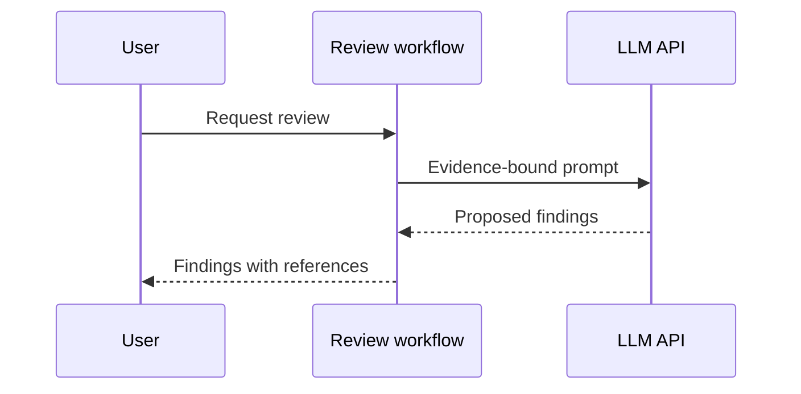

# Diagram playbook

## Choose by explanatory question

- `flowchart` — branches, approval gates, retries, failure routes.
- `sequenceDiagram` — interactions between services, actors, APIs; order and async responses.
- `stateDiagram-v2` — state transitions, guards and recovery.
- `classDiagram` or component graph — structure and dependencies (do not imply runtime calls from static imports).
- `erDiagram` — data entities and relationships.
- Before/after paired diagrams — behavior changes, refactoring, PR comparisons.
- SVG or another code-based medium — precise custom layouts or visual forms Mermaid cannot express well.

## Construction procedure

1. List verified nodes with clear, stable names; list verified edges with semantics ("calls," "reads," "retries," "emits," etc.).
2. Keep one diagram about one question. Group low-level details into labelled subsystems.
3. Make direction clear and label decisions. Distinguish intended vs observed edges.
4. Keep unknown transitions **unknown**, never silently complete a flow because it looks symmetric.
5. Supply a 2–4 sentence reading guide; include a text equivalent if the figure is essential.
6. Prefer source paths/line references beside important claims rather than inventing accuracy badges.

## Mermaid examples (illustrative)

These examples convey design intent; they do not prove that a specific GitHub Action implements these security checks.

## Implementation/validation

- Use Mermaid's documented grammar. Avoid unescaped punctuation in IDs; use concise quoted node labels where needed.
- If CLI/browser rendering is available, render and inspect the exported SVG/PNG (correct edges, orientation, clipping, legibility).
- Use Mermaid's default `strict` security mode when embedding third-party diagrams. Do not relax security just to add clickable nodes from untrusted content.
- For large graphs, produce an overview and a scoped second diagram; a giant unreadable graph fails this skill.
- Never generate or treat a stylized network diagram as proof of an architecture claim.
