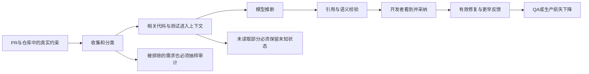

# SpecGuard 批判性审查：shift left、目标兑现与尚未被观测的问题

> 后续状态见[继续审查：修复后的反例与跨路径不变量](critical-shift-left-followup-2026-10-15.md)，基线为 PR #190 合并后的 d3234e3。本文保留原审查快照，不能将其中已修复的具体反例当作当前缺陷。

审查日期：2026-10-15（Australia/Sydney）。GitHub 取证截止：2026-10-14 21:09 UTC / 2026-10-15 08:09 AEDT。

最终代码基线：[`6ec3b8e8945424b93091bc61934b6d3924f1dd51`](https://github.com/Mira190/SpecGuard/commit/6ec3b8e8945424b93091bc61934b6d3924f1dd51)，来自 `fix/shift-left-improvements`。初始审查基线为 `edcee1c`；收尾时工作区合入 `origin/main`，已复核相关 leads/post 差异及表格化反例。下文“当前”均指这个冻结快照。本文只新增审查文档，不修改产品实现，也不把其他未提交文件纳入结论或提交。

## 1. 审查结论

**SpecGuard 已经有把部分问题提前到 PR 阶段发现的能力，但尚未证明能持续减少 QA/生产缺陷，也没有完成设计中的全部目标。** 最新 Kite PR review 对十个已知植入目标都有可见反馈，这是积极证据；同一批结果也暴露出确定性的误报、覆盖状态过强、评估漏算摘要噪声等问题。现在适合继续做有人工校准的 advisory pilot，尚不具备用总体“已覆盖”或 blocking gate 代替测试与人工判断的依据。

最重要的差距不是再增加一种输出，而是让每个判断的证据强度与措辞相符：

- “引用存在”只能证明引用真实，不能证明测试会执行、会失败、能发现该缺陷。
- “两次报告相同问题”证明可重复性，不能排除稳定的误报。
- “删除了断言文本”不等于删除了行为覆盖；等价重构必须保持审查结果不变。
- “没有再报，且有测试修改”不等于修复；它不能直接充当 shift-left 收益。
- 模型把真实要求归为“非需求”，会在判断覆盖之前把它移出分母；只检验最终 findings 会漏掉这类失败。

本次确认了五个代码级最小复现：表格化测试迁移被判定为删除、空 `test.skip` 被 scan 接受为 covered、分类冲突优先删除 requirement、无关测试变更被计为 addressed，以及含摘要误报的 clean case 仍通过评分。前三项直接影响审查可信度，后两项影响成效判断。它们是本文优先级最高的改进依据。

## 2. 范围、方法与证据边界

阅读了 [README](../README.md)、[设计与验收矩阵](design.md)、[目标第一性原理](goal-first-principles.md)、[目标批判](handoff-goal-critique.md)、[traceability 计划](traceability-plan.md)、[验证计划](validation-plan.md)、[Kite pilot](pilot-kite.md)、[field study](field-study.md)、[竞品风格对照](competitors/head-to-head.md)、[上一轮 shift-left 审查](shift-left-review-2026-10-14.md)、[可靠性加固验证](reliability-hardening-2026-10-14.md)，并沿 collect → requirements/trace/leads → engine/context → validate/verify → post/state → eval/telemetry 检查实现和相关测试。

通过 GitHub connector 读取 Kite 工作流、全部 80 条可见 run 记录、最新 scan 的 job 日志与 artifact、PR #10–#19 的最新摘要、行内评论和实际 diff；对争议结论读取其对应提交的源文件。本文保留可追溯链接，不提交 Kite 原始源码、prompt、artifact 或凭据。Kite 链接需要相应访问权限。

证据分三类：

| 标记 | 含义 | 允许得出的结论 |
|---|---|---|
| 实测 | 本次本地复现，或读取到的线上输出及对应 diff/source | 该输入、该版本确实出现此行为 |
| 静态确认 | 当前代码存在明确路径，未触发真实线上后果 | 给定条件下会发生；不声称已有事故 |
| 待证伪 | 边界条件、未知发生频率或外部依赖 | 必须设计实验，不能计为已发现缺陷或已达成目标 |

这不是对全部 Kite 行为、全部 22 个文档 gap 的逐条验收，也没有执行 Kite 测试或付费模型复跑。源码引用、已有测试报告、模型评测、真人采用结果分别计量，避免相互替代。

### 版本对齐

| 对象 | 实际版本与时间 | 解释 |
|---|---|---|
| 当前审查代码 | SpecGuard `6ec3b8e` | 包含 `251180c`、`edcee1c` 可靠性修复，以及合入的 `3c085bb` helper迁移修复 |
| [最新全仓 scan #12](https://github.com/Mira190/Kite/actions/runs/38515926303) | 2026-10-14 05:18 UTC；Kite `985758cb9b07937959906a787f605d511aaabf0f`；日志解析 action 为 SpecGuard `41e73c307c083b779dd9c83441b82a01f2636aee` | 比当前分支早；不能用其旧问题反证本地修复无效 |
| 最新 PR reviews，#10–#19 | 2026-10-14 09:46–09:47 UTC；各自 head 见下表 run 链接 | 抽查 #12 与 #19 的 job 日志，实际 action 均为 `3c085bb9e8df5cffee48f9b6ba4701159efbd7c9`；不假定仅凭 `@main` 就等于本地 HEAD |

截止取证，没有看到这些最新本地修复之后的 Kite scan；当前分支离线正确性与线上效果仍需分别验收。

## 3. 第一性原理：什么才算 shift left

目标应是：**把本来会更晚出现、值得修复的缺陷，在更便宜的时间点发现并正确处理，且总成本下降。** “发现更多 gap”“生成更多测试”“有一张需求表”都是中间产物。

可以用下式组织测量，不把未知量伪装成分数：

`净收益 = Σ[真实缺陷被提前发现且正确修复 × 避免的后期损失] − 模型/CI成本 − 开发者核查与改动成本 − 误导性修改成本`

拆成漏斗则是：PR 中存在可在当时识别的真实风险 → 有关信息进入上下文 → 正确识别 → 开发者看到并认可 → 形成有效修复/测试 → 后续缺陷减少。任一环节失败，前面的技术成功都不等于业务收益。



`R（需求）—C（实现）—T（测试）—S（标准）` 是有用的组织方式，但不应把它理解成形式化证明：

1. **CI 绿不证明 C≈T。** 它只表示被配置执行的测试，在特定环境和输入上没有失败。测试可同时遗漏分支、共享错误 oracle，或根本没被执行。
2. **R 是可能过期、冲突或混有未来计划的资料。** R 与 C 不一致首先是需要裁决的冲突；应说明权威来源和适用版本，不能一律断言 C 有 bug。
3. **无 R 不等于无价值。** 删除校验、边界遗漏、无断言、资源清理和并发错误可能仅从 C/T 就看得出来。文档覆盖率不能代替常见代码风险覆盖。
4. **测试强弱由可区分的错误行为决定。** `assert.ok` 包裹语义精确的 predicate 可以很强；`deepEqual` 对错误 oracle 也可以很弱。外观、函数名和语法相似度只是搜索线索。
5. **更低层不天然更好。** 应选择能忠实表达故障机制、反馈成本最低的测试边界。布局、OS 权限、流生命周期可能需要 component/integration；保留少量 e2e 验证装配关系。为了符合 unit 标签强行拆函数，可能增加维护成本而不增加保护。
6. **PR review 已经比 QA 左移，但不是最左。** local CLI/skill 能到编码阶段；是否被真人持续使用、反馈是否快到能改变行为，仍需观测。周扫描主要治理存量风险，不自动计为“在该 PR 提前拦截”。

推荐报告四档证据：引用真实；静态语义支持；相关测试实际执行；针对目标故障的反事实/变异被杀死。advisory 不必把所有结论提升到最高档，但不能用第一档的验证器输出第四档的承诺。

## 4. 全部目标的完成度

以下按 design、traceability 和 validation plan 的实际承诺逐项判断，不给没有统一分母的总完成百分比。

| 目标 | 当前证据 | 判定与尚缺验收 |
|---|---|---|
| 在 GitHub PR 中自动进行 QA review | Action、摘要、行内评论、去重、越界定位等已实现，Kite 有实际运行 | **交付机制成立**；稳定性与信息正确性另算 |
| 找缺失单测、新分支与边界回归 | 最新五个 test-side 植入目标均可见；有源码线索和本地测试 | **部分达成**；等价重构误报，真实漏报率未知 |
| 找弱测试、避免测试跟着错误实现走 | seeded 用例和 PR #11 有有效结果 | **部分达成，当前薄弱项**；最新 scan 两个 weak_test 理由均不足，见 F04 |
| requirement-aware review | PR/issue/仓库文档收集、trace、差分判断已落地；最新五个文档偏差目标均可见 | **部分达成**；分类召回、版本权威和外部来源失效条件未闭环 |
| 双向 R↔C↔T traceability | collector、协议、verify、展示及 harness 存在 | **实现与质量验收分离**；计划中的多次真实模型验证不能由 canned/unit tests 代替 |
| 明确确认 coding standards | 可读取 base 标准，可配置 lint/format check/status | **能力存在，pilot 未证明目标**；Kite 未配置标准检查，最新 scan 的 `standards.txt` 为空 |
| 在可行时把测试下推到更便宜的层 | schema/skill 有 pushdown，能区分部分 higher-level 情况 | **尚未验证正向收益**；当前可靠性报告明确没有 validated positive pushdown case |
| PR 之前提供反馈 | local CLI 与 skill 存在 | **交付存在，采用与收益未知**；需要真人使用、延迟和改动归因 |
| 全仓扫描、分批最终覆盖 | inventory、风险排序、轮转、issue state 已实现 | **部分达成**；大文件永远放不下、旧状态与代码变化脱钩仍影响“最终覆盖” |
| 一份 workflow、个人与组织均 0 secrets | Copilot 个人路径已有历史验证 | **未全部达成**；设计 S4 组织计费未完成；当前 Kite Claude 路径用了 secret，不能代证 0-secret 目标 |
| 三种语言、三仓库 pilot | 大范围离线 discovery study 与部分 replay 存在 | **S6 未完成**；不等于三个真人、真实测试体系、含组织计费的 end-to-end pilot；代码也有语言扩展名与断言语法启发式 |
| 全验收矩阵在所有 pilots 通过 | 大量自动测试、seeded eval | **未证明**；同一十例反复调优不等于新仓库上的完整验收 |
| blocking 前高置信 precision≥80% | seeded 结果有高 precision；当前仅 advisory | **未达到可宣称门槛**；缺真实 PR 校准、摘要噪声与独立 holdout；validation plan 的 65% 是试点继续阈值，应与 blocking 门槛分开 |
| 中位运行<5分钟、$/PR 可测且目标≤$1 | 最新 PR 摘要自报约15.6–23.1秒；单次 scan 模型阶段约6分38秒、$0.4853 | **局部样本成立，整体未验收**；需按引擎/规模分层并累计所有 pushes/retries，scan 与 PR 不能混算 |
| 真人接受、有效修复、QA缺陷下降 | 收集和统计工具已实现，计划给出了证伪标准 | **未证明**；最新十例无 outcome，agent 植入用例不是自然发生的真人工作流 |
| 发布与可安装 | design 将 S1/S2/S3/S5/S7 标为完成 | **工程里程碑不等于质量目标完成**；S4/S6 仍未勾选；design 引擎描述已与实际不一致 |

设计保留 advisory、测试不执行就标注 static review、只把明确证据放在主界面，这些取舍合理。下一阶段应提高证据与测量的可信度，不宜先扩大发布承诺。

## 5. 最新 GitHub 结果到底说明了什么

### 5.1 最新全仓 audit

来源：[workflow](https://github.com/Mira190/Kite/actions/workflows/specguard-audit.yml)、[run #12](https://github.com/Mira190/Kite/actions/runs/38515926303)、[扫描 issue #3](https://github.com/Mira190/Kite/issues/3)。读取了该 run 的 `audit.json`、`findings.json`、`audit-meta.json`、`scan-parts.json`、`usage.json`、上下文清单和渲染结果。

| 观察 | 事实 | 可得结论 |
|---|---|---|
| 工作流结论 | GitHub `success` | 表示工作流结束，不表示审查完整或全部达标 |
| 代码范围 | inventory 44 units，选择12，实际10个放入完整评估范围，2个文件被截断/未完整审查 | 7条 unit findings 的分母是本轮可见范围，不能称为全仓所有缺口 |
| 文档范围 | 131 blocks，选择80；其中10个因一个分批调用失败未审查 | 存在明确未知区，不是“0 findings” |
| 输出 | 5 missing + 2 weak；文档14条重复报告、8条首报 | 数量和重复出现不能充当真实性计数 |
| 调用与成本 | 7次调用、1次拆分；`totalCostUsd=0.485306305`，API累计397567ms | 一次运行的模型成本；不含runner、人工核查和后续重跑 |
| 标准 | `standards.txt` 为0字节 | 没有确认 coding standards 的依据 |
| 历史 coverage | 老输出出现141/131 | 属于已被当前分支修复的计数问题，见第7节，不重报为当前缺陷 |

对七条 unit findings 的人工复核：

| Finding | 复核判断 |
|---|---|
| `ownFile` 路径保护缺单测 | 委托逻辑已有测试；历史误报已有当前代码的离线修复与正向对照。最新线上 run 仍是旧版本。不能据此要求再次拆函数 |
| `Bar` 模式/暂停/时间显示 | 可能有测试缺口，但把多个层级行为捆成一个 unit gap，建议却只覆盖格式化函数；不足以关闭原先全部指控 |
| `Overlay` 边界与预设 | 是合理待补候选；仍需确认现有 component/间接调用测试及准确边界契约，不把未运行的 sketch 当成已证实的失败测试 |
| capture 生命周期与字节统计 | 值得测，但需要流与宿主边界；mock 方案是否忠实于真实失败序列需要验证 |
| `Kbd` 标签与可访问性文本 | 可做低成本组件测试；“必须抽成纯函数”不是由 gap 自动推出的结论 |
| `toolbox` 的 `has()` 被判弱 | helper 验证连续序列；缺少固定索引检查不自动构成缺陷。要求固定位置需要独立契约依据，而建议的索引断言可能更脆弱 |
| `board` 的期望公式被判 mirror | 期望由常量独立计算，不从生产输出取 oracle；改变生产公式会改变结果并被现有断言发现。“写成算式所以抓不住公式变更”不成立 |

源码核对入口：[toolbox helper及测试](https://github.com/Mira190/Kite/blob/985758cb9b07937959906a787f605d511aaabf0f/test/toolbox.test.ts#L5)、[board断言](https://github.com/Mira190/Kite/blob/985758cb9b07937959906a787f605d511aaabf0f/test/board.test.ts#L81)。这里评的是所给 finding 的理由，不是声称这两个模块已无任何测试缺口。

另核对了窗口尺寸、初始选中项、快捷键失败提示三类文档/实现不一致。它们能支持“存在 drift”，尚不足以单独判定文档还是实现应改；尤其提示文字不一致不能升级成整个保存/注册流程失败的结论。

**新发现的盲区在 findings 之前：** 最新 artifact 将设计文档中“选择区域限定在鼠标按下时所在显示器”的规则归为不可检查的 rationale；另一段含音量范围的文本被同时作为 requirement 和 not_requirement 回答，validator 选择保留后者。它们分别可通过宿主/集成测试和数值边界测试检查；高层测试需求不等于非需求。见 [design相关段落](https://github.com/Mira190/Kite/blob/985758cb9b07937959906a787f605d511aaabf0f/docs/design.md#L35) 和 F03。

### 5.2 最新 PR reviews：十个目标被找到，但并不干净

逐个比对最新摘要与相应 diff。下表“命中”仅表示反馈确实指出已植入的目标行为，包括摘要和仍然有效的已有行内评论；不要求每次都新发评论，也不计作十个自然发生的真实缺陷。

| PR / 最新运行 | 植入目标 | 最新反馈 |
|---|---|---|
| [#10](https://github.com/Mira190/Kite/pull/10) / [run](https://github.com/Mira190/Kite/actions/runs/38544755427) | 删除大小写相关测试保护 | 命中，摘要 |
| [#11](https://github.com/Mira190/Kite/pull/11) / [run](https://github.com/Mira190/Kite/actions/runs/38544762794) | 值断言退化为对象 truthy | 命中，已有 weak_test 评论 |
| [#12](https://github.com/Mira190/Kite/pull/12) / [run](https://github.com/Mira190/Kite/actions/runs/38544774478) | 改成表格测试时漏掉 exact-now 边界 | 命中；**同时多报两个实际上仍在表格中的用例** |
| [#13](https://github.com/Mira190/Kite/pull/13) / [run](https://github.com/Mira190/Kite/actions/runs/38544779391) | 新增鼠标侧键分支，没有相应断言 | 命中，行内；历史线程仍需注意重复阅读负担 |
| [#14](https://github.com/Mira190/Kite/pull/14) / [run](https://github.com/Mira190/Kite/actions/runs/38544786551) | 阈值边界改变，未补相应测试 | 命中，摘要 |
| [#15](https://github.com/Mira190/Kite/pull/15) / [run](https://github.com/Mira190/Kite/actions/runs/38544794550) | 计时默认行为偏离文档 | 命中，spec mismatch |
| [#16](https://github.com/Mira190/Kite/pull/16) / [run](https://github.com/Mira190/Kite/actions/runs/38544802059) | 删除启动前检查，测试同步改错 | 命中，摘要；当前代码另有 removed-line 差分修复 |
| [#17](https://github.com/Mira190/Kite/pull/17) / [run](https://github.com/Mira190/Kite/actions/runs/38544816005) | 默认快捷键改变，文档未同步 | 命中，spec mismatch |
| [#18](https://github.com/Mira190/Kite/pull/18) / [run](https://github.com/Mira190/Kite/actions/runs/38544817221) | 精确 UI 文案改变，测试跟随改变 | 命中，spec mismatch |
| [#19](https://github.com/Mira190/Kite/pull/19) / [run](https://github.com/Mira190/Kite/actions/runs/38544823184) | 缩小范围，测试跟随改变 | 命中，spec mismatch |

因此，旧文档中的早期 4.5/10 或 7.5/10 不应继续当成最新结果。**最新可见结果为这十个已知目标全部有反馈；这不是未知缺陷 recall=100%。** 它们经历了多轮针对性调优，没有独立 holdout；#12 的两个附带误报也不能因主目标命中而忽略。

十个摘要的机器状态全是 `tier=fast`、`reduced=true`、`complete=false`、`outcomes=[]`，模型记录为 `claude-haiku-5-5`；GitHub job 却全为 success。这是当前设计的保守策略，不是 API 报错，但意味着这一批结果无法通过现有聚合器产生 fix-through 证据。

## 6. 优先处理的发现

P1 表示在扩大试点、宣称质量或考虑阻断之前应解决；P2 表示影响目标兑现、成本或长期可信度。以下没有把待证伪的安全假设伪装为 P0。

### F01 · P1 · 把断言文本变化升级成“无替代”，制造确定性误报

**证据：实测 + 当前代码。** [PR #12摘要](https://github.com/Mira190/Kite/pull/12#issuecomment-6163642313) 一面将迁移后的正常时间用例列为 Evidenced，一面宣称对应旧断言删除后无替代。[leads.js](../src/leads.js#L190) 按断言 subject 字符串及新断言中的字面量寻找替代；合入的修复能识别部分helper迁移，但常量移入参数表、断言改用变量仍不匹配。[post.js](../src/post.js#L1553) 重新检查此类lead后，依旧自动生成 high-confidence missing_test，`obligation_ids=[]`，绕过已有 coverage 关系。

本地用两个完整保留的 `next(1)`/`next(2)` 用例改成参数表，`assertionDelta` 输出两个 `removed`。这证明失败来自确定性后处理，不是只靠更强模型就能解决。

**最小修正：** 保留 lead 供核查；不能证明行为消失就不要自动生成 high finding。至少把它与 coverage/等价迁移结论统一裁决，禁止同一行为同时为 Evidenced 和 Missing。增加“完整等价迁移”和“迁移时真实漏一个边界”的成对控制，跨文件搬移/改名同理。

**不修后果：** 重构越规范越可能被要求恢复重复断言，浪费核查时间并降低信任。

### F02 · P1 · scan 的 covered 接受无断言且被跳过的测试

**证据：实测。** 向当前 [audit-post.verify](../src/audit-post.js#L196) 提供真实存在的代码引用及 `test.skip("...", () => {});` 引用，结果仍为 `covered`。[gap](../src/audit-post.js#L163) 只检查代码/测试引用与 layer；它不像 PR 的 `verifyEvidence` 那样校验 assertion/disabled 状态。

**最小修正：** 共享 PR/scan 的“哪些证据能承载 covered”规则；声明、import、空测试、跳过测试不得承载正向覆盖。保留静态证据标签，不把这一修复说成证明测试在 CI 实际运行。增加每种拒绝例及一个有效 helper assertion 正例，防止变成单纯看语法的过滤器。

**不修后果：** scan 给最需要补测的行为制造安全感；轮转状态还会携带这个错误结论。

### F03 · P1 · 非需求分类具有删除权，真实义务可以从分母消失

**证据：线上实测 + 本地复现。** scan artifact 的 `16c78246` 为单显示器约束；`acbd3277` 含数值范围。后者既有 requirement 又有 not_requirement，日志明确记录 requirement 被 dropped。当前 [validate](../src/audit-post.js#L95) 先收集 skipped，再删除冲突 requirement；[verify](../src/audit-post.js#L235) 也不为 skipped 生成 unknown。

本地两个 requirement 中放入一个分类冲突，整体 validate 仍成功，冲突项只留下 not_requirement。因此最终表格完整、引用正确，也可以系统性漏掉真实规则。这比漏报一条 finding 更隐蔽。

**最小修正：** 冲突进入 unknown/review-needed，不能优先删除；混合“理由+规则”的段落拆出原子义务；not_requirement 给出可审计理由，并随机复核被排除样本。higher-level/human 与 not_requirement 分开。

**不修后果：** 分类越激进，表面覆盖率越好；真实 recall 的分母却越来越小。

### F04 · P1 · weak_test 仍按外观推断，缺少行为反事实

**证据：线上源码复核。** 最新 scan 的两个 weak finding 分别把连续子序列 predicate 当作不够精确、把独立常量计算当作自引用 oracle。当前 [可靠性报告](reliability-hardening-2026-10-14.md) 已将 toolbox 类问题列为 k2 TODO；board 是同类但不同机制，不能只加 helper 名称白名单。

**最小修正：** 每条 high weak_test 必须指出一个违反契约、却仍能通过现有断言的具体错误实现或输入。无法给出时降为待核查。必要时对少量高风险项做定向变异，而不是全仓新增重型执行层。保留真实 truthy、同源 oracle、hardcode 特例的正向控制。

**不修后果：** 开发者被引导把语义稳定的测试改成绑死实现位置的测试，成本增加，保护未增加。

### F05 · P1 · 评估漏算摘要中的误报，指标与用户实际阅读面不同

**证据：本地实测，线上给出真实影响样例。** [grade.js](../eval/grade.js#L85) 从高置信 posted comments 计算 FP；summary 可以帮助计 TP，却不对额外摘要 finding 对称地计 FP。`pass` 也不要求 `falsePositives.length===0`，`expect_clean` 主要检查 posted。给 `expect_clean:true` 的合成case提供一条能被解析的摘要误报，得到 `summary_only=1, fp=0, clean_ok=true, pass=true`。PR #12 的两个摘要误报正落在这一盲区。

**最小修正：** 统一按开发者可见、语义去重后的 actionable finding 计量，再按 inline/file/summary 分层；TP/FP 必须使用同一个总体。保留位置匹配作为自动辅助，但要求行为描述匹配；“同 kind、同文件”不能充分证明命中目标。允许噪声预算也应显式写进 gate。

**不修后果：** 把评论搬到摘要即可改善 headline precision，实际阅读成本不降；“评测通过”与“报告可用”脱节。

### F06 · P2 · scan 历史结论没有绑定代码/测试版本

**证据：静态确认。** [audit-units](../src/audit-units.js#L56) 用路径 hash 标识 unit，按首次/确认/日期轮转；[audit-collect](../src/audit-collect.js#L83) 的 block hash 由文档文本构成。文档不变而实现/测试变化时，不自动使旧 covered 或 not_req 失效。[stateOf](../src/audit-post.js#L335) 携带历史状态；`trackFindings` 按相同 fid 再现确认，不验证独立证据或依赖版本。

历史日期被保留是优点，但它没有解决“当前代码是否仍被保护”。同一模型、同一上下文两次重复，也可能只是稳定误判。

**最小修正：** 状态记录最小输入指纹与原始证据版本；相关源码/测试变化即标 stale 并优先重审。不知道依赖关系时先保守失效，暂不建设大型依赖图。保留“再次观测”措辞，不能把次数升级成语义确认。

**不修后果：** 删除旧测试可能仍展示历史覆盖；重跑的次数增加信心，却不增加证明力。

### F07 · P2 · 上下文上限只诚实报不完整，还没有保证最终取得进展

**证据：线上不完整 + 静态路径。** 最新 scan 两个大文件留待下次；当前修复确实将 unseen 标为 incomplete。但固定文件预算、相同前缀和无位置游标可能使同一文件每次都放不下。[context pack](../src/engines/claude-api.js#L147) 的 block windows 即使有窗口未装入，仍返回 `notWhole: []`；[slices](../src/engines/claude-api.js#L119) 的 complete 主要指选定窗口装得下，不保证80行窗口包含长测试的全部断言。

**最小修正：** 把实际读取区间/省略区间作为后处理可用数据；“某段没有测试”必须要求相关搜索范围足够。针对持续超限 unit 按函数/稳定窗口分片并记录进度，设置长期未审查年龄；不要单纯提高全局 token 上限。

**不修后果：** 高风险大文件长期饥饿，周扫描形成稳定黄色噪声；模型没看到的保护仍可能被误判不存在。

### F08 · P2 · addressed 代理被展示为 fixed，无法证明有效修复

**证据：实测 + 当前呈现。** [outcome](../src/post.js#L613) 在旧 finding 不再出现、且任意测试文件变化时返回 addressed；本地以 anchor 未动、无关测试变化复现。[摘要](../src/post.js#L754) 却显示 `fixed`。模型漏报、随机波动、无关重构均可满足代理条件。

**最小修正：** UI 使用“后续有相关改动/待验证”，取消未经验证的 fixed；将发现消失、证据变化、人工认可、回归测试通过分别记录。少量人工抽样确认有效修复，并保存所有 run 的成本，避免只看最后一次 push。

**不修后果：** 产品越不稳定，旧 finding 越容易消失；反而可能得到更漂亮的“修复率”。不能用它直接证明 QA 收益。

### F09 · P2 · fast model、执行完整性和可测量性被绑定在一个开关上

**证据：线上 + 静态确认。** 十个最新摘要都没有 outcomes。[engine-model](../src/engine-model.js#L11) 按名称猜 tier；[reducedReasons](../src/post.js#L441) 把 fast 纳入 reduced；[complete](../src/post.js#L1682) 因此必为 false；[aggregate-counts](../eval/aggregate-counts.js#L25) 丢弃它们。新名字默认 normal，说明这个标签本身也不是经校准的质量证明。

保守地不自动关闭旧问题合理；把所有观测一起丢掉会使低成本试点永远不能回答采用率，且 incomplete 不写完成标记会使同 head 重跑再次计费。

**最小修正：** 分开 `execution_complete`、证据等级、发布策略和 outcome 可判定性；fast run 可以记录成本、人工认可和修改事件，同时禁止不可靠的“消失即修复”。按实际模型版本分层验证，不靠名称代表质量。

**不修后果：** 很多“运行成功”的试点无可用成效样本，价格优势也可能被反复重跑抵消。

### F10 · P2 · 需求指纹仍漏掉外部 issue 内容变化

**证据：静态确认。** 最新提交已修复收集时的 PR 文本与 event payload 不一致问题，不能重报这一旧 bug。但 [reqKey](../src/preflight.js#L30) 仍只有 PR title/body；收集器会读取 linked issue 的正文及上下文。issue 更新而 head/title/body 不变时，已完成 review 仍可被 preflight 跳过。当前 Kite PR workflow 也未监听 `edited`；即使加 PR edited，也不覆盖 issue edited。

**最小修正：** 对真正作为约束的外部来源记录内容 hash/version，给出明确刷新入口或有界失效时间；收集、缓存和摘要统一引用同一快照。没有读取成功的来源不得沿用为“仍有效”。

**不修后果：** 最重视需求的产品可能在需求刚变更时继续依赖旧判断。

### F11 · P2 · standards 和 pushdown 的目标缺少对应的真实验收

**证据：目标与当前 pilot 的差距。** [action输入](../action.yml#L23) 有可选 standards check；Kite 没配置，scan 没有同等的标准验收结果。现有 pushdown 表达能力也没有证明一次实际降低测试成本且保持保护的成功案例。最新 Bar finding 甚至用格式化测试回应了更广的交互行为，scope 不相等。

**最小修正：** 标准结果明确区分通过/失败/未配置/待运行/不可读，并显示 head 或 merge SHA；先完成一个标准违规 canary 和一个检查未完成控制。pushdown 先选一个真实纯逻辑案例，用相同故障集比较原测试与新低层测试，再保留装配层 smoke。不要为凑单测数量批量拆组件。

**不修后果：** 主界面有四列不代表四项目标都被验证；“nothing to move down”也可能只是没有成功检索。

### F12 · P2 · 文档、部署版本和验收状态发生漂移

**证据：文档与线上配置。** design 仍称 Copilot-only、零密钥默认路线，当前实现和 Kite 已走 auto/Claude。用户看的 `@main`、工作流绿灯、旧评测数字和本地修复没有共享一个版本清单；最新 scan 仍展示已在本地修复的旧行为。

**最小修正：** 更新实际引擎/认证矩阵，保留历史决策的日期；每份评测与报告记录 action SHA、target SHA、model、skill/schema 版本、输入上限和运行状态。发布前在固定 SHA 做 scan 与 PR canary，用版本匹配的证据关闭目标。试点质量不足时继续 advisory，不因为工程 milestone 打勾就升级承诺。

**不修后果：** 用户无法判断看到的是旧 bug、回归还是未验证修复；维护者可能重复优化已经解决的问题。

## 7. 已修复事项，不应继续当作当前缺陷

以下由当前源码/回归与 [可靠性报告](reliability-hardening-2026-10-14.md) 支持；尚未由新的 Kite 线上 scan 再验证。

| 历史问题 | 当前处理 | 本文如何使用它 |
|---|---|---|
| 文档覆盖数字超过总数 | unique block id 计数与回归 | 只解释旧线上141/131，不要求重复修复 |
| carried gap 丢失原类型 | 状态携带真实 kind/class | 不再把所有 carried 项误当 missing_test 来指控当前代码 |
| unseen units/未回答 blocks 未体现不完整 | 输出 incomplete 并保留 due | 肯定状态诚实性；F07讨论剩余进展保证 |
| 静态线索立即变确认 gap | 不再直接写入 finding state | 肯定线索与结论分离；F01指出 PR 删除断言路径仍有例外 |
| wrapper 委托逻辑已测仍报缺失 | k1/scan guard 有真实管线回归和 recall 对照 | k2 仍未处理，不能把 k1 修复外推为 weak_test 已解决 |
| 断言迁移到helper被报删除、缩进lead未解析 | `3c085bb` 所含修复增加字面量匹配、重新核对diff与U1回归 | 承认helper案例已处理；F01针对仍可复现的表格化转换 |
| 私有 target 扫描结果可写入公开 control | visibility guard，未知 visibility fail closed | 不重报“公开泄露”已修复问题；细粒度受众边界另列假设 |
| PR 文本 fingerprint 记录错快照造成付费重跑 | 收集成功后写入模型实际读取的 key | F10只讨论 linked issue 的独立失效问题 |

这些修复表明项目在朝更可靠的方向推进。大量 unit/集成测试能证明对应规则被实现；它们不能证明模型对新仓库的语义判断已经可靠。

## 8. 既有研究与评测应怎样解读

- **seeded eval：** 当前可靠性报告记录两次18例运行，precision 0.947/1.000，recall 均0.857；这属于那批 fixture 和当时模型的结果。还有4–5个 degraded run、weak/missing assertion 较弱、无 validated positive pushdown；不能只摘 headline。
- **最新 Kite 十例：** 是一次有价值的回归观测；重复用同样目标调 prompt/后处理，证明“已知目标被处理”越来越好，未证明未知分布泛化。把#12额外误报计入后，不能描述为完美 review。
- **head-to-head：** [报告](competitors/head-to-head.md) 用24个真实 PR、同类 Sonnet 代理模拟不同 review 风格，再由同类模型裁决。lean 对12个 bug 的直接发现为7，对照风格为8和9；13/22 actionable≈59%，输入 token 约559k，对照约375k。这不支持“比真实 Copilot 产品更强/更便宜”；同模型裁判、样本小、开发过程重复看结果均限制外推。
- **field study：** [报告](field-study.md#7-after-fixdiscovery-merged-d786847) 从1378份文档的严格/宽松22%/68%，到过滤后515份的66%/98%，说明检索噪声改善；它测的是文档发现，不是原子需求 recall、更不是 bug recall。还应固定报告所用脚本与分类标注版本，避免本地修改影响可复现性。
- **traceability、mutation、SZZ：** harness 和 work package 的存在不是研究已经完成。必须区分 collector 找到候选、模型正确推断、post 没歪曲、真人采取有效动作四种结果；回放只能使用缺陷引入当时可见的资料，不能把后来 fix 的说明放进上下文。
- **试点指标：** [validation-plan](validation-plan.md) 对缺样本不判通过、PR cluster bootstrap、agent PR 不当真人采用、8–12周后观察 escaped defects 的限制写得合理。仍需修复 F05/F08/F09，才能让脚本测到计划想测的东西。

PR number mod 3 可作简单分流，但并非不可预测的随机分配；仓库、时间段、作者和 agent 使用可能不平衡，应按这些维度检查。历史四周 baseline 已有季节/人员混杂，不能仅靠 time-to-merge 差异宣称因果。`precision × A` 也要统一条件分母，避免对有效采用重复折扣，或把“错误建议被照做”算收益。

## 9. 挖掘 unknown unknown：用反事实寻找盲区

未知问题无法靠再列一遍已知 bug 穷尽。最有效的策略是给系统施加**语义不变的变换**，或**故障机制明确的最小扰动**，检查结论是否跟随真实语义。下表是待执行实验；没有实测的项目不计入本文确认缺陷。

| 要证伪的假设 | 最小实验/对照 | 应满足的性质 |
|---|---|---|
| 测试文本相似就代表覆盖相同 | 逐例断言↔参数表、同文件↔搬到另一测试、改helper名字；另配真删边界控制 | 等价转换不新增 gap；真丢保护仍被发现 |
| 声明存在就代表可执行保护 | `skip`、配置排除、未await异步断言、条件环境跳过；对照正常执行 | 无效证据不得 covered；运行配置不可见时明确 unknown |
| 引用了同一字面量就足以排除缺测 | 在注释、snapshot、无关错误路径中加入相同文本；对照真实断言 | cover guard 不能因此抑制真实 missing_test；k1的委托抑制也需wrapper附加逻辑控制 |
| 文档分类不会漏掉真正约束 | 相同规则放入理由段落、表格、否定句、中文、架构约束；抽样被拒绝 blocks | 原子规则保持可见；未判清进入 unknown，不能移出分母 |
| 文档永远是正确 oracle | 同时存在旧版/新版文档、未批准proposal、PR明确批准行为改变 | 展示权威冲突/适用版本，避免机械要求实现回退 |
| 两次报告就更可信 | 相同模型/上下文重复误报；另用独立证据或具体反例核查 | 重复性与正确性分开，不自动加“证实”权重 |
| 轮转最终覆盖所有风险 | 大文件尾部放真实缺陷；预算不变跑到预期完整一轮之后 | 能定位并推进未审查区间；有最大未审查年龄，无永久饥饿 |
| 局部 diff 足以判断全局语义 | feature flag、配置默认、跨模块契约、删除检查、平台差异各一个控制 | 找到必要调用者/配置，否则保留范围限制；不凭局部正常判全局一致 |
| 状态写入不会相互覆盖 | 同target手动与定时scan并发、旧run晚完成；Kite scan workflow 无 concurrency | issue/state始终属于新快照或按版本拒绝旧写入；这是并发假设，未观测到实际丢状态 |
| visibility 等于相同授权受众 | `control=internal,target=private`，以及不同权限成员的两个private repo | 输出受众不应大于源受众；当前guard只拦非公开→公开，细粒度ACL应作为部署前置条件 |
| 只读工具与prompt足以形成隔离 | malicious repo文本尝试改ctx、调取其它文件、影响工具调用；核对真实引擎权限边界 | 输入只能作为数据，不能改审查产物/扩大读范围；已有canary不能自动证明所有引擎都隔离 |
| 发布更安静就代表更精确 | 同一个错误 finding 在 inline/file/summary 间迁移 | 总TP/FP及阅读负担不因投递位置改变；只改变分层显示 |
| unit 下推减少成本且保留保护 | 选一个真实故障集合，比较原integration与新unit+少量smoke | 故障仍被杀死，反馈更快，维护成本可接受；没有此对照就不能计作收益 |
| 工具带来的是独有价值 | 真人PR中做现有review、SpecGuard、二者结合对照；按行为语义判重 | 测到有效且独有的发现、真实修复与额外耗时，不能只用同文件±3行代替语义重合 |

其中“非需求分母消失”“等价表格化却报删除”已经从未知风险变成了本次实测问题。下一轮应优先用这些成对性质测试扩展到新语言、新布局，而不是继续为十个 Kite case 逐一增加特殊规则。

## 10. 实施顺序与完成条件

### 第一批：让报告和评分先说真话

处理 F01/F02/F03/F05/F08；保留 k1 正向与负向控制，加入表格化、skip空测试、分类冲突、summary额外误报的回归。对 weak_test 使用可区分错误行为的解释要求。完成条件：这些已知反例消失，真实删除/弱断言仍可检出；同一行为不再既covered又missing；所有可见 actionable 输出进入评分。

### 第二批：让每个结论绑定输入和范围

处理 F06/F07/F09/F10/F12。使用实际读取区间、来源版本和模型版本；分离执行完整性与证据强度；未审查区间可持续推进。先用hash、区间、明确状态等小机制，不引入长期服务、向量数据库或复杂依赖图。完成条件：同head换需求、代码变而文档不变、永久超限、旧run晚完成均有明确且可验证的行为。

### 第三批：完成原目标，而非扩展更多功能

在固定 action SHA 上执行新的 scan 与 PR canary；补一个 standards 的正反例和一个真实 pushdown 正例；补组织计费路径及三种语言的真实 pilot。advisory 继续，先冻结一批未参与调优的自然 PR/历史引入缺陷，并保留独立人工裁决。

### 第四批：判断是否值得继续投入

按 validation plan 收集真人样本，记录每条发现的有效性、作者核查分钟、实际修改、相关测试结果和全部推送成本。先达到计划的样本门槛，再判断 precision、真实采纳、独有价值与合并延迟；escaped defects 需要更长观察窗。模型和策略在试验期间发生变更时分 cohort，不把不同版本拼成一个效果数字。

只有当有效发现被真人采用、形成可验证保护，并且总成本合理时，才能把目标从“更早提供有用线索”升级为“已证明带来 shift-left 收益”。若独有有效发现少、误报核查重或采用率低，应缩小到本地/摘要/重点高风险变更，而不是用更多扫描掩盖不足。

## 11. 本次验证记录

环境：Windows / Node `v26.11.1`；仓库 CI 使用 Ubuntu / Node22，本次不把本机结果冒充 CI 结果。

五个不修改仓库的 Node 探针均通过了“缺陷或评估盲区存在”的断言（通过不代表产品正确）：

| 探针 | 调用/输入 | 实际输出 |
|---|---|---|
| P1 | `audit.validate` + `audit.verify`，真实引用指向空 `test.skip` | `covered` |
| P2 | 两个有效需求，其中一个也列入 `not_requirements` | 整体validate成功；冲突需求被删除，没有unknown替代 |
| P3 | `assertionDelta`，两个逐例断言等价迁移到参数表 | 两条 `removed` |
| P4 | `post.outcome`，未再报告、anchor未动、任意测试有变化 | `addressed` |
| P5 | `grade`，`expect_clean:true`，没有行内评论但有一条可解析摘要误报 | `summary_only=1, fp=0, clean_ok=true, pass=true` |

为便于复核，P3的公共合成输入如下，未复制 Kite 源码：

```diff
-assert.equal(next(1), 2);
-assert.equal(next(2), 3);
+for (const [input, expected] of [[1, 2], [2, 3]]) {
+  assert.equal(next(input), expected);
+}
```

针对 `src/audit-post.test.js`、`src/leads.test.js`、`src/post.test.js` 的现有测试另行执行。首次受沙箱临时 Git 仓库写权限限制；移出沙箱后，初始基线为319 pass、0 fail、1 skip。发现共享工作区合入新提交后，另建工作树冻结在 `6ec3b8e`，用 `node --test --test-concurrency=3` 重跑这三个文件：**323 tests，322 pass，0 fail，1 skip，约160秒**。表格化反例也在合入helper修复后再次复现。未新增实现镜像式测试，未付费触发新的 Kite review。

现有可靠性文档记录的全套结果是1049 pass、0 fail、1 skip、1 todo；这是该文档的历史记录，不是本次重新运行全套得到的结果。本文也没有把任一项未完成的真人验证标记为完成。
