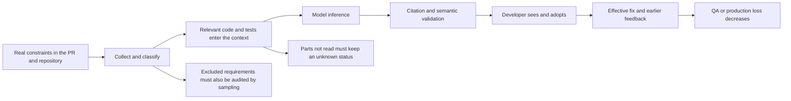

# SpecGuard Critical Review: Shift Left, Goal Delivery, and Problems Not Yet Observed

> For the follow-up status see [Continued review: counterexamples after the fixes and cross-path invariants](critical-shift-left-followup-2026-10-15.md), baselined on d3234e3 after PR #190 was merged. This document keeps the original review snapshot; the specific counterexamples in it that have since been fixed must not be treated as current defects.

Review date: 2026-10-15 (Australia/Sydney). GitHub evidence cutoff: 2026-10-14 21:09 UTC / 2026-10-15 08:09 AEDT.

Final code baseline: [`6ec3b8e8945424b93091bc61934b6d3924f1dd51`](https://github.com/Mira190/SpecGuard/commit/6ec3b8e8945424b93091bc61934b6d3924f1dd51), from `fix/shift-left-improvements`. The initial review baseline was `edcee1c`; at wrap-up the workspace merged `origin/main`, and the relevant leads/post differences and the tabular counterexamples were re-checked. "Current" below always means this frozen snapshot. This document only adds a review document; it does not change the product implementation, and does not fold other uncommitted files into the conclusions or the commit.

## 1. Review conclusion

**SpecGuard already has the ability to surface some problems earlier, at the PR stage, but it has not yet been shown to reduce QA/production defects consistently, and has not completed all the goals in the design.** The latest Kite PR reviews give visible feedback on all ten known seeded targets, which is positive evidence; the same batch of results also exposes deterministic false positives, over-strong coverage status, and an evaluation that fails to count summary noise. It is now appropriate to continue a human-calibrated advisory pilot; there is not yet a basis for letting an overall "covered" verdict or a blocking gate replace testing and human judgment.

The most important gap is not adding another kind of output, but making the strength of evidence behind each judgment match its wording:

- "The citation exists" only proves the citation is real; it does not prove the test will run, will fail, or can detect the defect.
- "The same problem was reported twice" proves repeatability; it cannot rule out a stable false positive.
- "The assertion text was deleted" does not equal "the behaviour coverage was deleted"; an equivalent refactor must leave the review result unchanged.
- "No longer reported, and a test was modified" does not equal a fix; it cannot directly serve as a shift-left benefit.
- When the model classifies a real requirement as a "non-requirement", it moves it out of the denominator before coverage is judged; checking only the final findings misses this kind of failure.

This round confirmed five minimal code-level reproductions: a tabular test migration judged as deletion, an empty `test.skip` accepted by scan as covered, a classification conflict that deletes the requirement first, an unrelated test change counted as addressed, and a clean case containing a summary false positive still passing the scoring. The first three directly affect review credibility; the last two affect the judgment of effectiveness. They are the highest-priority basis for improvement in this document.

## 2. Scope, method, and evidence boundaries

Read the [README](../README.md), [design and acceptance matrix](design.md), [goal first principles](goal-first-principles.md), [goal critique](handoff-goal-critique.md), [traceability plan](traceability-plan.md), [validation plan](validation-plan.md), [Kite pilot](pilot-kite.md), [field study](field-study.md), [competitor-style comparison](competitors/head-to-head.md), [previous shift-left review](shift-left-review-2026-10-14.md), [reliability hardening verification](reliability-hardening-2026-10-14.md), and inspected the implementation and related tests along collect → requirements/trace/leads → engine/context → validate/verify → post/state → eval/telemetry.

Through the GitHub connector, read the Kite workflow, all 80 visible run records, the job logs and artifacts of the latest scan, the latest summaries, inline comments, and actual diffs of PRs #10–#19; for disputed conclusions, read the source files at the corresponding commits. This document keeps traceable links, and does not commit Kite's original source, prompts, artifacts, or credentials. The Kite links require the corresponding access rights.

Evidence is of three kinds:

| Marker | Meaning | Conclusion allowed |
|---|---|---|
| Measured | Reproduced locally in this review, or online output read together with the corresponding diff/source | That input, that version really shows this behaviour |
| Statically confirmed | The current code has a clear path, but no real online consequence was triggered | It will happen under the given conditions; no incident is claimed |
| To be falsified | Boundary conditions, unknown frequency, or external dependencies | An experiment must be designed; it cannot be counted as a found defect or an achieved goal |

This is not a line-by-line acceptance of all Kite behaviour or all 22 documentation gaps, nor did it run Kite tests or re-run paid models. Source citations, existing test reports, model evaluations, and real human adoption results are measured separately and do not substitute for one another.

### Version alignment

| Object | Actual version and time | Interpretation |
|---|---|---|
| Code under review | SpecGuard `6ec3b8e` | Includes the reliability fixes `251180c`, `edcee1c`, and the merged helper-migration fix `3c085bb` |
| [Latest full-repo scan #12](https://github.com/Mira190/Kite/actions/runs/38515926303) | 2026-10-14 05:18 UTC; Kite `985758cb9b07937959906a787f605d511aaabf0f`; the action parsed from the log is SpecGuard `41e73c307c083b779dd9c83441b82a01f2636aee` | Earlier than the current branch; its old problems cannot be used to refute the local fixes |
| Latest PR reviews, #10–#19 | 2026-10-14 09:46–09:47 UTC; each head is in the run link in the table below | Spot-checked the job logs of #12 and #19; the actual action was `3c085bb9e8df5cffee48f9b6ba4701159efbd7c9` in both; `@main` alone is not assumed to equal local HEAD |

As of the evidence cutoff, no Kite scan after these latest local fixes was seen; the offline correctness and online effect of the current branch still need to be accepted separately.

## 3. First principles: what counts as shift left

The goal should be: **to find, at a cheaper point in time, defects worth fixing that would otherwise have appeared later, and handle them correctly, with total cost going down.** "Finding more gaps", "generating more tests", and "having a requirements table" are all intermediate products.

Measurement can be organized with the following formula, without disguising unknown quantities as scores:

`net benefit = Σ[real defects found earlier and fixed correctly × late-stage loss avoided] − model/CI cost − developer verification and change cost − cost of misleading changes`

Broken down as a funnel: a real risk that could be identified at the time exists in the PR → the relevant information enters the context → correct identification → the developer sees and agrees → an effective fix/test results → later defects decrease. If any link fails, the technical success before it does not equal business benefit.



`R (requirements) — C (implementation) — T (tests) — S (standards)` is a useful way to organize, but should not be read as a formal proof:

1. **Green CI does not prove C≈T.** It only means the tests that were configured to run did not fail in a particular environment and on particular inputs. Tests can simultaneously miss branches, share a wrong oracle, or not be executed at all.
2. **R is material that may be stale, conflicting, or mixed with future plans.** An R–C mismatch is first a conflict that needs adjudication; the authoritative source and applicable version must be stated, and C cannot always be asserted to have a bug.
3. **No R does not mean no value.** Deleted validation, missed boundaries, missing assertions, resource cleanup, and concurrency errors may be visible from C/T alone. Documentation coverage cannot replace coverage of common code risks.
4. **Test strength is determined by the wrong behaviours it can distinguish.** `assert.ok` wrapping a semantically precise predicate can be strong; `deepEqual` against a wrong oracle can also be weak. Appearance, function names, and syntactic similarity are only search clues.
5. **A lower level is not inherently better.** Choose the test boundary that faithfully expresses the failure mechanism at the lowest feedback cost. Layout, OS permissions, and stream lifecycle may need component/integration; keep a small number of e2e tests to verify the wiring. Forcibly splitting functions to match the unit label may add maintenance cost without adding protection.
6. **PR review is already further left than QA, but it is not the leftmost.** A local CLI/skill can reach the coding stage; whether it is used continuously by real people and whether feedback is fast enough to change behaviour still need observation. Weekly scans mainly govern the existing risk stock and do not automatically count as "caught earlier at that PR".

Recommended four tiers of evidence for reports: the citation is real; static semantic support; the relevant test actually ran; the counterfactual/mutation targeting the failure was killed. Advisory need not raise every conclusion to the highest tier, but the validator's tier-one output must not be used to make a tier-four promise.

## 4. Completion of all goals

The following judges each item against what the design, traceability, and validation plans actually promise, without giving an overall completion percentage that lacks a common denominator.

| Goal | Current evidence | Verdict and missing acceptance |
|---|---|---|
| Automatic QA review in GitHub PRs | Action, summary, inline comments, dedup, out-of-range location are implemented; Kite has real runs | **Delivery mechanism holds**; stability and correctness of information are counted separately |
| Find missing unit tests, new branches, and boundary regressions | All of the latest five test-side seeded targets are visible; source clues and local tests exist | **Partially achieved**; equivalent refactors are false-positived, the true miss rate is unknown |
| Find weak tests, avoid tests following a wrong implementation | Seeded cases and PR #11 have valid results | **Partially achieved, currently the weak spot**; both weak_test rationales in the latest scan are insufficient, see F04 |
| requirement-aware review | PR/issue/repo-document collection, trace, and differential judgment are in place; all of the latest five document-deviation targets are visible | **Partially achieved**; classification recall, version authority, and external-source invalidation conditions are not closed |
| Bidirectional R↔C↔T traceability | collector, protocol, verify, display, and harness exist | **Implementation and quality acceptance are separate**; the multiple real-model validations in the plan cannot be replaced by canned/unit tests |
| Explicitly confirm coding standards | Can read base standards; lint/format check/status can be configured | **Capability exists, pilot has not proven the goal**; Kite has no standards check configured, and the latest scan's `standards.txt` is empty |
| Push tests down to cheaper layers where feasible | schema/skill has pushdown and can distinguish some higher-level cases | **Positive benefit not yet validated**; the current reliability report explicitly has no validated positive pushdown case |
| Provide feedback before the PR | local CLI and skill exist | **Delivery exists, adoption and benefit unknown**; needs real human use, latency, and change attribution |
| Full-repo scan, eventual coverage in batches | inventory, risk ranking, rotation, issue state implemented | **Partially achieved**; big files that never fit and old state decoupled from code changes still affect "eventual coverage" |
| One workflow, 0 secrets for both personal and organization | The Copilot personal path has historical validation | **Not fully achieved**; design S4 organization billing is incomplete; the current Kite Claude path uses a secret and cannot stand in for the 0-secret goal |
| Three languages, three-repo pilot | Large offline discovery study and some replay exist | **S6 incomplete**; not equal to three real-human, real-test-system end-to-end pilots including organization billing; the code also has language-extension and assertion-syntax heuristics |
| Full acceptance matrix passes in all pilots | Many automated tests, seeded eval | **Not proven**; repeatedly tuning on the same ten cases is not full acceptance on a new repo |
| High-confidence precision ≥80% before blocking | seeded results show high precision; currently advisory only | **Threshold not reached for claiming**; lacks real PR calibration, summary noise, and an independent holdout; the 65% in the validation plan is a pilot continuation threshold and should be separate from the blocking threshold |
| Median run <5 minutes, $/PR measurable with target ≤$1 | Latest PR summaries self-report about 15.6–23.1 seconds; a single scan model stage about 6 min 38 s, $0.4853 | **Holds for a local sample, not accepted overall**; needs stratification by engine/size and accumulation over all pushes/retries; scan and PR must not be mixed |
| Real human acceptance, effective fixes, QA defect reduction | Collection and statistics tooling implemented, falsification criteria given in the plan | **Not proven**; the latest ten cases have no outcome, and agent-seeded cases are not naturally occurring human workflows |
| Released and installable | design marks S1/S2/S3/S5/S7 as done | **An engineering milestone is not a quality goal completed**; S4/S6 are still unchecked; the design's engine description no longer matches reality |

The design's trade-offs of staying advisory, labelling static review when tests are not run, and putting only clear evidence on the main surface are reasonable. The next stage should raise the credibility of evidence and measurement, and should not first expand release commitments.

## 5. What the latest GitHub results actually say

### 5.1 Latest full-repo audit

Sources: [workflow](https://github.com/Mira190/Kite/actions/workflows/specguard-audit.yml), [run #12](https://github.com/Mira190/Kite/actions/runs/38515926303), [scan issue #3](https://github.com/Mira190/Kite/issues/3). Read that run's `audit.json`, `findings.json`, `audit-meta.json`, `scan-parts.json`, `usage.json`, the context manifest, and the rendered result.

| Observation | Fact | Conclusion that can be drawn |
|---|---|---|
| Workflow conclusion | GitHub `success` | Means the workflow finished, not that the review was complete or everything met target |
| Code scope | inventory 44 units, 12 selected, 10 actually placed in the fully assessed range, 2 files truncated / not fully reviewed | The denominator of the 7 unit findings is the range visible this round; it cannot be called all gaps in the whole repo |
| Documentation scope | 131 blocks, 80 selected; 10 of them not reviewed because one batched call failed | There is an explicit unknown region; it is not "0 findings" |
| Output | 5 missing + 2 weak; documentation 14 repeated reports, 8 first reports | Counts and repeated appearances cannot serve as a count of truth |
| Calls and cost | 7 calls, 1 split; `totalCostUsd=0.485306305`, cumulative API 397567ms | The model cost of one run; excludes runner, human verification, and later re-runs |
| Standards | `standards.txt` is 0 bytes | No basis for confirming coding standards |
| Historical coverage | Old output showed 141/131 | A counting problem already fixed in the current branch, see section 7; not re-reported as a current defect |

Manual review of the seven unit findings:

| Finding | Review judgment |
|---|---|
| `ownFile` path protection lacks a unit test | The delegated logic already has tests; the historical false positive has an offline fix in the current code and a positive control. The latest online run is still the old version. This cannot be used to demand another function split |
| `Bar` mode/pause/time display | There may be a test gap, but it bundles multiple layers of behaviour into one unit gap, and the suggestion only covers the formatting function; this is not enough to close all of the original accusations |
| `Overlay` boundaries and presets | A reasonable candidate to add; still need to confirm existing component/indirect-call tests and the precise boundary contract, and not treat an unrun sketch as a proven failing test |
| capture lifecycle and byte statistics | Worth testing, but needs the stream and host boundary; whether the mock approach faithfully represents the real failure sequence needs validation |
| `Kbd` label and accessibility text | A low-cost component test is possible; "must be extracted into a pure function" is not a conclusion that follows automatically from the gap |
| `toolbox` `has()` judged weak | The helper verifies a contiguous sequence; lacking a fixed-index check is not automatically a defect. Requiring fixed positions needs an independent contract basis, and the suggested index assertion may be more brittle |
| `board` expected formula judged a mirror | The expectation is computed independently from constants and does not take the oracle from production output; changing the production formula would change the result and be caught by the existing assertion. "Written as an expression so it cannot catch a formula change" does not hold |

Source-check entry points: [toolbox helper and test](https://github.com/Mira190/Kite/blob/985758cb9b07937959906a787f605d511aaabf0f/test/toolbox.test.ts#L5), [board assertion](https://github.com/Mira190/Kite/blob/985758cb9b07937959906a787f605d511aaabf0f/test/board.test.ts#L81). What is judged here is the rationale of the given findings, not a claim that these two modules have no test gaps at all.

Also checked three documentation/implementation inconsistencies: window size, initially selected item, and the shortcut-failure message. They support "drift exists" but are not enough alone to decide whether the documentation or the implementation should change; in particular a message wording mismatch cannot be escalated into a conclusion that the whole save/register flow fails.

**A newly found blind spot lies before the findings:** the latest artifact classifies the design document's rule that "the selection region is limited to the display where the mouse was pressed" as an uncheckable rationale; another passage containing a volume range was answered as both requirement and not_requirement, and the validator chose to keep the latter. They can be checked respectively with host/integration tests and numeric-boundary tests; a requirement for a high-level test is not a non-requirement. See the [relevant design passage](https://github.com/Mira190/Kite/blob/985758cb9b07937959906a787f605d511aaabf0f/docs/design.md#L35) and F03.

### 5.2 Latest PR reviews: ten targets found, but not clean

Compared each latest summary with its diff one by one. "Hit" in the table below only means the feedback does point at the seeded target behaviour, including summaries and existing inline comments that remain valid; it does not require a new comment every time, and is not counted as ten naturally occurring real defects.

| PR / latest run | Seeded target | Latest feedback |
|---|---|---|
| [#10](https://github.com/Mira190/Kite/pull/10) / [run](https://github.com/Mira190/Kite/actions/runs/38544755427) | Removed case-sensitivity test protection | Hit, summary |
| [#11](https://github.com/Mira190/Kite/pull/11) / [run](https://github.com/Mira190/Kite/actions/runs/38544762794) | Value assertion degraded to an object truthy check | Hit, existing weak_test comment |
| [#12](https://github.com/Mira190/Kite/pull/12) / [run](https://github.com/Mira190/Kite/actions/runs/38544774478) | Exact-now boundary dropped when converting to a table test | Hit; **also over-reported two cases that are actually still in the table** |
| [#13](https://github.com/Mira190/Kite/pull/13) / [run](https://github.com/Mira190/Kite/actions/runs/38544779391) | New mouse side-button branch without a corresponding assertion | Hit, inline; the historical thread still needs attention for duplicate reading burden |
| [#14](https://github.com/Mira190/Kite/pull/14) / [run](https://github.com/Mira190/Kite/actions/runs/38544786551) | Threshold boundary changed without adding a corresponding test | Hit, summary |
| [#15](https://github.com/Mira190/Kite/pull/15) / [run](https://github.com/Mira190/Kite/actions/runs/38544794550) | Timer default behaviour deviates from documentation | Hit, spec mismatch |
| [#16](https://github.com/Mira190/Kite/pull/16) / [run](https://github.com/Mira190/Kite/actions/runs/38544802059) | Removed pre-start check, test changed wrongly in sync | Hit, summary; the current code has an additional removed-line differential fix |
| [#17](https://github.com/Mira190/Kite/pull/17) / [run](https://github.com/Mira190/Kite/actions/runs/38544816005) | Default shortcut changed, documentation not synced | Hit, spec mismatch |
| [#18](https://github.com/Mira190/Kite/pull/18) / [run](https://github.com/Mira190/Kite/actions/runs/38544817221) | Exact UI wording changed, test changed along with it | Hit, spec mismatch |
| [#19](https://github.com/Mira190/Kite/pull/19) / [run](https://github.com/Mira190/Kite/actions/runs/38544823184) | Range narrowed, test changed along with it | Hit, spec mismatch |

Therefore the earlier 4.5/10 or 7.5/10 in old documents should no longer be treated as the latest result. **The latest visible result is that all ten known targets got feedback; this is not recall=100% for unknown defects.** They went through multiple rounds of targeted tuning with no independent holdout; the two incidental false positives in #12 also cannot be ignored just because the main target was hit.

The machine state of all ten summaries is `tier=fast`, `reduced=true`, `complete=false`, `outcomes=[]`, with the model recorded as `claude-haiku-5-5`; the GitHub jobs are all success. This is the current design's conservative policy, not an API error, but it means this batch cannot produce fix-through evidence via the existing aggregator.

## 6. Findings to handle first

P1 means it should be resolved before expanding the pilot, claiming quality, or considering blocking; P2 means it affects goal delivery, cost, or long-term credibility. Unfalsified security hypotheses below are not disguised as P0.

### F01 · P1 · Assertion text changes are escalated to "no replacement", producing deterministic false positives

**Evidence: measured + current code.** [PR #12 summary](https://github.com/Mira190/Kite/pull/12#issuecomment-6163642313) lists the migrated normal-time cases as Evidenced on one side, while asserting on the other that the corresponding old assertions were deleted with no replacement. [leads.js](../src/leads.js#L190) looks for replacements by the assertion subject string and the literals in the new assertion; the merged fix can recognize some helper migrations, but it still fails to match when constants move into a parameter table or the assertion switches to a variable. After [post.js](../src/post.js#L1553) re-checks such a lead, it still automatically generates a high-confidence missing_test with `obligation_ids=[]`, bypassing the existing coverage relation.

Locally, converting two fully retained `next(1)`/`next(2)` cases into a parameter table makes `assertionDelta` output two `removed`. This shows the failure comes from deterministic post-processing, not something a stronger model alone would solve.

**Minimal fix:** keep the lead for verification; do not automatically generate a high finding when it cannot be proven that the behaviour disappeared. At least adjudicate it together with the coverage / equivalent-migration conclusion, and forbid the same behaviour from being both Evidenced and Missing. Add paired controls for "fully equivalent migration" and "migration that really drops a boundary"; cross-file moves/renames likewise.

**Consequence of not fixing:** the more standard the refactor, the more likely it is asked to restore duplicate assertions, wasting verification time and lowering trust.

### F02 · P1 · scan's covered accepts tests with no assertions that are skipped

**Evidence: measured.** Giving the current [audit-post.verify](../src/audit-post.js#L196) a code reference that really exists and a `test.skip("...", () => {});` reference still yields `covered`. [gap](../src/audit-post.js#L163) only checks the code/test references and layer; unlike the PR's `verifyEvidence`, it does not check assertion/disabled status.

**Minimal fix:** share the PR/scan rule for "which evidence can carry covered"; declarations, imports, empty tests, and skipped tests must not carry positive coverage. Keep the static-evidence label, and do not describe this fix as proving the test actually runs in CI. Add each rejection case plus one valid helper-assertion positive, to keep it from becoming a purely syntactic filter.

**Consequence of not fixing:** scan creates a sense of safety around the behaviours most in need of tests; the rotation state also carries this wrong conclusion forward.

### F03 · P1 · The non-requirement classification has deletion power, so real obligations can vanish from the denominator

**Evidence: online measured + local reproduction.** In the scan artifact, `16c78246` is the single-display constraint; `acbd3277` contains a numeric range. The latter has both a requirement and a not_requirement, and the log explicitly records the requirement being dropped. The current [validate](../src/audit-post.js#L95) first collects skipped, then deletes the conflicting requirement; [verify](../src/audit-post.js#L235) also does not generate unknown for skipped.

Locally, putting one classification conflict among two requirements, the overall validate still succeeds and the conflicting item is left only as not_requirement. So the final table is complete and the citations correct, yet real rules can still be systematically missed. This is more hidden than missing one finding.

**Minimal fix:** a conflict goes to unknown/review-needed and must not be deleted first; paragraphs that mix "rationale + rule" are split into atomic obligations; not_requirement gives an auditable reason, and a random re-check of the excluded samples is done. higher-level/human is kept separate from not_requirement.

**Consequence of not fixing:** the more aggressive the classification, the better the apparent coverage; the denominator of true recall keeps shrinking.

### F04 · P1 · weak_test is still inferred from appearance, with no behavioural counterfactual

**Evidence: online source re-check.** The two weak findings of the latest scan respectively treat a contiguous-subsequence predicate as insufficiently precise and an independent constant computation as a self-referential oracle. The current [reliability report](reliability-hardening-2026-10-14.md) already lists toolbox-type problems as k2 TODO; board is the same kind but a different mechanism, so a helper-name allowlist alone is not enough.

**Minimal fix:** every high weak_test must point out a specific wrong implementation or input that violates the contract yet still passes the existing assertion. When it cannot, downgrade it to needs-verification. Where necessary, run targeted mutation on a few high-risk items, rather than adding a heavy execution layer across the whole repo. Keep positive controls for real truthy, same-source oracle, and hardcoded special cases.

**Consequence of not fixing:** developers are steered into turning semantically stable tests into tests bound to implementation positions, raising cost without adding protection.

### F05 · P1 · The evaluation does not count false positives in the summary; the metric differs from what users actually read

**Evidence: measured locally, with a real impact example online.** [grade.js](../eval/grade.js#L85) computes FP from high-confidence posted comments; the summary can help count TP, but extra summary findings are not symmetrically counted as FP. `pass` also does not require `falsePositives.length===0`, and `expect_clean` mainly checks posted. Giving a synthetic case with `expect_clean:true` one parseable summary false positive yields `summary_only=1, fp=0, clean_ok=true, pass=true`. The two summary false positives in PR #12 fall exactly in this blind spot.

**Minimal fix:** measure uniformly by developer-visible, semantically de-duplicated actionable findings, then stratify by inline/file/summary; TP/FP must use the same population. Keep position matching as an automatic aid, but require the behaviour description to match; "same kind, same file" cannot sufficiently prove a hit on the target. The permitted noise budget should also be written explicitly into the gate.

**Consequence of not fixing:** simply moving comments into the summary improves headline precision while the reading cost does not drop; "evaluation passes" is decoupled from "report is usable".

### F06 · P2 · scan history conclusions are not bound to code/test versions

**Evidence: statically confirmed.** [audit-units](../src/audit-units.js#L56) identifies units by path hash and rotates by first/confirmed/date; the block hash in [audit-collect](../src/audit-collect.js#L83) is built from the documentation text. When the documentation is unchanged but the implementation/tests change, an old covered or not_req is not automatically invalidated. [stateOf](../src/audit-post.js#L335) carries historical state; `trackFindings` re-confirms by the same fid and does not verify independent evidence or dependency versions.

Retaining the historical date is a strength, but it does not resolve "is the current code still protected". Two repeats with the same model and the same context may also just be a stable misjudgment.

**Minimal fix:** state records a minimal input fingerprint and the original evidence version; when the relevant source/tests change, mark it stale and re-review it first. When dependencies are unknown, invalidate conservatively first, and do not build a large dependency graph yet. Keep the "observed again" wording; do not upgrade a count into semantic confirmation.

**Consequence of not fixing:** deleting an old test may still show historical coverage; more re-runs add confidence but no evidential force.

### F07 · P2 · The context cap only honestly reports incompleteness; it does not guarantee eventual progress

**Evidence: online incompleteness + static path.** Two large files in the latest scan were left for the next time; the current fix does mark unseen as incomplete. But a fixed file budget, the same prefix, and no position cursor can make the same file not fit every time. The block windows of the [context pack](../src/engines/claude-api.js#L147) still return `notWhole: []` even when some windows were not loaded; the complete of [slices](../src/engines/claude-api.js#L119) mainly means the selected windows fit, and does not guarantee that an 80-line window contains all the assertions of a long test.

**Minimal fix:** make the actually read ranges / omitted ranges available to post-processing; "no test for some part" must require a sufficient search range. For units that persistently exceed the limit, slice by function / stable window and record progress, and set a maximum unreviewed age; do not simply raise the global token cap.

**Consequence of not fixing:** high-risk large files starve for a long time and the weekly scan forms stable yellow noise; protections the model did not see may still be misjudged as absent.

### F08 · P2 · The addressed proxy is displayed as fixed, so effective fixes cannot be proven

**Evidence: measured + current presentation.** [outcome](../src/post.js#L613) returns addressed when the old finding no longer appears and any test file changed; reproduced locally with the anchor untouched and an unrelated test change. But the [summary](../src/post.js#L754) displays `fixed`. A model miss, random fluctuation, or an unrelated refactor can all satisfy the proxy condition.

**Minimal fix:** the UI uses "related change followed / awaiting verification" and drops the unverified fixed; record separately the finding disappearing, evidence changing, human acknowledgement, and regression tests passing. Confirm effective fixes by a small human sample, and save the cost of all runs, instead of looking only at the last push.

**Consequence of not fixing:** the less stable the product, the more easily old findings disappear; it may instead produce a prettier "fix rate". It cannot be used directly to prove QA benefit.

### F09 · P2 · The fast model, execution completeness, and measurability are bound to one switch

**Evidence: online + statically confirmed.** None of the ten latest summaries has outcomes. [engine-model](../src/engine-model.js#L11) guesses the tier by name; [reducedReasons](../src/post.js#L441) counts fast as reduced; [complete](../src/post.js#L1682) is therefore always false; [aggregate-counts](../eval/aggregate-counts.js#L25) discards them. New names default to normal, which shows this label itself is not a calibrated quality proof.

Conservatively not auto-closing old issues is reasonable; discarding all observations together means a low-cost pilot can never answer the adoption rate, and an incomplete run not writing a completion marker makes a same-head re-run bill again.

**Minimal fix:** separate `execution_complete`, evidence grade, publication policy, and outcome decidability; a fast run can record cost, human acknowledgement, and modification events, while forbidding the unreliable "disappeared means fixed". Validate stratified by actual model version, not by letting the name stand for quality.

**Consequence of not fixing:** many "successfully run" pilots have no usable effectiveness samples, and the price advantage may be cancelled by repeated re-runs.

### F10 · P2 · The requirement fingerprint still misses changes to external issue content

**Evidence: statically confirmed.** The latest commit already fixed the inconsistency between the PR text at collection time and the event payload, so this old bug must not be re-reported. But [reqKey](../src/preflight.js#L30) still has only the PR title/body; the collector reads the linked issue's body and context. When the issue is updated while head/title/body are unchanged, an already-completed review can still be skipped by preflight. The current Kite PR workflow also does not listen for `edited`; even adding PR edited would not cover issue edited.

**Minimal fix:** for external sources that truly act as constraints, record a content hash/version, and give an explicit refresh entry or a bounded expiry time; collection, caching, and the summary all reference the same snapshot. A source that was not read successfully must not be carried on as "still valid".

**Consequence of not fixing:** the product that values requirements most may keep relying on an old judgment right after requirements change.

### F11 · P2 · The standards and pushdown goals lack corresponding real acceptance

**Evidence: gap between goal and current pilot.** The [action input](../action.yml#L23) has an optional standards check; Kite did not configure it, and the scan has no equivalent standards acceptance result. Existing pushdown expressiveness also has not demonstrated one actual case that lowered test cost while keeping protection. The latest Bar finding even answered broader interaction behaviour with a formatting test, so the scopes are not equal.

**Minimal fix:** standards results explicitly distinguish passed / failed / not configured / pending / unreadable, and show the head or merge SHA; first complete one standards-violation canary and one check-not-finished control. For pushdown, first pick one real pure-logic case, compare the original test and the new lower-level test on the same fault set, then keep an assembly-layer smoke test. Do not batch-split components just to inflate the unit-test count.

**Consequence of not fixing:** four columns on the main surface do not mean four goals have been validated; "nothing to move down" may also just be a failed search.

### F12 · P2 · Documentation, deployed version, and acceptance status drift apart

**Evidence: documentation and online configuration.** The design still says Copilot-only with a zero-secret default route, while the current implementation and Kite already use auto/Claude. The `@main` the user sees, the green workflow light, old evaluation numbers, and local fixes do not share one version manifest; the latest scan still shows old behaviour that is already fixed locally.

**Minimal fix:** update the actual engine/authentication matrix, keeping the dates of historical decisions; every evaluation and report records the action SHA, target SHA, model, skill/schema version, input limits, and run status. Before release, run a scan and PR canary at a fixed SHA, and close goals with version-matched evidence. When pilot quality is insufficient, stay advisory, and do not upgrade the commitment just because an engineering milestone is ticked.

**Consequence of not fixing:** users cannot tell whether they are seeing an old bug, a regression, or an unverified fix; maintainers may re-optimize problems already solved.

## 7. Items already fixed, which should no longer be treated as current defects

The following are supported by the current source/regressions and the [reliability report](reliability-hardening-2026-10-14.md); they have not yet been re-validated by a new Kite online scan.

| Historical problem | Current handling | How this document uses it |
|---|---|---|
| Documentation coverage number exceeds the total | unique block id counting and regression | Only explains the old online 141/131; no repeated fix required |
| carried gap loses its original type | state carries the real kind/class | No longer accuse the current code by treating every carried item as missing_test |
| unseen units / unanswered blocks not reflected as incomplete | outputs incomplete and keeps due | Affirms state honesty; F07 discusses the remaining progress guarantee |
| Static clues immediately turn into confirmed gaps | no longer written directly into finding state | Affirms the separation of clue and conclusion; F01 points out the PR assertion-deletion path still has an exception |
| wrapper delegation logic already tested yet reported missing | k1/scan guard has real-pipeline regression and recall control | k2 is still unhandled; the k1 fix cannot be extrapolated to weak_test being solved |
| Assertions migrated to a helper reported as deleted, indented lead not parsed | the fix contained in `3c085bb` adds literal matching, diff re-checking, and a U1 regression | Acknowledges the helper case is handled; F01 targets the tabular conversion that can still be reproduced |
| Private target scan results writable to a public control | visibility guard, unknown visibility fails closed | Does not re-report the "public leak" as an unfixed problem; the fine-grained audience boundary is listed separately as a hypothesis |
| PR text fingerprint recorded the wrong snapshot causing paid re-runs | after successful collection, writes the key the model actually read | F10 only discusses the separate invalidation of linked issues |

These fixes show the project is moving toward being more reliable. Many unit/integration tests can prove that the corresponding rules are implemented; they cannot prove that the model's semantic judgment on a new repository is already reliable.

## 8. How to read the existing research and evaluations

- **seeded eval:** the current reliability report records two 18-case runs with precision 0.947/1.000 and recall of 0.857 for both; this is the result for that fixture set and the model at the time. There are also 4–5 degraded runs, weaker weak/missing assertion results, and no validated positive pushdown; the headline cannot be cherry-picked alone.
- **Latest Kite ten cases:** a valuable regression observation; repeatedly tuning prompts/post-processing on the same targets shows "known targets are handled" getting better and better, but does not show generalization to the unknown distribution. With the extra false positives of #12 counted, it cannot be described as a perfect review.
- **head-to-head:** the [report](competitors/head-to-head.md) uses 24 real PRs, with same-class Sonnet proxies simulating different review styles, then adjudicated by a same-class model. lean directly found 7 of the 12 bugs, against 8 and 9 for the comparison styles; 13/22 actionable ≈ 59%, input tokens about 559k against about 375k for the comparison. This does not support "stronger / cheaper than the real Copilot product"; a same-model judge, a small sample, and results being repeatedly viewed during development all limit extrapolation.
- **field study:** the [report](field-study.md#7-after-fixdiscovery-merged-d786847) goes from strict/lenient 22%/68% over 1378 documents to 66%/98% over the 515 documents after filtering, showing that retrieval noise improved; it measures document discovery, not atomic-requirement recall, and certainly not bug recall. The scripts used by the report and the version of the classification labels should also be pinned, so local modifications do not affect reproducibility.
- **traceability, mutation, SZZ:** the existence of the harness and work package does not mean the research is complete. Four outcomes must be distinguished: the collector finds a candidate, the model infers correctly, post does not distort, and a real person takes an effective action; replays may only use material visible at the time the defect was introduced, and must not put the later fix's description into the context.
- **Pilot metrics:** the [validation-plan](validation-plan.md) writes reasonably about not judging a pass on insufficient samples, PR cluster bootstrap, not treating agent PRs as real human adoption, and observing escaped defects after 8–12 weeks. F05/F08/F09 still need fixing so the scripts measure what the plan intends to measure.

PR number mod 3 can serve as a simple split, but it is not an unpredictable random assignment; repository, time period, author, and agent usage may be unbalanced, and should be checked along those dimensions. The historical four-week baseline already has seasonal/staffing confounds, and a causal claim cannot rest on a time-to-merge difference alone. `precision × A` also needs a unified conditional denominator, to avoid double-discounting effective adoption, or counting "a wrong suggestion being followed" as a benefit.

## 9. Mining unknown unknowns: use counterfactuals to find blind spots

Unknown problems cannot be exhausted by listing known bugs again. The most effective strategy is to apply a **semantics-preserving transformation** or a **minimal perturbation with a clear failure mechanism** to the system, and check whether the conclusion follows the real semantics. The table below lists experiments to be run; items without measurement are not counted as confirmed defects in this document.

| Hypothesis to falsify | Minimal experiment / control | Property that should hold |
|---|---|---|
| Similar test text means the same coverage | Case-by-case assertions ↔ parameter table, same file ↔ moved to another test, helper renamed; plus a control that really deletes a boundary | An equivalent transformation adds no gap; real loss of protection is still found |
| A declaration means executable protection | `skip`, config exclusion, un-awaited async assertion, conditional environment skip; compared with normal execution | Invalid evidence must not be covered; when the run configuration is invisible, say unknown explicitly |
| Citing the same literal is enough to rule out a missing test | Put the same text in comments, snapshots, or unrelated error paths; compared with a real assertion | The cover guard must not thereby suppress a real missing_test; k1's delegation suppression also needs a wrapper-extra-logic control |
| Document classification won't miss real constraints | Put the same rule in a rationale paragraph, a table, a negative sentence, Chinese, an architecture constraint; sample the rejected blocks | Atomic rules stay visible; undetermined goes to unknown and cannot be moved out of the denominator |
| Documentation is always the correct oracle | Old and new documentation coexisting, an unapproved proposal, a PR that explicitly approves a behaviour change | Show the authority conflict / applicable version, to avoid mechanically demanding the implementation roll back |
| Two reports make it more credible | The same model/context repeating a false positive; then check with independent evidence or a concrete counterexample | Repeatability is separate from correctness, and no automatic "confirmed" weight is added |
| Rotation eventually covers all risks | Put a real defect at the tail of a big file; run with an unchanged budget past the expected full round | Can locate and advance the unreviewed range; a maximum unreviewed age exists, no permanent starvation |
| A local diff suffices to judge global semantics | One control each for feature flag, config default, cross-module contract, deleted check, platform difference | Finds the necessary callers/config, otherwise keeps the scope limit; does not judge global consistency from local normality |
| State writes won't overwrite each other | Manual and scheduled scans on the same target concurrently, an old run finishing late; the Kite scan workflow has no concurrency | The issue/state always belongs to the new snapshot or rejects old writes by version; this is a concurrency hypothesis, with no actual state loss observed |
| Visibility equals the same authorized audience | `control=internal,target=private`, and two private repos with members of different permissions | The output audience should not be larger than the source audience; the current guard only blocks non-public→public, and fine-grained ACL should be a pre-deployment prerequisite |
| Read-only tools and the prompt are enough to form isolation | Malicious repo text trying to alter ctx, fetch other files, influence tool calls; check the real engine permission boundary | Input can only be data, cannot alter review artifacts / widen the read range; the existing canary cannot automatically prove every engine is isolated |
| Quieter publication means more precise | The same wrong finding migrating between inline/file/summary | Total TP/FP and reading burden do not change with delivery location; only the layered display changes |
| Unit pushdown reduces cost and keeps protection | Pick a real fault set, compare the original integration with the new unit + a small smoke | The faults are still killed, feedback is faster, maintenance cost is acceptable; without this control it cannot be counted as benefit |
| The tool brings unique value | In real-human PRs, compare existing review, SpecGuard, and the two combined; dedupe by behaviour semantics | Measures valid and unique findings, real fixes, and extra time spent; same file ±3 lines cannot be used to substitute for semantic overlap |

Of these, "non-requirement denominator vanishes" and "equivalent tabulation reported as deletion" have already gone from unknown risks to problems measured in this review. The next round should first extend these paired property tests to new languages and new layouts, rather than continuing to add special rules one by one for the ten Kite cases.

## 10. Implementation order and completion conditions

### First batch: make the report and the scoring tell the truth first

Handle F01/F02/F03/F05/F08; keep the k1 positive and negative controls, and add regressions for tabulation, skip empty tests, classification conflict, and extra summary false positives. For weak_test, require an explanation using a distinguishable wrong behaviour. Completion condition: these known counterexamples disappear, while real deletions / weak assertions can still be detected; the same behaviour is no longer both covered and missing; all visible actionable output enters the scoring.

### Second batch: bind every conclusion to its input and scope

Handle F06/F07/F09/F10/F12. Use the actually read ranges, source versions, and model versions; separate execution completeness from evidence strength; let unreviewed ranges keep advancing. Start with small mechanisms such as hashes, ranges, and explicit states, without introducing a long-running service, a vector database, or a complex dependency graph. Completion condition: a changed requirement at the same head, code changed with documentation unchanged, permanent over-limit, and an old run finishing late each have a clear and verifiable behaviour.

### Third batch: complete the original goals rather than expand more features

At a fixed action SHA, run a new scan and PR canary; add a positive and negative case for standards and one real pushdown positive; add the organization-billing path and real pilots in three languages. Advisory continues; first freeze a batch of natural PRs / historically introduced defects that did not take part in tuning, and keep independent human adjudication.

### Fourth batch: judge whether continued investment is worthwhile

Collect real-human samples per the validation plan, recording each finding's validity, author verification minutes, actual changes, related test results, and the cost of all pushes. First reach the plan's sample threshold, then judge precision, real adoption, unique value, and merge latency; escaped defects need a longer observation window. When the model and policy change during the trial, split into cohorts, and do not stitch different versions into one effect number.

Only when valid findings are adopted by real people, form verifiable protection, and the total cost is reasonable can the goal be upgraded from "provide useful clues earlier" to "shift-left benefit proven". If unique valid findings are few, false-positive verification is heavy, or adoption is low, narrow down to local / summary / key high-risk changes, rather than covering the shortfall with more scanning.

## 11. Verification record of this review

Environment: Windows / Node `v26.11.1`; the repository CI uses Ubuntu / Node22, and the local results of this run are not passed off as CI results.

Five Node probes that do not modify the repository all passed the assertion that "the defect or evaluation blind spot exists" (passing does not mean the product is correct):

| Probe | Call/input | Actual output |
|---|---|---|
| P1 | `audit.validate` + `audit.verify`, real reference pointing at an empty `test.skip` | `covered` |
| P2 | Two valid requirements, one of which is also listed in `not_requirements` | Overall validate succeeds; the conflicting requirement is deleted, with no unknown substitute |
| P3 | `assertionDelta`, two case-by-case assertions migrated equivalently into a parameter table | Two `removed` |
| P4 | `post.outcome`, no longer reported, anchor untouched, any test changed | `addressed` |
| P5 | `grade`, `expect_clean:true`, no inline comments but one parseable summary false positive | `summary_only=1, fp=0, clean_ok=true, pass=true` |

For ease of re-checking, the public synthetic input for P3 is as follows; Kite source was not copied:

```diff
-assert.equal(next(1), 2);
-assert.equal(next(2), 3);
+for (const [input, expected] of [[1, 2], [2, 3]]) {
+  assert.equal(next(input), expected);
+}
```

The existing tests for `src/audit-post.test.js`, `src/leads.test.js`, and `src/post.test.js` were run separately. The first attempt was limited by the sandbox's write permission for temporary Git repositories; after moving out of the sandbox, the initial baseline was 319 pass, 0 fail, 1 skip. After finding that the shared workspace had merged new commits, a separate worktree was created and frozen at `6ec3b8e`, and these three files were re-run with `node --test --test-concurrency=3`: **323 tests, 322 pass, 0 fail, 1 skip, about 160 seconds**. The tabular counterexample was also reproduced again after the helper fix was merged. No implementation-mirroring tests were added, and no new Kite review was triggered at cost.

The full-suite result recorded in the existing reliability document is 1049 pass, 0 fail, 1 skip, 1 todo; this is that document's historical record, not a result obtained by re-running the full suite in this review. This document also does not mark any unfinished real-human validation as complete.
