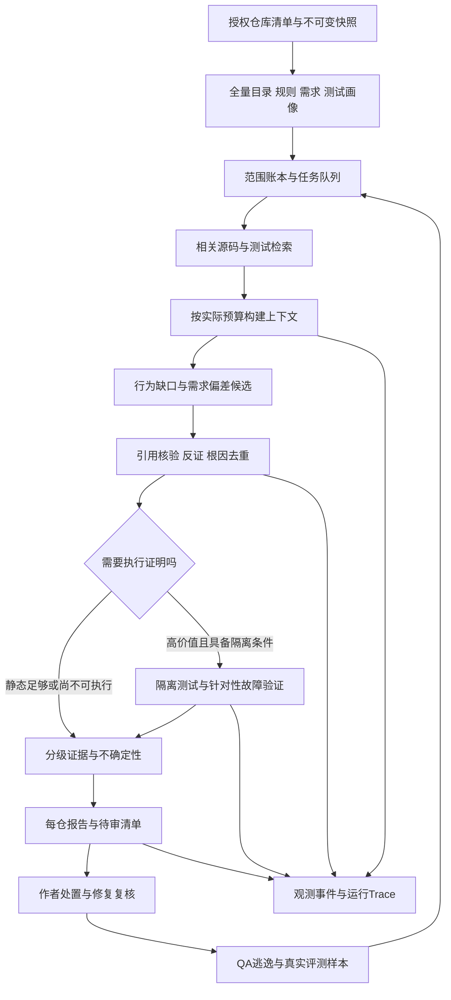

# Shift-left 调研：Anthropic、大厂实践、跨仓库扫描与可观测性

调研日期：2026-10-16（Australia/Sydney）。SpecGuard 本地基线：`b1aaf113aae3ca69fcc70e7b9026130affa6c30f`。

目标：服务于 SpecGuard 的原始任务——对照需求识别缺失或弱单元测试，确认仓库 coding standard，并判断哪些高层测试中的业务规则适合下沉；在 QA 接手前产生可核验的有效干预。接续[价值策略](shift-left-value-strategy-2026-10-16.md)，不把“全仓 AI 平台”本身当目标。

配套交付：[跨仓库扫描操作方案](cross-repository-scan-playbook-2026-10-16.md)、[单仓分析报告模板](templates/repository-shift-left-report.md)。本文是调研与设计建议，没有执行第三方仓库的全量模型审查、部署 telemetry 或发布外部评论。

## 1. 决策摘要

**公开实践支持的方向，是把早期反馈、独立证据、可控执行、人工处置和线上反馈连接起来。没有一家公司的公开材料能证明其流程“保证没有缺陷”。**

对我们最有价值的五项投入：

1. **先建立扫描范围账本。** 把“仓库里有什么、哪些进了上下文、哪些得到判断、哪些获得执行证明”分开记录。它直接解决虚假完整性和静默漏审。
2. **全仓用于建立基线，PR 用于及时行动。** 已有缺口与本 PR 引入的缺口分开；扫描不能把历史债务塞进每次 PR。
3. **验证具体行为，而非奖励测试数量。** 对高价值 weak-test 和需求偏差，提供反例、相关测试和独立期望；按需运行隔离证明。
4. **同时建设三种关联。** 需求到行为到测试的证据关联、审查系统的执行 trace、被测系统的运行 trace，分别回答不同问题。
5. **把 observability 接到价值漏斗。** 能定位为什么漏报、为什么误报、为什么没修，并核对 QA 交接前是否增加保护；只看 token、耗时或评论采纳不足以判断目标达成。

不建议先投入：全组织持续深度模型扫描、每条发现固定五模型投票、通用图数据库、强制 IDE 插件、生产全流量回放、自建全套 observability 平台。先在真实仓库证明上述五项能产生增量价值。

## 2. 调研方法与证据等级

本次检索并阅读 Anthropic 官方工程文章、Claude 官方文档与公开插件源码，以及 Google、Meta、Microsoft/GitHub、AWS、Uber 的官方工程资料/作者论文；OpenTelemetry 用官方规范与源码核对。搜索摘要只用于定位；未取得全文的材料不用于详细结论。

| 标记 | 含义 | 使用边界 |
|---|---|---|
| 公开实践 | 官方工程记录或作者论文，描述其特定系统 | 不能自动推广到整家公司或所有语言 |
| 产品说明 | 官方产品文档、公告、README | 证明文档所述机制或功能，不能当独立效果测量 |
| 本地事实 | 本次读取的 SpecGuard 实现 | 证明路径存在，不等于新做过质量验收 |
| 本文建议 | 基于前述资料对我们目标的推导 | 尚未实施，需试点确认 |

历史实践保留年份。版本会变化的能力按调研日核对；例如 2026-03 的 Claude Code Review 预览描述不能替代 2026-10-15 的 GA 公告。供应商自报处理率、覆盖提升和“被标错误率”，也不能直接换算成我们的 precision、缺陷避免率或 ROI。

未覆盖各家公司内部全部 SDLC、私有平台和未公开指标。本文对公开资料的归纳不是内部流程审计。

## 3. Anthropic：值得借鉴的机制与不能照搬的部分

### 3.1 审查是分层服务，不是只加长 prompt

**产品说明：** 2026-03 的发布文介绍并行寻找问题、验证候选和严重性排序，人仍负责批准。文中“被标记错误少于 1%”是用户反馈口径，不能据此推出 99% precision。2026-10-15 的 GA 公告新增按仓库选择 Quick/Standard/Deep，并称多数审查从约 20 分钟缩短到 6–10 分钟。这是厂商自报，不是我们复测。[预览发布文](https://claude.com/resources/articles/code-review)、[GA 公告](https://claude.com/resources/articles/code-review-is-now-generally-available)。

**本文建议：** 借鉴的是按风险分配验证预算，以及把发现与反证分开。我们不应因它用了多个 agent 就固定复制相同 agent 数量；同一模型的多个回答也可能共享同一个错误假设。先衡量“额外验证带来的有效发现或去噪”是否覆盖成本。

### 3.2 通用 code review 与测试审查不是一回事

**产品说明/源码：** 官方 `code-review` 插件关注差异中的明确问题，过滤一般性缺覆盖建议；独立的 `pr-test-analyzer` 则强调行为、边界、错误路径、现有集成保护和测试成本，不追求机械的 100% 覆盖。[通用 review 命令](https://raw.githubusercontent.com/anthropics/claude-plugins-official/main/plugins/code-review/commands/code-review.md)、[测试分析 agent](https://raw.githubusercontent.com/anthropics/claude-plugins-official/main/plugins/pr-review-toolkit/agents/pr-test-analyzer.md)。

**对我们目标的意义：** SpecGuard 的价值不该等同于又一个泛化代码审查器。需求、测试保护和测试层级需要完整盘点；“没有 bug 评论”不能被转换为“需求都被测了”。可复用行为审查准则，不继承通用 review 的静默分母。

### 3.3 Evals 看任务结果，也看可观察的执行过程

**公开实践：** Anthropic 区分 task、trial、grader、transcript；区分能力评测与回归评测，结合程序检查、模型裁定和人工校准；重复试验用于观察可靠性。它还强调阅读真实执行记录，而非只看总分。[Demystifying evals for AI agents，2026-01-09](https://www.anthropic.com/engineering/demystifying-evals-for-ai-agents)。

**本文建议：** 保留我们已有确定性回归；另建未参与调优的真实行为样本。每个失误都定位到收集、检索、判断、validator、投递或作者处理环节。不能通过“多跑几次挑成功的一次”证明稳定性；应报告首轮和多轮一致性，计入全部成本。

### 3.4 全仓理解依赖外部状态和按需读取

**公开实践：** context engineering 文章介绍轻量引用、按需载入和渐进披露；long-running harness 文章使用持久进度、明确任务与验证，减少会话切换后重复摸索或过早宣布完成。[Context engineering，2025-09-29](https://www.anthropic.com/engineering/effective-context-engineering-for-ai-agents)、[Long-running harnesses，2025-11-26](https://www.anthropic.com/engineering/effective-harnesses-for-long-running-agents)。

**本文建议：** 全仓文件清单、分片游标和证据保存在模型窗口之外；每批只送相关需求、源码和测试。我们的 Claude API 默认是单调用，需要确定性构建 context pack；工具型按需探索属于另一路执行方式，不能假装 API 单调用能自己继续查文件。

### 3.5 官方安全审查也有明示限制

**产品说明/源码：** `claude-code-security-review` 提供 diff-aware 安全分析、误报过滤和评估工具，其 README 明示没有针对 prompt injection 加固、只适合可信 PR。Anthropic 的 containment 文章也讨论仓库配置与工具执行的边界。[安全审查 Action](https://github.com/anthropics/claude-code-security-review)、[Containment 工程文章](https://www.anthropic.com/engineering/how-we-contain-claude)。

**本文建议：** 学习候选与反证工作流，不直接照搬执行权限。其他仓库的说明、hook、MCP 配置是被审数据；全仓静态读取与运行第三方构建/测试分开。执行验证交给隔离 job，不让它取得发布凭据或源仓库以外的写权限。

### 3.6 原生 telemetry 是输入，不是我们的价值报表

**产品说明：** Claude Code 文档支持 OTel metrics/events 和可选 beta traces；traces 默认关闭，需启用 telemetry、enhanced telemetry beta 和 exporter。原始 prompt、响应及工具内容受独立采集选项控制。[Monitoring 官方文档](https://code.claude.com/docs/en/monitoring-usage)。

**本文建议：** 不能延续“Claude Code 只有 metrics/events”的旧结论；也不能以为设置 Claude Code 环境变量就会监控我们的直接 API engine 或 Copilot。SpecGuard 必须在公共编排边界记录自己的 run、scope、validation 和 delivery，再按 engine 接入可获得的 provider 指标。

## 4. 其他大厂：不同层面的前移怎样组合

### 4.1 Google：嵌入工作流，限制噪声，验证测试是否真能抓错

**公开实践：** Tricorder 论文把静态分析做成嵌入开发工作流的数据驱动生态，关注多分析器协作与开发者使用效果。[Tricorder，ICSE 2015](https://research.google/pubs/tricorder-building-a-program-analysis-ecosystem/)。

**公开实践：** Google mutation testing 在变更上生成少量相关故障，利用 coverage 选择测试，对无产出变体做过滤，并在 review 中反馈；它没有把全仓 mutation score 作为唯一目标。[Google Testing Blog，2021](https://testing.googleblog.com/2021/04/mutation-testing.html)。

**本文建议：** 对一个高风险行为做有针对性的反例验证，比全仓无限生成变体更适合我们。coverage 帮助定位执行路径，不能单独证明断言或需求正确。过滤的目标是保护开发者注意力，不能用删除真实风险来制造低噪声。

**公开实践：** Google 的测试层级文章讨论过度依赖 E2E 的速度与诊断代价；SRE 文档关注延迟、流量、错误和饱和度；Dapper 强调低开销、公共库插桩和采样。[测试层级，2015](https://testing.googleblog.com/2015/04/just-say-no-to-more-end-to-end-tests.html)、[SRE monitoring](https://sre.google/sre-book/monitoring-distributed-systems/)、[Dapper，2010](https://research.google/pubs/dapper-a-large-scale-distributed-systems-tracing-infrastructure/)。

**本文建议：** 测试下推按具体行为与现有集成职责决定。对 SpecGuard 监控排队、失败和预算饱和；对业务系统的 trace 只在能转化为测试关联或真实缺陷回放时接入。

### 4.2 Meta：生成候选之后，必须有可运行的约束

**公开实践：** TestGen-LLM 先过滤无法构建的测试，再过滤不能稳定通过的测试，最后要求 coverage 提升。论文明确：没有自动 oracle 时，首次失败可能是错误断言或真实缺陷，因此该自动工作流丢弃失败测试，保留对现有行为的回归保护。[TestGen-LLM，FSE 2024 作者论文](https://arxiv.org/html/2402.09171v1)。

**关键推论：** 我们不能原样采用“失败即丢弃”。需要两条不同分支：增强回归保护时，测试应在正确 HEAD 通过并能拒绝目标故障；发现需求偏差时，独立需求驱动的测试在错误 HEAD 失败，可能正是成果，需人工确认 oracle 并修实现。

**公开实践：** Infer 在 review 阶段增量分析；SapFix 对候选修复检查编译、原崩溃和新崩溃，再交人工批准。预测式测试选择则用历史结果降低测试开销。[Infer，2015](https://engineering.fb.com/2015/06/11/developer-tools/open-sourcing-facebook-infer-identify-bugs-before-you-ship/)、[SapFix/Sapienz，2018](https://engineering.fb.com/2018/09/13/developer-tools/finding-and-fixing-software-bugs-automatically-with-sapfix-and-sapienz/)、[Predictive test selection，2018](https://engineering.fb.com/2018/11/21/developer-tools/predictive-test-selection/)。

**本文建议：** 借鉴发现—验证—人决定的闭环；先复用 adopter 自有 CI。测试选择必须展示选择依据与盲区，不将“被选中的测试通过”写成“所有受影响行为安全”。

### 4.3 Microsoft/GitHub：同类缺陷跨仓扩散检查，执行能力独立管理

**公开实践：** Microsoft 的 OneFuzz 记录了面向开发者的持续 fuzzing；其公开仓库后来声明向内部服务聚焦并归档。这里将它作为历史机制证据，不推荐直接把旧平台作为新基础设施。[Microsoft，2020](https://www.microsoft.com/en-us/security/blog/2020/09/15/microsoft-onefuzz-framework-open-source-developer-tool-fix-bugs/)、[OneFuzz 维护状态](https://github.com/microsoft/onefuzz)。

**产品说明：** GitHub MRVA 可把同一 CodeQL query 分发到有可用数据库的多个仓库；当前文档列出最多 1,000 仓库及 controller、数据库和权限前提。SARIF 用于接收受支持的静态分析结果。[MRVA 概念](https://docs.github.com/en/code-security/concepts/code-scanning/multi-repository-variant-analysis)、[MRVA 操作与前提](https://docs.github.com/en/code-security/how-tos/find-and-fix-code-vulnerabilities/scan-from-vs-code/run-queries-at-scale)、[SARIF support](https://docs.github.com/en/code-security/reference/code-scanning/sarif-files/sarif-support)。

**本文建议：** 一个真实漏报被确认后，可形成有适用条件和反例的“同类行为检查”，在授权仓库复查。MRVA 的并行仓库检查不等于跨仓调用链自动推理，也不证明需求到断言映射。JSON/Markdown 先服务当前目标，只有 adopter 确实需要 code scanning 统一入口时再适配 SARIF。

### 4.4 AWS：先建立系统模型，再验证路径与不确定性

**产品说明：** 2026-05-12 的 full-repository security review 公告描述 profile、风险组件搜索、根因去重、独立验证，并区分 verified 与 could-not-verify。本文引用该日期的机制，不据此断言预览在今天仍是其产品状态。[AWS 全仓审查公告](https://aws.amazon.com/blogs/security/aws-security-agent-full-repository-code-scanning-feature-now-available-in-preview/)。

**公开实践：** AWS boot-code verification 把限定模型中的内存安全性质放入 CI；其证明依赖建模范围和性质定义。[AWS boot code verification，2018](https://aws.amazon.com/blogs/security/automated-reasoning-provable-security-of-boot-code/)。

**本文建议：** 对我们，把 security profile 换成“需求、公共行为、测试入口、标准和仓库边界”画像；把 attack chain 换成“需求→实现→断言”证据链。模型认为成立、引用核对通过、测试执行证明、形式化性质证明，应明确不同。不能把局部性质成立扩写成业务全面正确。

### 4.5 Uber：trace 可以帮助把高层测试前移

**公开实践：** Uber BITS 将测试环境前移，给测试执行采集 trace，建立双向的测试—服务—端点索引，用于选择受变更影响的测试；另有 main 对照执行帮助区分变更问题与已有/环境问题。[Shifting E2E Testing Left at Uber，2024-08-22](https://www.uber.com/us/en/blog/shifting-e2e-testing-left/)。

**对我们目标的意义：** shift left 不等于把所有测试改成 unit。对于跨服务职责，应把必要的高层验证更早运行。我们可先消费 adopter 已有测试 trace，识别某业务规则只在慢路径被断言、或某关键服务没有可见测试执行。完整 BITS 环境、流量路由和隔离体系不应成为 SpecGuard 的前置依赖。

### 4.6 综合取舍

| 可借鉴机制 | 服务的原始目标 | 我们应保留的边界 |
|---|---|---|
| 需求与行为画像、精确引用 | 需求对齐、缺测试 | 来源存在不代表来源正确；冲突需要人决定 |
| 针对变更的低噪声发现 | 提前处理 | 历史债务另列；零评论不证明完整 |
| 程序检查与受控执行 | 弱测试、有效修复 | 运行通过不证明 oracle 正确 |
| 测试层级与运行关联 | 合理下推 | 真实集成职责不能被 mocks 替代 |
| 外部任务状态与扫描前沿 | 多次扫描最终覆盖 | 进程结束不等于范围完成 |
| 版本关联、trace、缺陷回流 | 发现为何失效、收益能否兑现 | 可观测性提供证据，不直接提供因果证明 |

## 5. “全面扫描”应当有可审计定义

以下为本文设计。全面是对声明范围有完整核算，不是承诺任何规模的仓库都被一个模型完整理解。

### 5.1 五层完整性分别报告

| 层次 | 必须有的证据 | 未达到时的正确表达 |
|---|---|---|
| 资产完整 | 授权目标仓库、解析到的不可变 SHA、全 tracked tree 与外部依赖边界 | 部分仓库不可读、submodule/LFS 未展开 |
| 范围完整 | 每个文件和需求属于纳入、排除、未知、不可读或未支持之一 | 仅扫描支持语言和选定 package |
| 阅读完整 | 为每个义务记录相关源/测试/需求是否进入模型上下文 | 某测试只展示窗口，缺口判断受限 |
| 判断完整 | 所有本轮预定原子任务有结论或明确 unknown/deferred | worker 已结束，但仍有待审任务 |
| 验证完整 | 指定 SHA 下的执行、断言或目标故障证据 | 只有静态支持，尚未执行验证 |

全文件被枚举，只能满足第一层；每文件有摘要，也不代表所有可观察行为都生成了正确义务。报告必须展示“枚举覆盖”和“行为评估范围”的区别。

### 5.2 当前 SpecGuard 的实际起点

本地事实：已有[跨仓手动 workflow](../.github/workflows/specguard-run.yml)、[code-first inventory](../src/audit-units.js)、[需求与证据收集](../src/audit-collect.js)、[分批](../src/scan-parts.js)、[scan 校验与报告](../src/audit-post.js)，不是从零建设。

但 `audit-units.js` 的 code-first source 正则只列出部分语言后缀，排除了 config、migrations、generated 等类别，并有文件大小、文件数、时间与测试总量上限。尤其 C/C++ 不在该 code-first 正则列表中。**模型可读多语言不等于收集器完整支持所有语言。** 应把这些边界放进资产账本，不能把未入选文件当已审无问题。本文没有对这些语言路径重新做端到端验收。

已有 `max_units`、文档 block 限额、两次 scan 确认与游标降低重复成本，但有限次运行不保证耗尽全仓。`scan_issue: false` 时不能依赖 issue 中的轮转状态；启用 `scan_issue` 会写入 issue，也必须事先明确输出目的地。

### 5.3 扫描单元按行为切分

推荐队列以“公共行为/需求条目 + 相关实现与测试 + 当前版本”组织；初版可复用现有 source-file unit 和 document block，逐步关联多文件行为。不先建设通用全语言 AST。

优先级来自后果与保护缺口：关键业务、异常和拒绝路径、边界变更、历史逃逸、断言退化；同时为长期未审任务保留份额，避免风险排序永久饿死其他目录。画像中的高 churn 只是候选信号，不直接证明存在缺陷。

## 6. 跨仓架构：复用一个核心，保存明确的扫描前沿



### 6.1 控制面和执行面

控制面保存授权目标、scope、版本、预算、任务状态和报告索引。执行面在单仓、指定 SHA 下使用已有 collector、engine、verifier 和 renderer。首版可用受控文件与 JSONL 聚合，不要求常驻服务。

每个任务至少保存 `pending / running / reviewed / unknown / deferred / failed / excluded`，但 `unknown` 不是自动完成了语义验证；是否继续复查由缺失证据决定。重试产生新 attempt，保留旧结果；聚合不能让失败被后续空输出抹掉。

没有可持久化前沿时，一次扫描只能叫 one-off focused review。不能通过定期重复读取前 12 个文件，宣称持续全仓覆盖。

### 6.2 Context pack 决定实际分片

分片预算需要同时容纳源码、相关测试、需求和规则；分片字节数要考虑行号、提示和输出预算开销。已有约 40 KB source window 与 context pack 单文件/共享配额存在不匹配风险，见[价值策略](shift-left-value-strategy-2026-10-16.md)。

建议先按实际可用额度安排 source+test 的成组任务；仍装不下就缩小行为范围、减少本批任务或标 unknown。只截断测试并继续断言“没有测试”不是合法降级。

### 6.3 版本与失效

任务身份包含 repo、不可变 revision、scope、行为/需求引用和分析版本。覆盖结论的证据依赖至少包括相关需求、源码、测试与测试发现配置；变化时按影响失效。

缓存分层：文件画像可按 blob 复用；检索结果还依赖索引和配置；语义结论还依赖 prompt、schema、模型与证据集合。单个源码文件未改，不能保证其他测试、调用者或需求没有改变。当前 build hash 有帮助，但完整 provenance 还需 workflow/Action 版本和运行参数。

### 6.4 跨仓依赖不要只靠搜索同名函数

先从显式 package/import、服务目录、OpenAPI/Protobuf/schema、部署信息和已有运行 trace 建候选关系。关系都带来源、版本与确定性等级。

调用图告诉我们可能经过哪里；测试执行 trace 告诉我们某次经过哪里；断言和独立需求才支持行为正确性。运行 trace 缺失可能只是没采到；跨仓“没搜到实现”也可能是无权读取或运行时依赖，必须保留 unresolved boundary。

多仓同时变更用 `change_set_id` 关联各仓独立 SHA；不要假设 default branch 的各个最新提交来自同一发布版本。已部署的依赖关系还要对齐 release/image digest，不能只用今天源码解释昨天生产事故。

## 7. Trace：至少三种概念，不能互相替代

| 类型 | 连接的对象 | 回答的问题 | 不能证明 |
|---|---|---|---|
| 需求与证据 traceability | 需求版本→义务→实现→断言→执行→处置 | 这条结论依据什么？哪个需求仍缺保护？ | 测试已运行、业务意图天然正确 |
| SpecGuard 执行 trace | 收集→检索→pack→模型→校验→投递 | 为什么慢、漏、错，在哪一步丢失？ | 被审代码的运行行为正确 |
| 被测系统 distributed trace | 请求/测试→服务→端点→依赖 | 某次真实调用触达什么？哪些测试关联某服务？ | 所有路径覆盖、测试断言正确 |

数据流 path（如 CodeQL）是另一类静态关系，描述可能流向；也不能与一次实际执行等同。

OpenTelemetry 定义 span、context propagation 和 link，可承载执行关联；跨异步操作可用 span links。本文建议的需求证据边及字段是 SpecGuard 自有模型，不是 OTel 已有标准。[OTel traces](https://opentelemetry.io/docs/concepts/signals/traces/)、[Context propagation](https://opentelemetry.io/docs/concepts/context-propagation/)。

### 7.1 最小证据图可以先是普通 JSON

```text
Requirement{source, revision, quote}
  --拆分为--> Obligation{observable_behaviour, input, expected, oracle_origin}
  --实现在--> CodeRef{repo, revision, path, range, digest}
  --由其断言--> TestRef{repo, revision, test_id, assertion_ref, layer}
  --本次执行--> Execution{revision, command, environment, status, artifact_ref}
  --暴露风险--> Finding{behaviour_id, evidence_level, counterexample, limits}
  --处理为--> Resolution{decision, commit, verification_ref, before_QA}
```

这些边是待核验主张。每条边注明 `inferred / source_verified / execution_observed / behaviour_verified` 等证据等级，并允许冲突与失效。哈希便于内容匹配，不应被当成权限隔离或敏感文本不可恢复的保证。

无需先用图数据库。仅当人工报告和关系查询已成为实测瓶颈，才引入更复杂存储。

## 8. Observability：先让系统能解释自己的失误

### 8.1 三个观测面

| 观测面 | 关键问题 | 最低可用输出 |
|---|---|---|
| 运行健康 | 该跑的是否跑了？预算耗在哪？ | eligibility、排队、延迟、失败、截断、重试、费用 |
| 判断质量 | 该看的看到了吗？候选为何升降级？ | evidence manifest、candidate→validated→delivered 漏斗、具体原因 |
| 目标收益 | 有效发现是否带来交付前保护？ | 人工有效性、处置、验证结果、QA交接时间、逃逸回访 |

本地 `src/post.js` 已输出 build、counts、`execution_complete` 和部分 outcomes；context 里有模型、用量和遗漏信息。本次在 `src`/`bin` 未检索到 `OpenTelemetry`、`OTEL_` 或 `traceparent` 的现有接入。它们是可复用素材，不等于完整端到端 tracing 已实现。

### 8.2 建议 span 结构

```text
specguard.review_run                         # 单个repo/revision/attempt
  target.resolve
  context.collect
    requirements.discover
    tests.discover
    scope.account
  evidence.retrieve
  context.pack
  model.call                                 # 每次请求各一span
  result.parse
  result.validate
  report.render
  report.deliver

specguard.verify_run                         # 后续独立执行
  test.baseline
  test.candidate
  fault.check
  resolution.record
```

异步复核与数天后的作者处置作为新 run/event，用稳定业务 ID 和必要的 span link 关联，不保持一个跨数周的未结束 span。仅以时间相邻拼接两条 trace 不能证明是同一处理链。

### 8.3 字段、状态与版本

以下字段是建议，不是当前 schema 新承诺：

| 层级 | 字段示例 | 用途 |
|---|---|---|
| provenance | `run_id, attempt_id, parent_run_id, repo_id, base_sha, head_sha, scope_hash` | 重放、重试、跨报告对齐 |
| 分析版本 | `specguard_build, action_sha, prompt_hash, schema_version, engine, requested_model, actual_model, config_hash` | 区分升级和环境差异 |
| 范围 | `inventory_count, eligible_count, read_count, reviewed_count, unknown_count, deferred_count, omitted_reasons` | 防止分母缩水 |
| 判断 | `candidate_id, behaviour_id, finding_id, rule_id, evidence_refs, validation_decision, validation_reason` | 追踪去重、压低或丢弃 |
| 运行 | `duration_ms, queue_ms, retry_count, tokens_by_type, cost_amount, cost_basis` | 定位成本与等待 |
| 结果 | `delivery_state, human_verdict, resolution_state, verification_ref, qa_handoff_at` | 判断保护是否兑现 |

`execution_state`、`scope_state`、`review_strength`、`delivery_state` 分开：一次成功 HTTP 调用可以产出范围不完整、降低强度且没有成功投递的审查。不要让同一个 `complete=true` 同时代表四件事。保留旧字段兼容映射，不在文档中假装新协议已实施。

高基数字段如 SHA、路径、finding ID、prompt hash 放 event/span/artifact；时间序列 labels 保持有限维度，例如 mode、engine、stage、outcome、reason。仓库维度只在受控数量内使用；不要为每个 PR 和文件创造一组新时序。

记录可观察输入/输出、工具调用元数据和简短判定依据；不依赖模型私有思维链。无法取得 provider 内部步骤时明确只观测到外层调用，不伪造子 span。

### 8.4 最少需要的指标

| 指标 | 分母/口径 | 用于行动 |
|---|---|---|
| scheduled→started→finished→delivered | 预先定义的 eligible run，保留 skip/fail | 配置、队列或权限问题 |
| 首个可执行反馈 p50/p95 | 从触发起，包含排队；无反馈单列 | 是否赶在作者/QA交接前 |
| 范围完成与待审年龄 | 固定 snapshot 的 eligible 原子任务 | 分片饥饿、预算不匹配 |
| omission 与 unknown 原因分布 | 全部审查任务 | 该补检索、上下文还是语言适配 |
| 候选、降级、投递漏斗 | 按独立行为去重，全部出口 | validator 是否误杀或噪声外溢 |
| 人工有效性及分类型 precision | 盲标 valid/invalid，unsure 单列 | 调整何种发现应首屏显示 |
| 有效提前干预/100 eligible PR | QA前完成且有相关保护/修复证据 | 是否实现目标，而非制造活动 |
| 全周期成本/PR 与有效干预成本 | 全部 push、本地运行、重试和验证；人工耗时另列 | 判断额外验证是否值得 |
| QA逃逸与重复缺陷 | 风险分层、相同成熟观察窗 | 形成真实漏报样本并长期验证 |

`addressed`、改了测试文件、线程被关闭和未再报告，都只算代理状态。出现零有效干预时，单位干预成本应标无可估计或未产生收益，不给出误导性低成本。

### 8.5 如何用 trace 定位问题

| 现场现象 | 要找的证据 | 具体改动方向 |
|---|---|---|
| QA发现漏测，但机器人无评论 | 目标是否进 eligible、retrieval、pack 和 obligations | 分别修发现、候选检索或判断，不先泛化加 prompt |
| 测试明明存在仍被报缺失 | 测试路径、断言窗口、排除与读取失败 | 补配置或完整窗口，保持 unknown 边界 |
| 候选正确，报告没显示 | validator reason、去重合并、inline/summary routing | 核查误杀与展示，不盲目换模型 |
| 多次 scan 无新覆盖 | cursor、实际读取范围、任务年龄、per-file budget | 缩片或减批，避免假进度 |
| 评论被采纳，QA仍复现同类问题 | 独立oracle、运行记录、变体、测试选取与部署版本 | 核对是否修错预期或保护没有进入交付 |
| 成本上涨，发现数不变 | 全部调用、输入膨胀、repair、反证收益 | 调整 pack 和验证预算，保留质量护栏 |

### 8.6 采样、内容和观测系统自身可靠性

建议所有 run 保存最小无原文事件和最终 outcome；调试 trace 按风险/错误/迟延和随机对照抽样。需要保留所有错误 trace 时，不能先在 head sampling 丢弃它们；可在完整接收或合适配置的 tail sampling 后决定保留，同时监控丢 span/队列压力。[OTel sampling](https://opentelemetry.io/docs/concepts/sampling/)。

正文、代码、prompt、测试输出单独放受控 artifact，设访问范围与保留期；遥测只存引用和摘要。授权和 endpoint 由可信运行配置决定，不从目标仓库的设置继承。Baggage 不放 token、PII 或敏感需求正文；跨外部服务传播时核对边界。[OTel propagation 安全说明](https://opentelemetry.io/docs/concepts/context-propagation/)。

初版 tracing exporter 失败应保存本地诊断并标 `observability_partial`，不伪装执行完成，也不让可选遥测故障无故阻断 advisory review。若关键范围账本丢失，报告范围 unknown；不能因为 AI 输出成功就宣布全仓完成。

GenAI 约定已拆到独立仓库，调研时 manifest 标为 `development`。应固定版本并以 adapter 映射，避免把不稳定属性名硬编码为长期存储合同。[官方 GenAI 仓库](https://github.com/open-telemetry/semantic-conventions-genai)、[manifest](https://raw.githubusercontent.com/open-telemetry/semantic-conventions-genai/main/model/manifest.yaml)。

### 8.7 最小事件与接入验收

第一版先定义有限事件：`run.started`、`evidence.omitted`、`finding.validated`、`report.delivered`、`run.finished`、`run.failed`、`resolution.verified`；跳过也要有原因。下例是拟议格式，不是当前产物：

```json
{
  "event_schema": "proposal-1",
  "event_name": "finding.validated",
  "run_id": "RUN_ID",
  "attempt_id": "ATTEMPT_ID",
  "repo_id": "CONTROLLED_REPO_ID",
  "head_sha": "FULL_COMMIT_SHA",
  "behaviour_id": "BEHAVIOUR_ID",
  "candidate_id": "CANDIDATE_ID",
  "decision": "downgraded",
  "reason": "candidate_test_context_incomplete",
  "evidence_refs": ["restricted-artifact-reference"],
  "scope_state": "incomplete"
}
```

实际事件还需可信时间戳和版本。`downgraded` 不是“候选无效”，只说明缺少足够证据；丢弃和合并也要有不同reason，避免无法复盘。

公共wrapper在进程启动时建立run身份，收集器、engine、verifier、publisher共享该身份；多进程需要显式传递受控关联信息，不能期望开启某个CLI telemetry后所有进程天然在同一trace。短命Actions进程退出前应完成export flush；崩溃、强制取消和超时可能无法写terminal事件，由外层调度结果补“异常终止”，保留事件缺口。

接入验收至少包括：正常运行可串起全部阶段；候选被降级时能找到原原因；CLI/API/scan入口能关联；失败/取消不消失；secret与原文默认不进入遥测；exporter断连可诊断；重复attempt不会重复计有效修复。先在fake provider与合成输入下验收，再在一个真实授权仓库canary。

## 9. 如何消费业务系统的 observability

以下是第二阶段能力；没有它也能先做 PR 测试审查。

### 9.1 优先接已有 CI 与测试产物

先接确定 SHA 的 JUnit/测试清单、coverage、测试命令/环境、lint/typecheck 结果，以及 adopter 已有测试 trace。检测 skip、CI 排除、运行层级、相关测试实际执行与否。coverage 缺命中只说明这次运行没有执行该位置，不证明仓库没有测试。

再建立 `test_id → service/endpoint → code/package` 候选索引，附执行版本与采样信息。高层 trace 中触达一个 endpoint，只提供执行可达证据；需要继续读断言才能判断业务规则是否被保护。

### 9.2 用线上异常生成受控回归线索

```text
线上异常/QA缺陷
  → 脱敏的行为描述、时间与部署版本
  → 定位源仓revision和变更范围
  → 人工确认需求及引入关系
  → PR时刻信息的离线回放
  → 需求驱动的最小回归测试
  → 隔离CI验证
  → 未见样本与回归集分别维护
```

生产输入不能直接复制到模型或测试环境。先最小化、脱敏并确认可重放副作用。请求样本代表观察分布，也可能遗漏未采样失败、低流量路径和新功能；不能把它当完整业务规格。

真正跨服务才能出现的故障归给相应集成/契约/E2E 验证，并明确 SpecGuard 的单位测试边界。业务 observability 主要帮助选题、定位和构造回归，不承诺静态模型取代运行验证。

## 10. 每仓报告与组织汇总应该如何写

每仓报告按[模板](templates/repository-shift-left-report.md)写出：

1. 仓库、精确 SHA、scope、模型与配置，以及本报告是否静态/执行/混合。
2. 资产与范围账本，包括不支持、排除、未知、未读和长期待审。
3. 原始四轴结论：需求对齐、单元测试保护、标准确认、测试层级。
4. 按行为去重的优先发现：影响、输入、需求、代码、现有测试、反例、验证等级、限制、最小行动与负责人。
5. 本轮相对上轮的真实变化：新引入、历史债务、证据失效、已验证修复与未再观察到分别列出。
6. 可复跑入口、工件索引、成本和下一批任务。

组织汇总按缺陷类型、业务后果和可核验处置排序，不按仓库“分数排名”。不同语言的发现支持范围与义务分母不同，不能直接用 `covered/obligations` 给团队评级。一个没有规格的仓库应展示意图未知，不能因义务少而排名更好。

## 11. 对 SpecGuard 的实施顺序

| 优先级 | 工作项 | 复用起点 | 完成证据 |
|---|---|---|---|
| P0 | 全量inventory与互斥范围状态、明确不支持语言 | audit-units、audit-collect、现有 caps | 任意tracked文件有去向；分母可复算 |
| P0 | 公共边界结构化事件与 provenance | version、counts、engine-model、遗漏文件 | 给定finding能追到输入范围、validator和投递 |
| P0 | 实际预算驱动的source+test分片及进度验收 | contextPack、scan-parts、cursor | 同一快照重跑能增加真实已审范围或报告停滞 |
| P0 | 人工有效修复表与真实失败样本 | replay、prove、label-export | 至少有可复核的QA前保护增强，不以代理修改冒充 |
| P1 | 标准正反canary与真实pushdown成对样例 | checks、现有层级契约 | 规则+执行同SHA；同故障集合下验证层级收益 |
| P1 | 若已有后端则导出OTel；无则先JSONL | 公共run事件 | API/CLI/本地/scan有共同业务ID；遥测故障可诊断 |
| P1 | 三类授权仓库试点与语义去重 | 既有manual workflow、现有Action | 支持边界、噪声、总成本与有效干预分层报告 |
| P2 | 测试trace索引、跨仓契约与同类缺陷复查 | adopter已有CI/OTel/CodeQL | 比现有检索增加可确认价值，且保留未知边界 |
| 按触发投入 | SARIF、图数据库、IDE、常驻调度 | 有明确使用方后 | 操作或查询瓶颈实测存在，收益超过维护成本 |

“三类”建议为：有明确需求且单测成熟；需求薄弱但测试成熟；monorepo/跨服务且高层测试较多。至少覆盖不同语言，避免把一个种子仓库的结果当普适能力。

不重写现有引擎，不为审查四轴固定拆四次模型调用，不把现有 `scan` 改造成无边界安全扫描。安全案例用于借鉴验证和范围机制，原目标仍是需求驱动的测试保护。

## 12. 六组应该先做的验证

| 验证 | 正反对照 | 回答的决策问题 |
|---|---|---|
| 范围诚实与最终进展 | unsupported、截断、大文件、失败、连续重跑、期间变更 | 能否合理宣称扫描覆盖？ |
| weak-test语义 | 真弱断言、真实有效truthy断言、等价迁移、独立错误oracle | 具体反例是否提高precision且保留召回？ |
| 独立验证收益 | 同一原始候选，在不同验证预算下盲标 | 是否值得增加第二次检查或执行？ |
| trace用于检索 | 有/无已有测试trace索引，同预算与同快照 | 是否多找到有效测试而减少误报？ |
| 本地与PR反馈 | 同行为的首次提示时间、后续处置和全部调用成本 | 更早入口是否真正减少往返？ |
| 真人增量与QA滞后 | 保持现有流程的对照、语义独有发现、相同成熟观察窗 | 能否证明目标收益而非活动增长？ |

不以十个 planted PR 当真人precision，不用今天 issue 内容回放过去，不让后续修复进入 reviewer 上下文；零发现与失败 PR 也抽样查漏。模型作为 grader 需人工校准；测试形态检查不能替代语义真值。

沿用已有[验证计划](validation-plan.md)的样本与阶段边界；不同实验方案事先固定，不能看到结果后换门槛。2–4 周可验证部分采用和保护闭环，QA逃逸仍需更长且一致的观察窗。任何厂商自报指标都不能作为我们达标的证据。

## 13. 这次调研对上一轮分析增加了什么

- 从“有效提前干预”进一步落实到范围账本、行为证据图和运行事件，说明怎样追查闭环断在哪里。
- 用 Meta 的失败测试过滤解释两类不同目标：保持现行为与发现需求偏差，避免错误照搬验证管线。
- 用 Uber 的测试trace索引解释 observability 如何直接帮助测试选择与层级分析，而非仅增加仪表盘。
- 核对 Claude Code Review 的最新 GA 变化与 beta tracing，避免沿用旧产品状态。
- 指出 SpecGuard 当前 code-first 语言/目录范围、预算轮转和 telemetry 接入边界，给出渐进方案。

## 14. 本次验证与资料限制

本次进行了公开官方资料检索、相关全文/官方源码阅读、本地实现核对，以及交付文档的链接、代码块和 diff 格式检查。没有执行全组织扫描、真实模型对照、fuzzing、mutation、第三方测试代码或生产流量回放；没有安装服务或向其他仓库发布内容。

`claude.dev` 的“How the Claude Code team does code review”搜索结果可定位，但全文工具读取失败，因此没有把其细节当依据。官方产品公告是机制和自报效果的证据；历史工程文章是特定系统当年的实践，不据此推定其 2026 年所有内部状态。

这份报告新增的是有来源的研究和可操作设计。SpecGuard 的真实人工 precision、执行验证增量、跨语言可用范围和 QA 返工下降，仍需按本文与配套方案实际测量。
