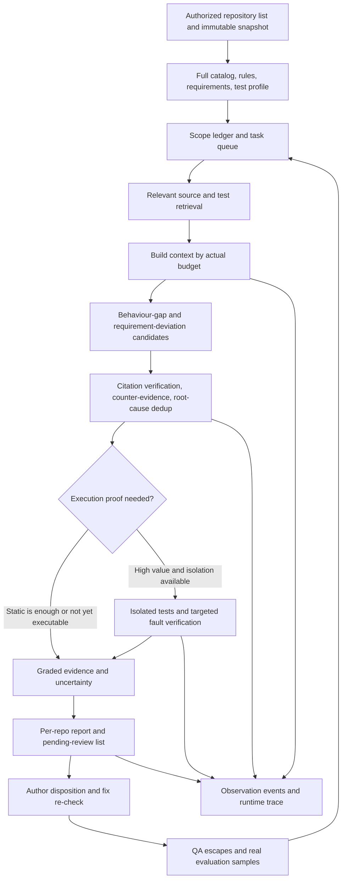

# Shift-left Research: Anthropic, Big-Tech Practice, Cross-Repository Scanning, and Observability

Research date: 2026-10-16 (Australia/Sydney). SpecGuard local baseline: `b1aaf113aae3ca69fcc70e7b9026130affa6c30f`.

Goal: serve SpecGuard's original task of identifying missing or weak unit tests against requirements, confirming the repository coding standard, and judging which business rules in higher-level tests are suitable for pushing down; to produce verifiable, effective interventions before QA takes over. This continues the [value strategy](shift-left-value-strategy-2026-10-16.md), and does not treat a "full-repo AI platform" as the goal itself.

Companion deliverables: the [cross-repository scan playbook](cross-repository-scan-playbook-2026-10-16.md) and the [single-repository analysis report template](templates/repository-shift-left-report.md). This document is research and design recommendations; it did not run a full-scale model review of third-party repositories, deploy telemetry, or publish external comments.

## 1. Decision summary

**The direction supported by public practice is to connect early feedback, independent evidence, controlled execution, human disposition, and online feedback. No company's public material can prove that its process "guarantees no defects".**

The five investments most valuable to us:

1. **Build a scan-scope ledger first.** Record separately "what is in the repository, what entered the context, what received a judgment, and what obtained execution proof". It directly addresses false completeness and silent missed review.
2. **Use the full repo to build a baseline, and the PR for timely action.** Keep existing gaps separate from gaps introduced by this PR; the scan must not stuff historical debt into every PR.
3. **Verify specific behaviour rather than rewarding test count.** For high-value weak-test and requirement deviations, provide counterexamples, related tests, and independent expectations; run isolated proofs on demand.
4. **Build three kinds of linkage at once.** Evidence linkage from requirement to behaviour to test, the execution trace of the review system, and the runtime trace of the system under test, each answering a different question.
5. **Connect observability to the value funnel.** Be able to locate why something was missed, why a false positive appeared, why it was not fixed, and to check whether protection was added before QA handoff; looking only at tokens, latency, or comment adoption is not enough to judge whether the goal was achieved.

Not recommended to invest in first: continuous deep model scanning across the whole organization, a fixed five-model vote for every finding, a general graph database, mandatory IDE plugins, full production traffic replay, building a complete observability platform in-house. First prove on real repositories that the five items above can produce incremental value.

## 2. Research method and evidence grades

This round searched for and read Anthropic's official engineering articles, official Claude documentation and public plugin source, and official engineering materials / author papers from Google, Meta, Microsoft/GitHub, AWS, and Uber; OpenTelemetry was checked against the official specification and source. Search snippets were used only for locating; material whose full text was not obtained is not used for detailed conclusions.

| Marker | Meaning | Boundary of use |
|---|---|---|
| Public practice | Official engineering records or author papers describing their specific system | Cannot be automatically generalized to a whole company or all languages |
| Product description | Official product documentation, announcements, README | Proves the mechanism or feature described in the document; cannot be treated as an independent effect measurement |
| Local fact | The SpecGuard implementation read in this round | Proves the path exists; does not equal a new quality acceptance |
| This document's recommendation | Inference about our goal based on the material above | Not yet implemented, needs pilot confirmation |

Historical practices keep their year. Capabilities whose versions change were checked as of the research date; for example, the 2026-03 Claude Code Review preview description cannot replace the 2026-10-15 GA announcement. Vendor self-reported processing rates, coverage gains, and "flagged-as-wrong rate" also cannot be converted directly into our precision, defect-avoidance rate, or ROI.

The internal full SDLC, private platforms, and unpublished metrics of each company are not covered. This document's summary of public material is not an audit of internal processes.

## 3. Anthropic: mechanisms worth borrowing and parts that cannot be copied

### 3.1 Review is a layered service, not just a longer prompt

**Product description:** The 2026-03 launch post describes finding problems in parallel, verifying candidates, and severity ranking, with humans still responsible for approval. The "flagged as wrong less than 1%" in it is on a user-feedback basis, and 99% precision cannot be inferred from it. The 2026-10-15 GA announcement adds per-repository selection of Quick/Standard/Deep and says most reviews are shortened from about 20 minutes to 6–10 minutes. This is vendor self-report, not re-measured by us. [Preview launch post](https://claude.com/resources/articles/code-review), [GA announcement](https://claude.com/resources/articles/code-review-is-now-generally-available).

**This document's recommendation:** What to borrow is allocating verification budget by risk, and separating findings from counter-evidence. We should not fix the same number of agents just because it used multiple agents; multiple answers from the same model may also share the same wrong assumption. First measure whether "the valid findings or denoising brought by extra verification" covers the cost.

### 3.2 General code review and test review are not the same thing

**Product description / source:** The official `code-review` plugin focuses on clear problems in the diff and filters generic lack-of-coverage suggestions; the separate `pr-test-analyzer` stresses behaviour, boundaries, error paths, existing integration protection, and test cost, and does not pursue mechanical 100% coverage. [General review command](https://raw.githubusercontent.com/anthropics/claude-plugins-official/main/plugins/code-review/commands/code-review.md), [test analysis agent](https://raw.githubusercontent.com/anthropics/claude-plugins-official/main/plugins/pr-review-toolkit/agents/pr-test-analyzer.md).

**Significance for our goal:** SpecGuard's value should not equal yet another generalized code reviewer. Requirements, test protection, and test levels need a full inventory; "no bug comments" cannot be converted into "requirements are all tested". Behaviour-review principles can be reused, without inheriting the silent denominator of general review.

### 3.3 Evals look at task results and also at the observable execution process

**Public practice:** Anthropic distinguishes task, trial, grader, and transcript; distinguishes capability evals from regression evals, combines programmatic checks, model adjudication, and human calibration; repeated trials are used to observe reliability. It also stresses reading real execution records rather than only the total score. [Demystifying evals for AI agents, 2026-01-09](https://www.anthropic.com/engineering/demystifying-evals-for-ai-agents).

**This document's recommendation:** Keep our existing deterministic regressions; separately build real-behaviour samples that did not take part in tuning. Locate every miss to the collection, retrieval, judgment, validator, delivery, or author-handling stage. Stability cannot be proven by "run several times and pick the successful one"; report first-round and multi-round consistency, and count all costs.

### 3.4 Whole-repo understanding depends on external state and on-demand reading

**Public practice:** The context engineering article introduces lightweight references, on-demand loading, and progressive disclosure; the long-running harness article uses persistent progress, explicit tasks, and verification to reduce repeated groping after session switches or premature declarations of completion. [Context engineering, 2025-09-29](https://www.anthropic.com/engineering/effective-context-engineering-for-ai-agents), [Long-running harnesses, 2025-11-26](https://www.anthropic.com/engineering/effective-harnesses-for-long-running-agents).

**This document's recommendation:** Keep the whole-repo file list, shard cursor, and evidence outside the model window; send only relevant requirements, source, and tests per batch. Our Claude API default is a single call, which needs a deterministically built context pack; tool-based on-demand exploration is a different execution mode, and we cannot pretend an API single call can keep looking up files on its own.

### 3.5 The official security review also has stated limitations

**Product description / source:** `claude-code-security-review` provides diff-aware security analysis, false-positive filtering, and evaluation tooling, and its README states it is not hardened against prompt injection and is suitable only for trusted PRs. Anthropic's containment article also discusses the boundary between repository configuration and tool execution. [Security review Action](https://github.com/anthropics/claude-code-security-review), [Containment engineering article](https://www.anthropic.com/engineering/how-we-contain-claude).

**This document's recommendation:** Learn the candidate-and-counter-evidence workflow, without copying its execution permissions directly. Other repositories' instructions, hooks, and MCP configuration are data under review; whole-repo static reading is separate from running third-party builds/tests. Hand execution verification to an isolated job, and do not let it obtain publishing credentials or write permissions beyond the source repository.

### 3.6 Native telemetry is an input, not our value report

**Product description:** The Claude Code documentation supports OTel metrics/events and optional beta traces; traces are off by default and need telemetry, the enhanced telemetry beta, and an exporter to be enabled. Raw prompts, responses, and tool content are controlled by separate collection options. [Official Monitoring documentation](https://code.claude.com/docs/en/monitoring-usage).

**This document's recommendation:** The old conclusion that "Claude Code only has metrics/events" cannot be continued; nor can one assume that setting Claude Code environment variables will monitor our direct API engine or Copilot. SpecGuard must record its own runs, scope, validation, and delivery at the common orchestration boundary, then connect the provider metrics obtainable per engine.

## 4. Other big companies: how shift-left at different layers combines

### 4.1 Google: embed in the workflow, limit noise, verify tests can really catch errors

**Public practice:** The Tricorder paper builds static analysis as a data-driven ecosystem embedded in the developer workflow, focusing on multi-analyzer collaboration and developer usage effects. [Tricorder, ICSE 2015](https://research.google/pubs/tricorder-building-a-program-analysis-ecosystem/).

**Public practice:** Google mutation testing generates a small number of relevant faults on a change, uses coverage to select tests, filters unproductive variants, and gives feedback in review; it does not make a whole-repo mutation score the sole goal. [Google Testing Blog, 2021](https://testing.googleblog.com/2021/04/mutation-testing.html).

**This document's recommendation:** For a high-risk behaviour, targeted counterexample verification suits us better than endlessly generating variants across the whole repo. Coverage helps locate execution paths, but cannot alone prove an assertion or requirement correct. The aim of filtering is to protect developer attention; it cannot be used to create low noise by deleting real risk.

**Public practice:** Google's test-level article discusses the speed and diagnosis cost of over-relying on E2E; the SRE documentation focuses on latency, traffic, errors, and saturation; Dapper stresses low overhead, common-library instrumentation, and sampling. [Test levels, 2015](https://testing.googleblog.com/2015/04/just-say-no-to-more-end-to-end-tests.html), [SRE monitoring](https://sre.google/sre-book/monitoring-distributed-systems/), [Dapper, 2010](https://research.google/pubs/dapper-a-large-scale-distributed-systems-tracing-infrastructure/).

**This document's recommendation:** Test pushdown is decided by specific behaviour and existing integration responsibilities. For SpecGuard, monitor queueing, failure, and budget saturation; connect traces of business systems only when they can be converted into test linkage or real-defect replay.

### 4.2 Meta: after generating candidates, there must be runnable constraints

**Public practice:** TestGen-LLM first filters tests that cannot build, then tests that cannot pass stably, and finally requires a coverage increase. The paper states clearly: without an automatic oracle, a first failure may be a wrong assertion or a real defect, so that automatic workflow discards failing tests and keeps regression protection for existing behaviour. [TestGen-LLM, FSE 2024 author paper](https://arxiv.org/html/2402.09171v1).

**Key inference:** We cannot adopt "discard on failure" as is. Two different branches are needed: when strengthening regression protection, the test should pass on the correct HEAD and be able to reject the target fault; when finding a requirement deviation, an independent requirement-driven test failing on the wrong HEAD may be exactly the result, and a human must confirm the oracle and fix the implementation.

**Public practice:** Infer analyzes incrementally at review time; SapFix checks compilation, the original crash, and new crashes for candidate fixes, then hands over to human approval. Predictive test selection uses historical results to reduce testing overhead. [Infer, 2015](https://engineering.fb.com/2015/06/11/developer-tools/open-sourcing-facebook-infer-identify-bugs-before-you-ship/), [SapFix/Sapienz, 2018](https://engineering.fb.com/2018/09/13/developer-tools/finding-and-fixing-software-bugs-automatically-with-sapfix-and-sapienz/), [Predictive test selection, 2018](https://engineering.fb.com/2018/11/21/developer-tools/predictive-test-selection/).

**This document's recommendation:** Borrow the discover — verify — human decides loop; first reuse the adopter's own CI. Test selection must show its selection basis and blind spots, and not write "the selected tests passed" as "all affected behaviour is safe".

### 4.3 Microsoft/GitHub: cross-repository spread checks for similar defects, with execution capability managed independently

**Public practice:** Microsoft's OneFuzz documented developer-facing continuous fuzzing; its public repository later declared a focus on internal services and was archived. It is used here as historical evidence of a mechanism, and directly adopting the old platform as new infrastructure is not recommended. [Microsoft, 2020](https://www.microsoft.com/en-us/security/blog/2020/09/15/microsoft-onefuzz-framework-open-source-developer-tool-fix-bugs/), [OneFuzz maintenance status](https://github.com/microsoft/onefuzz).

**Product description:** GitHub MRVA can distribute the same CodeQL query to multiple repositories that have a usable database; the current documentation lists up to 1,000 repositories and prerequisites for the controller, database, and permissions. SARIF is used to receive supported static analysis results. [MRVA concepts](https://docs.github.com/en/code-security/concepts/code-scanning/multi-repository-variant-analysis), [MRVA operation and prerequisites](https://docs.github.com/en/code-security/how-tos/find-and-fix-code-vulnerabilities/scan-from-vs-code/run-queries-at-scale), [SARIF support](https://docs.github.com/en/code-security/reference/code-scanning/sarif-files/sarif-support).

**This document's recommendation:** After a real miss is confirmed, a "similar-behaviour check" with applicability conditions and counterexamples can be formed and re-checked in authorized repositories. MRVA's parallel repository checking is not equal to automatic reasoning over cross-repository call chains, and does not prove a requirement-to-assertion mapping. JSON/Markdown first serve the current goal; adapt SARIF only when an adopter really needs a unified code scanning entry.

### 4.4 AWS: build the system model first, then verify paths and uncertainty

**Product description:** The 2026-05-12 full-repository security review announcement describes profile, risk-component search, root-cause dedup, independent verification, and distinguishes verified from could-not-verify. This document cites the mechanism as of that date, and does not assert from it that the preview is still the product's state today. [AWS full-repository review announcement](https://aws.amazon.com/blogs/security/aws-security-agent-full-repository-code-scanning-feature-now-available-in-preview/).

**Public practice:** AWS boot-code verification puts memory-safety properties in a bounded model into CI; its proof depends on the modeling scope and property definition. [AWS boot code verification, 2018](https://aws.amazon.com/blogs/security/automated-reasoning-provable-security-of-boot-code/).

**This document's recommendation:** For us, replace the security profile with a profile of "requirements, public behaviour, test entry points, standards, and repository boundaries"; replace the attack chain with a "requirement → implementation → assertion" evidence chain. The model believing something holds, citation check passing, test execution proof, and formal property proof should be clearly different. A locally established property cannot be extended into overall business correctness.

### 4.5 Uber: traces can help shift higher-level tests left

**Public practice:** Uber BITS moves the test environment left, collects traces for test runs, builds a bidirectional test—service—endpoint index used to select tests affected by a change; another main comparison run helps distinguish change problems from pre-existing / environment problems. [Shifting E2E Testing Left at Uber, 2024-08-22](https://www.uber.com/us/en/blog/shifting-e2e-testing-left/).

**Significance for our goal:** shift left does not mean turning all tests into unit tests. For cross-service responsibilities, necessary higher-level verification should run earlier. We can first consume the adopter's existing test traces, to identify a business rule that is asserted only on a slow path, or a key service with no visible test execution. The complete BITS environment, traffic routing, and isolation system should not be a prerequisite dependency of SpecGuard.

### 4.6 Overall trade-offs

| Mechanism to borrow | Original goal served | Boundary we should keep |
|---|---|---|
| Requirement and behaviour profile, precise citations | Requirement alignment, missing tests | A source existing does not mean the source is correct; conflicts need a human to decide |
| Low-noise discovery targeted at the change | Handling things earlier | Historical debt listed separately; zero comments do not prove completeness |
| Programmatic checks and controlled execution | Weak tests, effective fixes | A passing run does not prove the oracle is correct |
| Test level and run linkage | Reasonable pushdown | Real integration responsibilities cannot be replaced by mocks |
| External task state and scan frontier | Eventual coverage across multiple scans | A process ending does not equal scope completion |
| Version linkage, trace, defect feedback | Why discovery failed, whether benefits materialize | Observability provides evidence, not causal proof directly |

## 5. A "comprehensive scan" should have an auditable definition

The following is this document's design. Comprehensive means a complete accounting of the declared scope; it is not a promise that a repository of any size is completely understood by one model.

### 5.1 Five layers of completeness reported separately

| Layer | Evidence required | Correct wording when not reached |
|---|---|---|
| Asset completeness | Authorized target repositories, the resolved immutable SHA, the full tracked tree and external dependency boundary | Some repositories unreadable, submodule/LFS not expanded |
| Scope completeness | Every file and requirement belongs to one of included, excluded, unknown, unreadable, or unsupported | Only supported languages and selected packages were scanned |
| Reading completeness | For each obligation, record whether the related source/tests/requirements entered the model context | A test was shown only as a window, so gap judgment is limited |
| Judgment completeness | All atomic tasks scheduled for this round have a conclusion or an explicit unknown/deferred | The worker has finished but tasks awaiting review remain |
| Verification completeness | Execution, assertion, or target-fault evidence at the specified SHA | Only static support, execution verification not yet done |

Enumerating all files can only satisfy the first layer; having a summary per file also does not mean all observable behaviours produced correct obligations. A report must show the difference between "enumeration coverage" and "behaviour assessment scope".

### 5.2 SpecGuard's actual starting point

Local facts: there are already a [cross-repository manual workflow](../.github/workflows/specguard-run.yml), a [code-first inventory](../src/audit-units.js), [requirement and evidence collection](../src/audit-collect.js), [batching](../src/scan-parts.js), and [scan validation and reporting](../src/audit-post.js); it is not being built from zero.

But the code-first source regex in `audit-units.js` lists only some language suffixes, excludes categories such as config, migrations, and generated, and has caps on file size, file count, time, and test volume. In particular C/C++ is not in this code-first regex list. **The model being able to read many languages does not mean the collector fully supports all languages.** These boundaries should be put in the asset ledger, and files not selected cannot be treated as reviewed with no problems. This document did not redo end-to-end acceptance on these language paths.

Existing `max_units`, document block limits, two-scan confirmation, and cursors reduce repeated cost, but a finite number of runs does not guarantee exhausting the whole repo. With `scan_issue: false`, one cannot rely on the rotation state in an issue; enabling `scan_issue` writes to an issue, and the output destination must also be made explicit in advance.

### 5.3 Scan units split by behaviour

The recommended queue is organized by "public behaviour / requirement item + related implementation and tests + current version"; the first version can reuse the existing source-file unit and document block, gradually linking multi-file behaviours. Do not first build a general all-language AST.

Priority comes from consequence and protection gap: key business, exception and rejection paths, boundary changes, historical escapes, assertion degradation; at the same time reserve a share for long-unreviewed tasks, to avoid risk ranking permanently starving other directories. High churn in the profile is only a candidate signal and does not directly prove a defect exists.

## 6. Cross-repository architecture: reuse one core, save an explicit scan frontier



### 6.1 Control plane and execution plane

The control plane stores authorized targets, scope, version, budget, task state, and the report index. The execution plane uses the existing collector, engine, verifier, and renderer on a single repository at a specified SHA. The first version can use controlled files and JSONL aggregation, with no always-on service required.

Each task saves at least `pending / running / reviewed / unknown / deferred / failed / excluded`, but `unknown` does not mean semantic verification was done automatically; whether to keep re-checking is decided by the missing evidence. A retry produces a new attempt and keeps the old result; aggregation must not let a failure be erased by a later empty output.

Without a persistable frontier, one scan can only be called a one-off focused review. Periodically re-reading the first 12 files cannot be used to claim continuous whole-repo coverage.

### 6.2 The context pack determines the actual sharding

The shard budget must accommodate source, related tests, requirements, and rules at the same time; shard byte counts must account for line numbers, prompts, and output-budget overhead. The existing roughly 40 KB source window and the context pack's per-file / shared quotas have a mismatch risk, see the [value strategy](shift-left-value-strategy-2026-10-16.md).

It is recommended to first arrange source+test grouped tasks by the actual available quota; if they still do not fit, narrow the behaviour scope, reduce this batch's tasks, or mark unknown. Truncating only the tests and continuing to assert "there are no tests" is not a legitimate downgrade.

### 6.3 Versioning and invalidation

A task's identity includes repo, immutable revision, scope, behaviour/requirement reference, and analysis version. The evidence dependencies of a coverage conclusion include at least the related requirements, source, tests, and test-discovery configuration; when they change, invalidate by impact.

Cache layering: file profiles can be reused by blob; retrieval results also depend on the index and configuration; semantic conclusions also depend on prompt, schema, model, and the evidence set. A single source file being unchanged cannot guarantee that other tests, callers, or requirements have not changed. The current build hash helps, but complete provenance also needs the workflow/Action version and run parameters.

### 6.4 Cross-repository dependencies should not rely only on searching same-named functions

Build candidate relations first from explicit package/import, service catalog, OpenAPI/Protobuf/schema, deployment information, and existing runtime traces. Every relation carries a source, version, and level of certainty.

A call graph tells us where execution may pass; a test execution trace tells us where a particular run passed; assertions and independent requirements support behavioural correctness. A missing runtime trace may simply be unsampled; "implementation not found" across repositories may also be lack of read permission or a runtime dependency, and an unresolved boundary must be kept.

For simultaneous multi-repository changes, use `change_set_id` to link each repository's independent SHA; do not assume the latest commits of each default branch come from the same release. Deployed dependency relationships must also align with the release/image digest; today's source cannot be used to explain yesterday's production incident.

## 7. Trace: at least three concepts, which cannot substitute for each other

| Type | Objects connected | Questions answered | Cannot prove |
|---|---|---|---|
| Requirement and evidence traceability | Requirement version → obligation → implementation → assertion → execution → disposition | What is this conclusion based on? Which requirement still lacks protection? | That the test ran, that business intent is inherently correct |
| SpecGuard execution trace | Collect → retrieve → pack → model → validate → deliver | Why slow, missed, wrong; at which step was it lost? | That the runtime behaviour of the code under review is correct |
| Distributed trace of the system under test | Request/test → service → endpoint → dependency | What did a particular real call touch? Which tests are linked to a service? | That all paths are covered, that test assertions are correct |

A dataflow path (such as CodeQL) is another kind of static relation, describing possible flows; it also cannot be equated with an actual execution.

OpenTelemetry defines span, context propagation, and link, which can carry execution linkage; span links can be used across asynchronous operations. The requirement-evidence edges and fields proposed in this document are SpecGuard's own model, not an existing OTel standard. [OTel traces](https://opentelemetry.io/docs/concepts/signals/traces/), [Context propagation](https://opentelemetry.io/docs/concepts/context-propagation/).

### 7.1 The minimal evidence graph can start as plain JSON

```text
Requirement{source, revision, quote}
  --split into--> Obligation{observable_behaviour, input, expected, oracle_origin}
  --implemented in--> CodeRef{repo, revision, path, range, digest}
  --asserted by--> TestRef{repo, revision, test_id, assertion_ref, layer}
  --executed in this run--> Execution{revision, command, environment, status, artifact_ref}
  --exposes risk--> Finding{behaviour_id, evidence_level, counterexample, limits}
  --handled as--> Resolution{decision, commit, verification_ref, before_QA}
```

These edges are claims to be verified. Each edge is annotated with an evidence grade such as `inferred / source_verified / execution_observed / behaviour_verified`, and conflicts and invalidation are allowed. Hashes make content matching convenient, and should not be taken as a guarantee of permission isolation or that sensitive text is unrecoverable.

There is no need to use a graph database first. Introduce more complex storage only once manual reporting and relationship queries have become a measured bottleneck.

## 8. Observability: first let the system explain its own mistakes

### 8.1 Three observation planes

| Observation plane | Key question | Minimum usable output |
|---|---|---|
| Run health | Did what should run actually run? Where was the budget spent? | eligibility, queueing, latency, failure, truncation, retry, cost |
| Judgment quality | Was what should be seen seen? Why were candidates promoted or demoted? | evidence manifest, candidate→validated→delivered funnel, specific reasons |
| Goal benefit | Do valid findings bring pre-delivery protection? | human validity, disposition, verification result, QA handoff time, escape follow-up |

Local `src/post.js` already outputs build, counts, `execution_complete`, and some outcomes; the context has model, usage, and omission information. This round found no existing integration of `OpenTelemetry`, `OTEL_`, or `traceparent` in `src`/`bin`. They are reusable material, not a fully implemented end-to-end tracing.

### 8.2 Suggested span structure

```text
specguard.review_run                         # a single repo/revision/attempt
  target.resolve
  context.collect
    requirements.discover
    tests.discover
    scope.account
  evidence.retrieve
  context.pack
  model.call                                 # one span per request
  result.parse
  result.validate
  report.render
  report.deliver

specguard.verify_run                         # later independent execution
  test.baseline
  test.candidate
  fault.check
  resolution.record
```

Asynchronous re-checks and author disposition days later are treated as new runs/events, linked by stable business IDs and necessary span links, without keeping a span open across weeks. Stitching two traces merely by time adjacency cannot prove they are the same processing chain.

### 8.3 Fields, states, and versions

The following fields are suggestions, not new commitments of the current schema:

| Level | Example fields | Purpose |
|---|---|---|
| provenance | `run_id, attempt_id, parent_run_id, repo_id, base_sha, head_sha, scope_hash` | Replay, retry, cross-report alignment |
| Analysis version | `specguard_build, action_sha, prompt_hash, schema_version, engine, requested_model, actual_model, config_hash` | Distinguish upgrades from environment differences |
| Scope | `inventory_count, eligible_count, read_count, reviewed_count, unknown_count, deferred_count, omitted_reasons` | Prevent denominator shrinkage |
| Judgment | `candidate_id, behaviour_id, finding_id, rule_id, evidence_refs, validation_decision, validation_reason` | Trace dedup, demotion, or discard |
| Run | `duration_ms, queue_ms, retry_count, tokens_by_type, cost_amount, cost_basis` | Locate cost and waiting |
| Result | `delivery_state, human_verdict, resolution_state, verification_ref, qa_handoff_at` | Judge whether protection materialized |

Keep `execution_state`, `scope_state`, `review_strength`, and `delivery_state` separate: one successful HTTP call can produce a review with incomplete scope, reduced strength, and no successful delivery. Do not let the same `complete=true` represent four things at once. Keep a compatibility mapping for old fields, and do not pretend in the documentation that a new protocol has been implemented.

High-cardinality fields such as SHA, path, finding ID, and prompt hash go in events/spans/artifacts; time-series labels stay low-dimensional, e.g. mode, engine, stage, outcome, reason. Use the repository dimension only within a controlled count; do not create a new time series for every PR and file.

Record observable inputs/outputs, tool-call metadata, and brief grounds for a judgment; do not depend on the model's private chain of thought. When the provider's internal steps cannot be obtained, state explicitly that only the outer call was observed, and do not fabricate child spans.

### 8.4 Minimum metrics needed

| Metric | Denominator / basis | Used for action |
|---|---|---|
| scheduled→started→finished→delivered | Pre-defined eligible runs, keeping skip/fail | Configuration, queue, or permission problems |
| First actionable feedback p50/p95 | From trigger, including queueing; no-feedback listed separately | Whether it arrives before author/QA handoff |
| Scope completion and pending-review age | Eligible atomic tasks of a fixed snapshot | Shard starvation, budget mismatch |
| omission and unknown reason distribution | All review tasks | Whether to improve retrieval, context, or language adaptation |
| Candidate, demotion, delivery funnel | Deduplicated by independent behaviour, all exits | Whether the validator kills wrongly or noise spills out |
| Human validity and per-type precision | Blind-labelled valid/invalid, unsure listed separately | Adjust which findings should appear on the first screen |
| Valid early interventions / 100 eligible PRs | Completed before QA with related protection/fix evidence | Whether the goal is achieved, rather than activity manufactured |
| Full-cycle cost / PR and cost per valid intervention | All pushes, local runs, retries, and verification; human time listed separately | Judge whether extra verification is worthwhile |
| QA escapes and repeated defects | Risk-stratified, same maturity observation window | Form real-miss samples and validate over the long term |

`addressed`, a test file being changed, a thread being closed, and no longer being reported are all only proxy states. When there are zero valid interventions, the cost per intervention should be marked as not estimable or no benefit produced, and a misleadingly low cost should not be given.

### 8.5 How to use traces to locate problems

| Observed phenomenon | Evidence to look for | Specific direction of change |
|---|---|---|
| QA finds a missed test, but the bot has no comment | Whether the target entered eligible, retrieval, pack, and obligations | Fix discovery, candidate retrieval, or judgment respectively, without first adding to the prompt generally |
| The test clearly exists yet is reported missing | Test path, assertion window, exclusions, and read failures | Fix config or the full window, keep the unknown boundary |
| The candidate is correct, the report did not show it | validator reason, dedup merge, inline/summary routing | Check wrongful kills and display, do not blindly switch models |
| Multiple scans with no new coverage | cursor, actual read range, task age, per-file budget | Shrink shards or reduce batches, avoid fake progress |
| The comment was adopted, QA still reproduces the same class of problem | Independent oracle, run records, variants, test selection, and deployed version | Check whether the expectation was fixed wrongly or the protection did not enter delivery |
| Cost rises, finding count unchanged | All calls, input inflation, repair, counter-evidence benefit | Adjust the pack and verification budget, keep quality guardrails |

### 8.6 Sampling, content, and the reliability of the observability system itself

It is recommended that every run save a minimal no-raw-text event and the final outcome; debug traces are sampled by risk/error/delay and with a random control. When all error traces need to be kept, they cannot first be dropped by head sampling; the decision to keep can be made after full reception or a suitably configured tail sampling, while monitoring dropped spans / queue pressure. [OTel sampling](https://opentelemetry.io/docs/concepts/sampling/).

Body text, code, prompts, and test output go in controlled artifacts separately, with an access scope and retention period; telemetry stores only references and summaries. Authorization and endpoints are decided by trusted run configuration, and are not inherited from the target repository's settings. Baggage should not carry tokens, PII, or sensitive requirement text; check the boundary when propagating to external services. [OTel propagation security notes](https://opentelemetry.io/docs/concepts/context-propagation/).

If the first version's tracing exporter fails, it should save local diagnostics and mark `observability_partial`, not pretend execution completed, and not block the advisory review for no reason because of optional telemetry failure. If the key scope ledger is lost, the report scope is unknown; the whole repo cannot be declared complete just because the AI output succeeded.

The GenAI conventions have been split into a separate repository, and at research time the manifest was marked `development`. Pin the version and map through an adapter, to avoid hardcoding unstable attribute names as a long-term storage contract. [Official GenAI repository](https://github.com/open-telemetry/semantic-conventions-genai), [manifest](https://raw.githubusercontent.com/open-telemetry/semantic-conventions-genai/main/model/manifest.yaml).

### 8.7 Minimum events and integration acceptance

The first version defines a limited set of events: `run.started`, `evidence.omitted`, `finding.validated`, `report.delivered`, `run.finished`, `run.failed`, `resolution.verified`; a skip must also have a reason. The example below is a proposed format, not a current artifact:

```json
{
  "event_schema": "proposal-1",
  "event_name": "finding.validated",
  "run_id": "RUN_ID",
  "attempt_id": "ATTEMPT_ID",
  "repo_id": "CONTROLLED_REPO_ID",
  "head_sha": "FULL_COMMIT_SHA",
  "behaviour_id": "BEHAVIOUR_ID",
  "candidate_id": "CANDIDATE_ID",
  "decision": "downgraded",
  "reason": "candidate_test_context_incomplete",
  "evidence_refs": ["restricted-artifact-reference"],
  "scope_state": "incomplete"
}
```

Actual events also need a trusted timestamp and version. `downgraded` does not mean "the candidate is invalid"; it only says there is not enough evidence; discard and merge must also have different reasons, so that it cannot be reconstructed afterwards.

The common wrapper establishes the run identity at process start, and the collector, engine, verifier, and publisher share that identity; multiple processes need controlled correlation information passed explicitly, and one cannot expect that turning on some CLI's telemetry puts all processes naturally in the same trace. Short-lived Actions processes should complete an export flush before exit; crashes, forced cancellation, and timeouts may be unable to write a terminal event, and the outer scheduling result supplements an "abnormal termination", keeping the event gap.

Integration acceptance includes at least: a normal run can string together all stages; when a candidate is demoted the original reason can be found; CLI/API/scan entries can be correlated; failure/cancellation does not disappear; secrets and raw text do not enter telemetry by default; exporter disconnection is diagnosable; duplicate attempts do not double-count valid fixes. Accept first with a fake provider and synthetic inputs, then run a canary on one real authorized repository.

## 9. How to consume business-system observability

The following is a second-phase capability; PR test review can be done first without it.

### 9.1 Connect existing CI and test artifacts first

First connect the JUnit/test manifest at a determined SHA, coverage, test commands/environment, lint/typecheck results, and the test traces the adopter already has. Detect skip, CI exclusion, run level, and whether the related tests actually ran. A coverage miss only says this run did not execute that location, and does not prove the repository has no tests.

Then build a `test_id → service/endpoint → code/package` candidate index, with execution version and sampling information attached. A higher-level trace touching an endpoint provides only evidence of execution reachability; one must keep reading assertions to judge whether the business rule is protected.

### 9.2 Use online anomalies to generate controlled regression leads

```text
Online anomaly / QA defect
  → anonymized behaviour description, time, and deployed version
  → locate the source repo revision and change scope
  → human confirms the requirement and the introducing relation
  → offline replay of the information at PR time
  → requirement-driven minimal regression test
  → isolated CI verification
  → unseen samples and regression set maintained separately
```

Production inputs cannot be copied directly into the model or test environment. First minimize, anonymize, and confirm replayable side effects. Request samples represent the observed distribution, and may miss unsampled failures, low-traffic paths, and new features; they cannot be treated as a complete business specification.

Failures that can only occur across services are attributed to the corresponding integration / contract / E2E verification, with SpecGuard's unit-test boundary stated clearly. Business observability mainly helps with topic selection, location, and constructing regressions, and does not promise a static model replaces runtime verification.

## 10. How per-repository reports and organization summaries should be written

Each per-repository report is written per the [template](templates/repository-shift-left-report.md):

1. Repository, exact SHA, scope, model and configuration, and whether this report is static / executed / mixed.
2. Asset and scope ledger, including unsupported, excluded, unknown, unread, and long-pending review.
3. The original four-axis conclusions: requirement alignment, unit test protection, standards confirmation, test level.
4. Priority findings deduplicated by behaviour: impact, input, requirement, code, existing tests, counterexample, verification grade, limits, minimal action, and owner.
5. Real changes in this round relative to the last: newly introduced, historical debt, evidence invalidation, verified fixes, and no longer observed listed separately.
6. Re-runnable entry points, artifact index, cost, and the next batch of tasks.

Organization summaries are ordered by defect type, business consequence, and verifiable disposition, not by a repository "score ranking". The findings support range and obligation denominator differ across languages, so teams cannot be rated directly by `covered/obligations`. A repository with no specification should show intent unknown, and cannot rank better because it has fewer obligations.

## 11. Implementation order for SpecGuard

| Priority | Work item | Reuse starting point | Completion evidence |
|---|---|---|---|
| P0 | Full inventory and mutually exclusive scope states, explicit unsupported languages | audit-units, audit-collect, existing caps | Any tracked file has a destination; the denominator can be recomputed |
| P0 | Structured events and provenance at the common boundary | version, counts, engine-model, omitted files | Given a finding, it can be traced to the input scope, validator, and delivery |
| P0 | Source+test sharding driven by the actual budget, with progress acceptance | contextPack, scan-parts, cursor | Re-running on the same snapshot can increase the truly reviewed scope or report stagnation |
| P0 | Human valid-fix table and real failure samples | replay, prove, label-export | At least a re-checkable pre-QA protection enhancement, not a proxy change passed off as one |
| P1 | Standards positive/negative canaries and real pushdown paired examples | checks, existing level contract | Rule + execution at the same SHA; level benefit verified on the same fault set |
| P1 | Export OTel if a backend exists; otherwise JSONL first | Common run events | API/CLI/local/scan share a common business ID; telemetry failures are diagnosable |
| P1 | Pilot on three kinds of authorized repositories and semantic dedup | Existing manual workflow, existing Action | Support boundary, noise, total cost, and valid interventions reported by layer |
| P2 | Test trace index, cross-repo contracts, and similar-defect re-check | Adopter's existing CI/OTel/CodeQL | Adds confirmable value over existing retrieval, and keeps unknown boundaries |
| Invest on trigger | SARIF, graph database, IDE, always-on scheduling | After a clear user exists | A measured bottleneck in operation or query exists, and benefit exceeds maintenance cost |

The suggested "three kinds" are: clear requirements and mature unit tests; weak requirements but mature tests; monorepo / cross-service with many higher-level tests. Cover different languages at least, to avoid taking the result of one seed repository as a universal capability.

Do not rewrite the existing engine, do not split the four review axes into four fixed model calls, and do not turn the existing `scan` into an unbounded security scan. Security cases are used to borrow verification and scope mechanisms; the original goal is still requirement-driven test protection.

## 12. Six groups of validation that should be done first

| Validation | Positive/negative controls | Decision question answered |
|---|---|---|
| Scope honesty and eventual progress | unsupported, truncation, big files, failure, consecutive re-runs, changes in the interim | Can scan coverage be reasonably claimed? |
| weak-test semantics | Truly weak assertion, truly valid truthy assertion, equivalent migration, independent wrong oracle | Does the specific counterexample raise precision while keeping recall? |
| Benefit of independent verification | The same original candidates, blind-labelled under different verification budgets | Is a second check or execution worth adding? |
| trace for retrieval | With/without an existing test-trace index, same budget and same snapshot | Does it find more valid tests while reducing false positives? |
| Local and PR feedback | First prompt time for the same behaviour, later disposition, and all call costs | Does the earlier entry point really reduce round trips? |
| Real-human increment and QA lag | A control keeping the existing process, semantically unique findings, the same maturity observation window | Can goal benefit be proven rather than activity growth? |

Ten planted PRs are not taken as real-human precision, today's issue content is not used to replay the past, and later fixes are not allowed into the reviewer context; zero-finding and failed PRs are also sampled for misses. A model as grader needs human calibration; test-shape checks cannot replace semantic ground truth.

Follow the sample and phase boundaries of the existing [validation plan](validation-plan.md); different experiment plans are fixed beforehand, and thresholds cannot be changed after seeing results. Within 2–4 weeks, adoption and the protection loop can be verified, while QA escapes still need a longer, consistent observation window. No vendor self-reported metric can serve as evidence that we reached the bar.

## 13. What this research adds to the previous round of analysis

- From "valid early intervention" it goes further to the scope ledger, behaviour evidence graph, and run events, showing how to trace where the loop breaks.
- It uses Meta's failing-test filtering to explain two different goals, preserving existing behaviour versus finding requirement deviations, avoiding a wrongly copied verification pipeline.
- It uses Uber's test-trace index to explain how observability can directly help test selection and level analysis, rather than merely adding dashboards.
- It checks the latest GA changes of Claude Code Review and the beta tracing, avoiding carrying forward an old product state.
- It points out SpecGuard's current code-first language/directory scope, budget rotation, and telemetry integration boundary, and gives an incremental plan.

## 14. Verification in this round and limits of the material

This round carried out searches of public official material, reading of related full texts / official source, a check of the local implementation, and link, code block, and diff format checks of the delivered documents. It did not run whole-organization scans, real-model comparisons, fuzzing, mutation, third-party test code, or production traffic replay; it did not install services or publish content to other repositories.

The search result for `claude.dev`'s "How the Claude Code team does code review" could be located, but the full-text tool failed to read it, so its details were not used as a basis. Official product announcements are evidence of mechanisms and self-reported effects; historical engineering articles are the practice of a specific system in its year, and no inference is made from them about all of its internal state in 2026.

What this report adds is sourced research and an operable design. SpecGuard's real human precision, the increment of execution verification, cross-language usable range, and the reduction in QA rework still need to be actually measured following this document and the companion plan.
